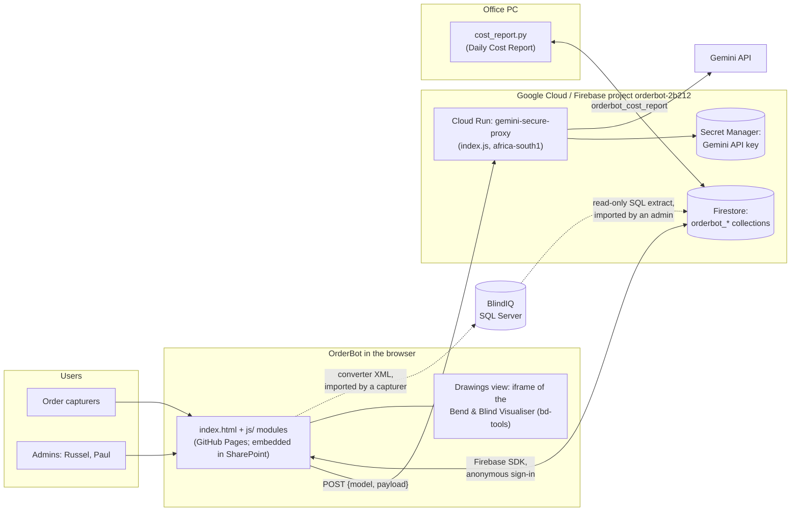
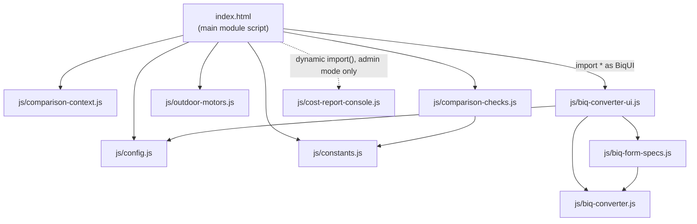

# Architecture

OrderBot is a static single-page app with no build step. It runs in the capturer's browser, talks straight to Firebase Firestore for its data, and reaches Google's Gemini AI through one small proxy on Google Cloud Run. This page shows the moving parts, how the frontend code is organised, and, important for anyone taking over, what lives outside this repository.

## System context

Solid lines are automatic. Dotted lines are steps a person takes: an admin imports a catalogue extract, and a capturer imports the converter's XML into BlindIQ.

## Components

| Component | Where it runs | What it does | More |
|---|---|---|---|
| Frontend (`index.html`, `js/`) | Static files on GitHub Pages, served from `main`; also embedded in the staff SharePoint site | All the business logic: comparison, converter, reference data, history, cost report settings | [User interface](app/user-interface.md) |
| Gemini proxy (`index.js`) | Google Cloud Run, service `gemini-secure-proxy`, region `africa-south1` | Adds the Gemini API key from Secret Manager and forwards the request. Stores nothing. | [Backend proxy](backend-proxy.md) |
| Firestore | Firebase project `orderbot-2b212` | Comparisons, corrections, guidelines, reference tables, converter mappings, cost report settings | [Data model](data-model.md) |
| Gemini API | Google | Reads documents and compares orders. Gemini 3.8 Flash for every call. | [AI models](ai-models.md) |
| Bend & Blind Visualiser | A separate repository (`bd-tools`) on GitHub Pages, shown in an iframe | Factory and customer drawings for curtain tracks, sloped verticals and shaped cellular blinds. Encrypted build. | Outside this repo |
| Daily Cost Report | `cost_report.py` on the office PC | Emails the cost report. Reads its settings from, and writes its status to, `orderbot_cost_report`. | [Cost report console](cost-report-console.md) |
| BlindIQ | Blind Designs' SQL Server | The system of record. The source of the converter's catalogue; receives the converter's XML. | [Mappings and catalogue](converter/mappings-and-catalogue.md) |

## Frontend modules

The page uses the browser's own ES modules (`<script type="module">`), with no bundler. Modules use named exports only.

| File | Role |
|---|---|
| `index.html` | Markup, styles, and the main module script: Firebase start-up, the comparison pipeline (`runComparisonPipeline`, `processSingleComparison`, `persistComparison`), report rendering, history, corrections, guidelines, and the fabric, motor and tube tables. A second, plain script at the end switches between the Orders, Drawings and Cost report views. |
| `js/config.js` | Firebase web config, `PROXY_API_URL`, `PROMPT_VERSION`, `SECOND_READING`, the two model constants and `isGemini3`. |
| `js/constants.js` | Validation lists, `CRITICAL_FIELDS`, `CACHE_TTL_MS`. |
| `js/comparison-context.js` | The building blocks of the comparison prompt (`BD_STANDARDS`, `READING_RULES`, `NOT_SPECIFIED_RULES`, `describeConverterReading`, and others). Pure, so it can be tested in Node. |
| `js/comparison-checks.js` | Rule checks that run after the AI (`applyDeterministicChecks`, `applyExactReading`, `reconcileSecondReading`, `needsSecondReading`). Pure. |
| `js/outdoor-motors.js` | The Zip X motor table check (`validateOutdoorMotors`). |
| `js/biq-converter.js` | The converter core: parsers for each dealer layout, name-to-ID resolution, the business rules, problems and warnings, XML generation. It has no DOM code, so the tests and the June 2026 server automation can run it in Node. |
| `js/biq-form-specs.js` | Specs for Blind Designs' own fillable PDF order forms. |
| `js/biq-converter-ui.js` | The converter's screens and mapping tools. It also exports `biqReadCustomerFile` and `biqComparisonCatalogue`, which the comparison uses. `initBiqConverter(deps)` receives Firebase and the page's helpers from `index.html`, so the module never reaches outside its own section. |
| `js/cost-report-console.js` | The admin Cost report view, loaded with `import()` only in admin mode, so a fault in it can't stop OrderBot loading. |

Three modules are also imported as namespaces on purpose (`import * as BiqUI` and `import * as Checks` in `index.html`, `import * as BiqConv` in `js/biq-converter-ui.js`). For a few minutes after a deploy, a browser can still hold the previous copy of a file. A missing named export would stop the whole page loading, whereas a missing property on a namespace only switches one feature off. Code added after a release looks its newest functions up on the namespace for this reason.

### Libraries loaded from CDNs

| Library | Version | Loaded from | Notes |
|---|---|---|---|
| Tailwind CSS (Play CDN) | Not pinned | `cdn.tailwindcss.com` | Development build. Unpinned, so it can change under the app. |
| SheetJS (`xlsx`) | 0.18.5 | cdnjs | Reads dealer spreadsheets |
| PDF.js | 3.11.174 (and its worker) | cdnjs | Reads PDFs: text, positions and legibility checks |
| Firebase JS SDK (app, auth, firestore) | 11.6.1 | `www.gstatic.com` | |
| Google Fonts | | `fonts.googleapis.com` | |

None of them have integrity (SRI) hashes. Upgrades are on the [roadmap](known-issues-and-roadmap.md).

### Backend dependencies

`package.json` lists two: `express` (^4.18.2) and `@google-cloud/secret-manager` (^5.0.1). There's no lockfile, so each build can pick up newer minor versions. The container image is `node:20-slim`, and Node 20 reached end of life in April 2026.

## Data

Firestore holds nine collections, all prefixed `orderbot_`: `comparisons`, `feedback`, `guidelines`, `fabric_properties`, `motor_properties`, `tube_properties`, `biq_mappings`, `customer_formats` and `cost_report`. Every browser signs in anonymously. The browser also keeps a few preferences in `localStorage`: admin mode (`biq_admin`), which panels are open, and the cost report editor's name. Shapes, writers and readers are in [data-model.md](data-model.md).

## Key design choices

| Choice | Why | Record |
|---|---|---|
| No build step; browser-native modules | Simple to host and to change; a build pipeline wasn't worth the risk yet | [ADR 0001](decisions/0001-no-build-step.md) |
| The backend is a minimal proxy | Keeps the API key off the browser with the least server code to break | [ADR 0002](decisions/0002-minimal-backend-proxy.md) |
| BlindIQ's database is the source of truth for mappings | Drift from a stale snapshot caused every wrong-ID incident of August 2026 | [ADR 0003](decisions/0003-blindiq-database-is-source-of-truth-for-mappings.md) |
| Gemini 3.8 Flash at its default temperature | One GA model for every call; Google advises against lowering the temperature on Gemini 3 | [ADR 0004](decisions/0004-gemini-3-8-flash-default-temperature.md) |
| Deterministic rules run after the AI and keep its answer | Rules cut the noise; keeping the AI's result makes every change auditable | [ADR 0006](decisions/0006-deterministic-rules-after-the-ai.md) |

## Things that live outside this repository

A developer taking over needs all of these. Until each one has a home in a private repository, it depends on one person's PC or OneDrive.

| What | Where it is now | Why it matters | Suggested home |
|---|---|---|---|
| Regression tests (`orderbot-tests.zip`) | OneDrive: `Document Converter/OrderBot reviews/` | The only automated safety net: about 1,250 checks pass on `main`. Kept out of this repo because its fixtures are business data. | `tests/` in this repo once it's private ([testing.md](testing.md)) |
| Review packages for each change (patches, tests, replays) | OneDrive: `Document Converter/OrderBot reviews/<topic>/` and `Document Converter/OrderBot converter accuracy 2026-10-09/` | Evidence behind the rules | Pull requests and their descriptions; data in a private store |
| Finished but unmerged work: the Finish Logic purchase-order support (`finish-logic-2026-10`, 16 Oct 2026) | Patches in its review package only; the branch isn't on GitHub | Easy to lose or forget | Push the branch and open a pull request |
| Analysis tooling for the quarterly review and monthly report (`analysis-tools/`, `monthly/`: SQL, `compute.mjs`, `render.mjs`, `firestore_export.js`) | OneDrive: `Document Converter/OrderBot reviews/` | Produces the numbers management sees | A private `orderbot-analytics` repo |
| Daily Cost Report (`cost_report.py`) | The office PC | Shares a data contract with `js/cost-report-console.js` | Its own private repo |
| Bend & Blind Visualiser source | Not in any repository. Only an encrypted build is in `RussedyBussedy/bd-tools`. | The Drawings view depends on it | A private repo with the build step |
| June 2026 server automation (`convert-cli.mjs`, `setup-server.ps1`, `watch-tasks.ps1`) | OneDrive: `Document Converter/OrderBot integration/automation/` | Runs an older subset of the converter's rules; due to be retired | Retire, or a private repo |
| BlindIQ SQL extract scripts (`BlindIQ_schema_discovery.sql` and the catalogue refresh queries) | OneDrive: `Document Converter/` and the review packages | Rebuild the converter's catalogue | `tools/catalogue/` in a private repo |
| Specs that `CLAUDE.md` cites as Claude project documents (`specs/blindiq-catalogue.md`, `claude/daily-cost-report/orderbot-console-spec.md`) | Not among the OrderBot Claude project's documents today, so their location needs confirming | Background for the converter's catalogue and the cost report contract | `docs/` once the repo is private |
| Scheduled tasks ("OrderBot quarterly review", "OrderBot monthly report") | Claude scheduled tasks on Russel's PC | Produce the reviews and the monthly email draft; never push code | Documented in [runbooks](operations/runbooks.md) |
| Firebase and Google Cloud configuration: Firestore security rules and indexes, the web API key's restrictions, the Secret Manager secret, the Cloud Run service settings | Google Cloud and Firebase consoles | Security and availability depend on them, and none of it is versioned | `firestore.rules`, `firestore.indexes.json` and a short `infra/` note in this repo |
| SharePoint embed (including the visualiser's key in the URL fragment) | The staff SharePoint page | How most staff reach OrderBot | Documented in [deployment.md](deployment.md) |

## Related pages

- [Overview](overview.md)
- [User interface](app/user-interface.md)
- [Backend proxy](backend-proxy.md)
- [Data model](data-model.md)
- [Deployment](deployment.md)
- [Decisions](decisions/README.md)
- [Moving to a company GitHub organisation](plans/move-to-company-github.md)
