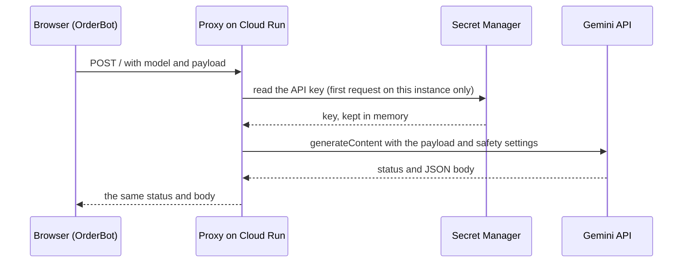

# Backend proxy

`index.js` is OrderBot's only server code: a small Express app on Google Cloud Run that adds the Gemini API key to the browser's AI requests and forwards them to Google. It stores nothing, and a standing rule keeps it that minimal.

Cloud Run, CORS, Secret Manager and Gemini are explained in the [glossary](glossary.md).

## What it does



1. The browser sends `POST /` with a JSON body holding `model` and `payload`.
2. The proxy gets the API key (`getApiKey`), replaces `payload.safetySettings`, and calls Gemini's `generateContent` for `model`.
3. It returns Gemini's HTTP status and response body unchanged.

## Request and response

| | |
|---|---|
| Routes | `POST /`, and `OPTIONS /` for the CORS preflight. Nothing else is routed. |
| Request body | JSON of at most 10 MB, with `model` (a Gemini model name such as `gemini-3.8-flash`) and `payload` (a Gemini `generateContent` request body: `contents`, usually with `generationConfig`) |
| Call to Google | `POST https://generativelanguage.googleapis.com/v1beta/models/<model>:generateContent`, with the API key as the `key` query parameter and `payload` as the body |
| Response | Gemini's status code and body, passed through as text. Express labels the body `text/html`, and every caller parses it as JSON itself. |

A request body, shortened from the converter's name matching (`aiDiscern`):

```json
{
  "model": "gemini-3.8-flash",
  "payload": {
    "contents": [ { "role": "user", "parts": [ { "text": "…prompt…" } ] } ],
    "generationConfig": { "responseMimeType": "application/json", "responseSchema": { "type": "OBJECT" } }
  }
}
```

On success the callers read `candidates[0].content.parts[0].text`, which is a JSON string because of `responseMimeType`. The comparison also keeps Gemini's `modelVersion` as `modelUsed`.

| Situation | Status | Body |
|---|---|---|
| `model` or `payload` missing | 400 | `error`: "Request body must include 'model' and 'payload' keys." |
| The secret's value is empty | 500 | `error`: "API Key is not configured on the server." |
| Secret Manager or the call to Google throws | 500 | `error`: "Internal Server Error: " followed by the exception message |
| Gemini refuses or fails (400, 429, 5xx and so on) | Gemini's | Gemini's error JSON |
| Body over 10 MB, or not valid JSON | 413 or 400 | Express's default error page. It's sent before the CORS middleware runs, so a browser reports a network or CORS error instead of the status. |

Retrying is the callers' job, and most AI calls retry 429 and 5xx answers ([ai-models.md](ai-models.md)).

## Who calls it

Every caller reads the proxy's address from `PROXY_API_URL` in `js/config.js`. Both model constants are `gemini-3.8-flash` today.

| Caller | Function | Model constant | Purpose |
|---|---|---|---|
| `index.html` | `processSingleComparison` | `COMPARISON_MODEL` | Pass 1: the comparison |
| `index.html` | `reExtractLowConfidence` | `COMPARISON_MODEL` | Pass 2: another look at low-confidence lines |
| `index.html` | `secondReadingOf` | `COMPARISON_MODEL` | Second reading of a handwritten or unclear customer file |
| `index.html` | Click handler of `#submit-feedback-btn` | `EXTRACTION_MODEL` | Rewrites a capturer's correction as a clear rule |
| `index.html` | Click handler of `#save-guideline-btn` | `EXTRACTION_MODEL` | Merges a new AI guideline into the existing ones |
| `js/biq-converter-ui.js` | `aiExtract` | `EXTRACTION_MODEL` | Converter: reads a document no parser recognises |
| `js/biq-converter-ui.js` | `aiDiscern` | `COMPARISON_MODEL` | Converter: matches unresolved names to the BlindIQ catalogue |

## The API key: Secret Manager and caching

- **The secret** is `projects/orderbot-2b212/secrets/gemini-api-key/versions/latest` (the constant `secretName`).
- **Caching.** `getApiKey()` reads it with `SecretManagerServiceClient.accessSecretVersion` on the first request and keeps it in `cachedSecret` for the life of the container instance. Nothing else is cached.
- **Permissions.** On Cloud Run, the client signs in as the service's runtime service account, which needs permission to read the secret (the Secret Manager Secret Accessor role). Which account the service uses is set in Cloud Run, not in this repo.
- **Rotating the key.** Add a new version of the secret. Running instances keep the old key until they're replaced, so deploy a new revision after rotating, and disable the old version only once the new revision is serving.
- **No override.** The secret's name is written into the code, with no setting for another project or key. A local run uses the production key and its quota.

## CORS

`handleCors` runs on every request. The allowed origins are in `allowedOrigins`:

| Origin | Code comment |
|---|---|
| `https://russedybussedy.github.io` | The live GitHub Pages site |
| `https://app.lab-pa.googleapis.com` | "The Canvas preview environment" |
| `https://blinddesignscoza.sharepoint.com` | The SharePoint site |

- An allowed `Origin` is echoed back in `Access-Control-Allow-Origin`. Any other origin is logged as a warning and gets no such header; the request itself still runs.
- `Access-Control-Allow-Methods: POST, OPTIONS` and `Access-Control-Allow-Headers: Content-Type` are always set.
- `OPTIONS /` answers the preflight with 204.
- CORS only controls what a page in a browser may read. It isn't authentication; verifying the caller is planned (see [security.md](security.md)).

## Body limit and safety settings

- **Body limit.** `express.json({ limit: '10mb' })`. Documents travel inside the JSON as base64, which adds about a third, so roughly 7 MB of files fit in one request.
- **Safety settings.** `payload.safetySettings` is always replaced with `BLOCK_NONE` for four categories: `HARM_CATEGORY_HARASSMENT`, `HARM_CATEGORY_HATE_SPEECH`, `HARM_CATEGORY_SEXUALLY_EXPLICIT` and `HARM_CATEGORY_DANGEROUS_CONTENT`. Any safety settings a caller sends are discarded. The repo doesn't record why.

## Logging

| Message | Level | When |
|---|---|---|
| `Request received from origin: <origin>` | `console.log` | Every request |
| `Origin <origin> not in allowed list.` | `console.warn` | An origin that isn't allowed, or none |
| `API Key not found in Secret Manager.` | `console.error` | The secret's value is empty |
| `Error in Cloud Run service:` and the error | `console.error` | Any exception |
| `Server listening on port <port>` | `console.log` | Start-up |

Request bodies, documents and the key are never logged. Cloud Run sends these lines to Cloud Logging. Read them in the Google Cloud console (Cloud Run, `gemini-secure-proxy`, Logs) or with:

```bash
gcloud logging read 'resource.type="cloud_run_revision" AND resource.labels.service_name="gemini-secure-proxy"' \
  --project orderbot-2b212 --limit 50
```

## Deployment

### The container

| File | What it does |
|---|---|
| `Dockerfile` | Starts from `node:20-slim`, copies `package*.json`, runs `npm install --omit=dev`, copies the source, exposes 8080 and starts with `npm start` (that is, `node index.js`) |
| `package.json` | The package `cloudrun-gemini-proxy`, with two dependencies: `express` (^4.18.2) and `@google-cloud/secret-manager` (^5.0.1). There's no lockfile, so a build can pick up newer minor versions. |
| `.dockerignore` | Leaves out `.git`, `index.html`, `*.md` (at the top level only), `node_modules` and `npm-debug.log`. The rest of the repo, such as `js/`, `data/`, the logo and `docs/`, is copied into the image, where nothing uses it. |
| `.gitignore` | Keeps `node_modules/`, `.env` and `.env.*`, log files and `.DS_Store` out of Git |

- The server listens on `PORT` (Cloud Run sets it) or on 8080.
- Node 20 reached end of life in April 2026 ([known-issues-and-roadmap.md](known-issues-and-roadmap.md)).

### Deploying

The service is `gemini-secure-proxy`, in region `africa-south1` of project `orderbot-2b212`. The command in `CLAUDE.md`, run from the repo root:

```bash
gcloud run deploy gemini-secure-proxy \
  --source . \
  --region africa-south1 \
  --project orderbot-2b212
```

- `--source .` uploads the folder, Cloud Build builds the image from the `Dockerfile`, and the new revision normally takes all traffic at once, unless traffic is pinned to a revision.
- That is production: the live app's `PROXY_API_URL` points at this service. Prefer the tagged route in the next section.
- `CLAUDE.md` also mentions a Cloud Run build trigger. Unverified: nothing in the repo configures one.
- The service's settings (memory, request timeout, scaling, ingress, who may call it, the runtime service account) live in Cloud Run and aren't versioned here.

The frontend is deployed separately ([deployment.md](deployment.md)).

### Running it locally

You need Node 20, the Google Cloud CLI, and a Google account that may read the secret.

```bash
npm install
gcloud auth application-default login   # credentials for the Secret Manager client
npm start                               # listens on http://localhost:8080, or on $PORT
```

Then try the check from `CLAUDE.md`:

```bash
curl -X POST http://localhost:8080 \
  -H "Content-Type: application/json" \
  -d '{"model":"gemini-3.8-flash","payload":{"contents":[]}}'
```

Gemini rejects an empty `contents`, and its error comes straight back through the proxy, which still shows that the proxy started, read the key and reached Gemini. A 500 from the proxy itself means the key couldn't be read. For a real answer, send one text part, as in step 3 below.

- The local server uses the production key, so every call is billed and counts against the production quota.
- To use the app in a browser against a local proxy, the page's origin must be in `allowedOrigins` and `PROXY_API_URL` must point at localhost. Make both changes locally only, and don't commit them.

## Testing a change without touching production

This is the recommended practice for any change to `index.js`, `package.json` or the `Dockerfile`. Cloud Run can deploy a revision that gets no traffic but has its own tagged address.

1. Test locally first, as above.
2. Deploy a candidate revision with no traffic:

   ```bash
   gcloud run deploy gemini-secure-proxy \
     --source . \
     --region africa-south1 \
     --project orderbot-2b212 \
     --no-traffic \
     --tag candidate
   ```

   gcloud prints the candidate's address, which starts with `https://candidate---`. Live traffic stays on the current revision.
3. Test the candidate's address with curl. Include an `Origin` header if the CORS code changed:

   ```bash
   curl -i -X POST "<candidate address>" \
     -H "Content-Type: application/json" \
     -H "Origin: https://russedybussedy.github.io" \
     -d '{"model":"gemini-3.8-flash","payload":{"contents":[{"role":"user","parts":[{"text":"Reply with OK"}]}]}}'
   ```

   Look for status 200, an `Access-Control-Allow-Origin` header that echoes the origin, and a `candidates` array in the body.
4. Move the traffic to it:

   ```bash
   gcloud run services update-traffic gemini-secure-proxy \
     --to-latest \
     --region africa-south1 --project orderbot-2b212
   ```

   `--to-latest` sends all traffic to the newest revision (the candidate, as long as nothing else was deployed in between) and lets later deploys take traffic again. Then run a comparison and a converter AI read in the app, and watch the logs.
5. Remove the tag:

   ```bash
   gcloud run services update-traffic gemini-secure-proxy \
     --remove-tags candidate \
     --region africa-south1 --project orderbot-2b212
   ```

To roll back, find the previous revision and move all traffic to it:

```bash
gcloud run revisions list --service gemini-secure-proxy \
  --region africa-south1 --project orderbot-2b212
gcloud run services update-traffic gemini-secure-proxy \
  --to-revisions <previous-revision>=100 \
  --region africa-south1 --project orderbot-2b212
```

Traffic then stays pinned to that revision: later deploys get no traffic until `update-traffic --to-latest` runs again. A tagged address reaches the service just as its main address does, so remove tags you no longer need.

## Why the backend stays minimal

The rule (`CLAUDE.md`, "Critical Rules for Future Changes"):

- `index.js` is a proxy, not an application server.
- Don't add helmet, rate-limiting middleware or server-side timeouts unless each one is tested on its own.
- Never mix frontend and backend changes in one commit, and never add a dependency and restructure code in the same change.

The history behind it:

- Commit `ef4eea8` ("Phase 4: modularize frontend into ES modules", 3 April 2026) split `index.html` into thirteen modules. In the same commit it rewrote the proxy with `helmet`, `express-rate-limit`, an allow-list of models, a 120-second timeout on the call to Google and a `/health` route, pinned new dependency versions with a lockfile, and changed the `Dockerfile` (a pinned Node version, a non-root user and a `HEALTHCHECK`).
- It broke production and was reverted the next day by `42b7a65` ("Revert to working March 9 state (6fc372b)").
- `CLAUDE.md` names helmet, rate limiting and timeouts as the backend's part in the failure. Which change actually broke it isn't recorded.

If you need one of those protections, add it on its own, test it on a tagged revision as above, and record the decision ([decisions/README.md](decisions/README.md)).

## Limitations

These are stated plainly; what to do about them is in [security.md](security.md) and [known-issues-and-roadmap.md](known-issues-and-roadmap.md).

- Hardening work for the proxy (verifying the caller, limiting which models it forwards, spending caps, trimming error detail, the container user) is tracked privately; see [security.md](security.md#where-findings-live).
- Gemini's safety filters are off for the four categories above.
- No timeout of its own. Cloud Run's request timeout applies.
- A rotated key reaches running instances only when they're replaced.
- An oversized or malformed body fails before the CORS headers are added, so the browser shows a network error.
- No lockfile, and Node 20 is past its end of life.

## Related pages

- [Architecture](architecture.md)
- [AI models](ai-models.md)
- [Deployment](deployment.md)
- [Environments](environments.md)
- [Security](security.md)
- [Runbooks](operations/runbooks.md)
- [Known issues and roadmap](known-issues-and-roadmap.md)
- [Decisions](decisions/README.md)
