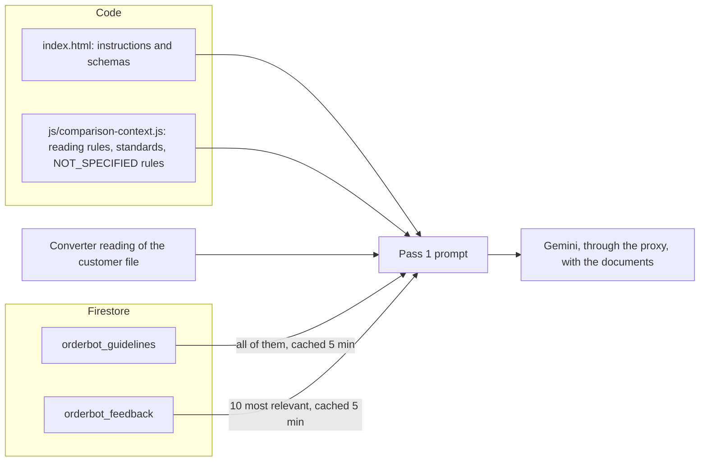

# Comparison AI context

How OrderBot puts together the text it sends to Gemini with the documents: the fixed instructions in `index.html`, the reusable blocks in `js/comparison-context.js`, the team's corrections and guidelines from Firestore, and the converter's reading of the customer file. It also covers the models and temperatures, `PROMPT_VERSION`, and how to change a prompt safely.

## Where the prompt text lives

| Block | Defined in | Sent with |
|---|---|---|
| Pass 1 instructions: identity, task, extraction rules, comparison protocol, order numbers, extraction principles | The `systemPrompt` template string in `processSingleComparison` (`index.html`) | Pass 1 |
| Pass 2 instructions | The `focusedPrompt` template string in `reExtractLowConfidence` (`index.html`) | Pass 2 |
| `READING_RULES` | `js/comparison-context.js` | Pass 1, Pass 2 |
| `BD_STANDARDS` | `js/comparison-context.js` | Pass 1, Pass 2 |
| `NOT_SPECIFIED_RULES` | `js/comparison-context.js` | Pass 1 (Pass 2 has a one-line version inline) |
| `RESULT_VALUES` | `js/comparison-context.js` | The `enum` of every `result` in the Pass 1 and Pass 2 schemas |
| The converter reading | `describeConverterReading` in `js/comparison-context.js` | Pass 1 |
| Guidelines | Firestore `orderbot_guidelines` | Pass 1 |
| Correction examples | Firestore `orderbot_feedback`, via `selectRelevantFeedback` and `formatCorrectionExamples` | Pass 1 |
| `SECOND_READING_PROMPT`, `secondReadingSchema` | `js/comparison-context.js` | The second reading |
| Response schemas | `schema` in `processSingleComparison`, `focusedSchema` in `reExtractLowConfidence` | Pass 1, Pass 2 |

`js/comparison-context.js` is pure: text and functions with no DOM and no Firestore, so the regression tests can import it in node. Keep it that way.

## How the Pass 1 prompt is assembled

`processSingleComparison` builds one text, in this order:

1. **Identity, task and document relationship.** OrderBot compares customer order documents against Blind IQ documents; several Blind IQ files are one consolidated order.
2. **Extraction rules.** The primary fields per row; the range is read from the Blind IQ document only; the two columns both called "Control" (left-most → `control1`, right-most → `control2`, a blank cell stays blank); the "=" specification line under a row belongs to that row; the sundries table; detecting an instruction that **all** blinds get valances (`valanceInstruction`).
3. **Comparison protocol and completeness.** Reasoning first, field by field, side by side; every blind and sundry, nothing skipped.
4. **Order numbers.** Where the BDO number and the customer's order number appear; never invent a BDO number.
5. **Extraction principles 1 to 5.** A fixed schema for any input layout; visual cues (column headers, numbers along a sketch's edges, section headers, numbers inside names aren't sizes); synonyms, including that the partner of a **coupled** blind correctly has no drive of its own; uncertainty goes into confidence scores (0.9+ clear, 0.5–0.8 inferred, 0.2–0.4 handwritten guesses, 0.1 illegible), never into hedging words; and dealer-specific rules belong in the guidelines, which win over these principles.
6. `READING_RULES`, `BD_STANDARDS`, `NOT_SPECIFIED_RULES`.
7. The converter reading, when there is one.
8. A one-line "# JSON OUTPUT" instruction.
9. The guidelines block.
10. The correction examples.

The message then has one text part with all of that, followed by each customer file (a "--- START CUSTOMER FILE: name ---" text part and the file as `inlineData`) and each Blind IQ file (the same, with "BLIND IQ FILE").

**Keep the prompt inline.** The comment in `processSingleComparison` records that moving it into Gemini's `systemInstruction` (commit `09371e8`) measurably degraded extraction on unfamiliar customer layouts: the model follows instructions sitting next to the images more closely.

## Corrections: orderbot_feedback

When a capturer corrects a field in a report, a document is saved in `orderbot_feedback` (how, and its shape, are in [History, feedback and reference data](history-feedback-and-reference-data.md)). Pass 1 shows the AI up to ten of them:

1. **Loading.** All correction documents are read together with the guidelines and kept in `_feedbackGuidelineCache` for `CACHE_TTL_MS` (five minutes, `js/constants.js`).
2. **Context terms.** The names of the pair's files (customer and Blind IQ), without extensions, split on spaces, underscores, hyphens, dots, commas and brackets, keeping words longer than two characters.
3. **Selection.** `selectRelevantFeedback(allFeedback, contextTerms, n = 10)` scores each correction by how many of the terms appear in its incorrect item, the capturer's words and the AI rewrite, and keeps the ten best, newest first on ties. With no terms it keeps the ten newest.
4. **Formatting.** `formatCorrectionExamples(list)` writes a "# CORRECTION EXAMPLES" block. Each example gives the incorrect item (as JSON), "What was wrong (capturer)" with the capturer's own words (`userExplanation`) and "Rule" with the AI rewrite (`enhancedExplanation`).
5. **Cleaning.** `correctionText(fb, max = 600)` removes the "RAW:" prefix of failed rewrites, up to three chatty opening lines ("Here's…", "Sure…"), separator lines, and the rule itself when it only repeats the capturer's words; both texts are cut to 600 characters at a word boundary.

Why it works this way (v2.3): earlier prompts used only `enhancedExplanation`, which 47 of the first 63 corrections (July 2025) didn't have, so they reached the AI as "undefined". Some rewrites also began with chat rather than a rule.

Pasted images are kept with the correction but never sent to the comparison. Because the context terms come from file names, which are often just order numbers, the selection in practice tends towards the newest corrections plus any that share a word with the file names.

## Guidelines: orderbot_guidelines

Every guideline document's `enhancedGuideline` is included, with no selection, as a bulleted list under "# GUIDELINES (USER-DEFINED)", introduced by "You must follow these rules without exception". Principle 5 tells the AI that a guideline wins over the general extraction principles. Guidelines are only sent with Pass 1. How they're written and consolidated is in [History, feedback and reference data](history-feedback-and-reference-data.md).

## BD_STANDARDS

What Blind Designs supplies when the customer document says nothing, so that Blind IQ's value isn't reported as a difference, plus the dealer wordings that mean the same thing. Its sources are the July 2026 price lists, the Roller System Selector and the converter rules checked against stored orders.

| Topic | What the AI is told, in short |
|---|---|
| Names | Dealer names for products ("Sys 40", "Element Roller", "Vertical") and fixes ("F/Fix", "R/Fix", "Recess") |
| Suffixes | Blind IQ's range and colour names carry roll widths, "@", "#", "^", "Fr", "/ Aventus 5%": compare the name itself |
| Sizes | Blind IQ keeps sizes in 5 mm steps; a 1–2 mm difference that is exactly that rounding is a MATCH, except for products made to the millimetre (shutters, Perfect Fit, outdoor, skylight) |
| Control drop | Calculated by Blind IQ: usually 75% of the drop for rollers, 66% for venetians and Allusion, 80% with a 1.5:1 control; a length the customer writes wins |
| Valances | Blind IQ carries a valance as its own line, so item letters can shift; an unnamed roller valance is a Linear Valance; a cassette given as an option on the customer's blind line pairs with Blind IQ's separate Valance line (a different colour is a MISMATCH there); valances, pelmets and tracks have no drop |
| Roller System 40 / 55 | White hardware unless stated; a stated cassette colour sets it; bar and cassette follow the hardware; standard roll; Full End Cap with a cassette; no chain tidy; 1.5:1 only over about 4 kg |
| Chain side | The customer's control side is the chain side and the pin opposite comes with it (a MATCH, not an OMISSION); "RC"/"LC" and "L"/"R" give the side |
| Chains | The standard chain is plastic, matching the control colour; a colour given for the chain itself means that plastic chain, so Steel Ball Chain=Yes is then a MISMATCH; silence about the chain is NOT_SPECIFIED |
| Out of Warranty, venetians, verticals, Allusion, Urban shutters, cellular | The price-list rules: selling limits, Split under 600 mm and Grouped from 600 mm, track-coloured chain and cord, 107 mm vanes, 100 mm rails, White headrail and bar |
| Perfect Fit | A clip or gasket size is Blind IQ's Gasket fix of that size; bead depths between Gaskets follow Louvolite's chart (a NOTE); the Universal Frame is never the customer's option (a MISMATCH against a clip size); reveal or face fitting goes on the Universal Frame (a NOTE) |
| Outdoor and curtains | System X crank and motor rules; Butt Arm Kit or Single Butt Arm by stack |

Points to keep in mind:

- **Keep it in step with the code.** Several standards are also enforced by [rule checks](rule-checks.md) (5 mm steps, the pin with the chain side, venetian Grouped/Split, Perfect Fit) and by the [converter rules](../converter/rules.md). When a standard changes, change all of them.
- **The chain rule** reflects Russel's ruling that a colour given for the chain itself means the plastic chain. When the customer is silent the AI must say NOT_SPECIFIED, because 44% of 2026 chain rollers have a steel ball chain, concentrated in some dealers, so it's often the dealer's standing choice.
- **Valances on venetians.** `BD_STANDARDS` still describes valances as separate Blind IQ lines, which is true for rollers; wood and retro venetians carry the valance as options on the blind (Val Size). `CLAUDE.md` notes that telling the AI so would be a prompt change.

## RESULT_VALUES and NOT_SPECIFIED_RULES

`RESULT_VALUES` is `['MATCH', 'MISMATCH', 'OMISSION', 'NOTE', 'NOT_SPECIFIED']`. The [pipeline page](pipeline.md#result-values) shows how each one is displayed.

`NOT_SPECIFIED_RULES` tells the AI:

- NOT_SPECIFIED means the customer document doesn't mention the field or option at all, and Blind IQ shows a value (usually a standard or the capturer's choice). It's information, not an error. Use it for options, Fix and Location, with Blind IQ's value in `blindIQValue` and `customerValue` empty.
- It's **never** used for Blind Type, Range, Colour, QTY, Width, Drop, Control 1 or Control 2 (Paul's critical fields). Missing, those are an OMISSION, unless the value follows from what the customer did state (the pin opposite a chain side, the Linear Valance on a roller), which is a MATCH.
- MISMATCH: the customer states a value and Blind IQ shows another. OMISSION: the customer asks for something Blind IQ lacks, or a critical field is missing.

The code enforces the critical-field part too: `applyConfidenceThresholds` turns any NOT_SPECIFIED on a critical field into an OMISSION.

Why (v2.3): over half the flags the comparison raised (7,304 of 13,679 in the first 841 comparisons, June to October 2026) were values the customer document doesn't mention, and about one flag in 60 led to a change.

## READING_RULES (v2.4)

The mistakes OrderBot missed were mostly customer values reported as exactly what Blind IQ shows: a handwritten 2720 read as Blind IQ's 2700, "Opal" read as "Bronze", widths written under a sketch read as drops, a column header's legend taken as the row's value, "1350 x 2" read as a drop. `READING_RULES` asks the AI to:

- read each customer value from the customer document **before** looking at Blind IQ's, and say where on the document it was read when the two agree;
- never let Blind IQ's value decide an unclear handwritten mark; compare confusable digits (5/8, 2/7, 4/6, 1/7, 0/6, 3/8) with the same writer's other digits; a MATCH on an unclear mark has a confidence of 0.5 or less;
- on sketches, read the number along the top or bottom edge as the width, also when it's written under the box, and the side as the drop;
- carry a value to other rows only where the customer marks it (ditto marks, arrows, "same", "as above", "all");
- treat words in brackets or lists of choices in a column header as that column's options, not the row's value;
- read a multiplier after a size ("1350 x 2", "pair") as a quantity;
- for an order that only accepts a Blind Designs quote and gives no sizes, quote the wording in `specialInstructions`, leave the customer values empty and use NOTE (a [rule check](rule-checks.md) handles the same case in code).

## The converter reading: describeConverterReading

For each customer file the converter recognises, `BiqUI.biqReadCustomerFile` returns `{ order, format, defaults, exact }`, and `describeConverterReading(reading, fileName)` turns it into a block of prompt text. Unrecognised layouts and images add nothing.

- **A dealer layout** gives "# CONVERTER READING OF THE CUSTOMER DOCUMENT": one line per item in Blind IQ's names ("Line N (location): qty | blind type | range | colour | W x D | fix | controls | control drop"), its options (marked "(default)" where the value equals the Blind IQ sheet's default, so the AI knows it may not be on the document), the converter's notes (cut to 500 characters) and the sundries. The AI is told this is a fixed parser to cross-check against, that the documents remain the source of truth, and that converter notes such as "not on the order" mark values the customer didn't state.
- **A BlindIQ Online export** (`exact`) gives "# THE CUSTOMER'S BLINDIQ ONLINE ORDER": items by the customer's own letters, only the options printed on the order, the order message, and an instruction to use these values exactly as the customer values, matching lines by the customer's item letter. `applyExactReading` then enforces the same in code; see [Comparison rule checks](rule-checks.md).

When any customer file was read this way, no [second reading](pipeline.md#second-reading-secondreadingof) is made.

## The second-reading prompt

`SECOND_READING_PROMPT` asks for the customer document(s) only, line by line, exactly as written, with no supplier document to lean on: widths and drops as digits, the sketch rule, multipliers as quantities, the customer's own words for product, range, colour, control, fix and location, the line's own reference, and a confidence for each line's width, drop, quantity and colour (0.9 or more only when unambiguous, 0.5 or less when a digit could be read two ways).

`secondReadingSchema()` returns the response schema: a `lines` array whose items have `ref`, `location`, `qty`, `width`, `drop`, `product`, `range`, `colour`, `control`, `fix` and `notes` (strings) and `qtyConfidence`, `widthConfidence`, `dropConfidence` and `colourConfidence` (numbers). `ref`, `location`, `qty`, `width`, `drop`, `product`, `colour`, `widthConfidence` and `dropConfidence` are required. How the answer is used is in [Comparison rule checks](rule-checks.md).

## Models and temperatures

Both model constants are in `js/config.js`, and both are `gemini-3.8-flash` since October 2026 (from `gemini-3-flash-preview` for extraction and `gemini-2.5-pro` for comparison).

| Constant | Comparison use in `index.html` | Temperature on a 2.x model | Converter use |
|---|---|---|---|
| `COMPARISON_MODEL` | Pass 1, Pass 2, the second reading | 0.1, 0.2, 0.1 | Name matching ("discernment") |
| `EXTRACTION_MODEL` | The rewrite of a correction (no `generationConfig` at all); guideline consolidation | Not set; 0.1 | Document extraction |

`isGemini3(model)` is true for model names from `gemini-3` upwards. For those models the call sites leave `temperature` out, because Google advises that lowering it on Gemini 3 can cause looping or degraded output. Setting a constant back to a 2.x model brings back that model's old, low temperature automatically. No `thinkingConfig` or output-token limit is set. Model history and how to switch are in [AI models](../ai-models.md).

## PROMPT_VERSION

- **What:** a label in `js/config.js`, currently `'v2.4'`, with a comment summarising what each recent version changed.
- **Where it's stored:** `persistComparison` saves it on every comparison as `promptVersion` in `orderbot_comparisons`. It isn't shown anywhere in the app.
- **Why:** so results made with different prompts can be told apart when the comparisons are reviewed (the quarterly reviews compare by version).
- **When to bump it:** whenever what the model receives changes: the inline instructions, any block in `js/comparison-context.js`, a response schema, `RESULT_VALUES`, how corrections or guidelines are selected or formatted, or how the converter reading is described. Bump it in the same pull request as the change (rule 5 of `CONTRIBUTING.md`; see [Development workflow](../development-workflow.md)).
- **A gap to know about:** the BlindIQ Online block in `describeConverterReading` and the Perfect Fit standard in `BD_STANDARDS` were added later on 11 October 2026 (commits `0a83f25` and `c928527`), after `v2.4` was set and without a bump, so `v2.4` covers more than one prompt text. Changes to the rule checks or validations alone change results too without changing the prompt; record them in the commit message and `CLAUDE.md`.

## Prompt history

| Version | When | What changed |
|---|---|---|
| v1.2 to v2.2 | April to July 2026 | The prompt-quality baseline that first stored the version (commit `09371e8`), BlindIQ Online purchase orders, third-party dealer layouts, the principle-based extraction prompt, and keeping the prompt inline with the images (v2.1). See [History](../history.md) |
| v2.3 | 10 October 2026 | `BD_STANDARDS`, the NOT_SPECIFIED result, the converter reading, corrections shown with the capturer's own words |
| v2.4 | 11 October 2026 | `READING_RULES` in Pass 1 and Pass 2; "above it or under it" in the sketch principle; new standards (a cassette given on the blind line pairs with Blind IQ's Valance line, "RC"/"LC", the chain-colour rule); Pass 2 can no longer clear a critical flag by agreeing with Blind IQ; the rule checks in `js/comparison-checks.js`; the second reading |

### v2.3 to v2.4

Every first check from July 2025 to October 2026 (16,511 orders) was joined with what changed on the BlindIQ order afterwards. Two problems came out: missed mistakes were mostly customer values reported as Blind IQ's, and real flags were passed over because only about one flag in 90 led to a change. v2.4 answers the first with the reading rules, the Pass 2 change and the second reading, and the second with the rule checks.

v2.4 was A/B-tested against v2.3 on the real customer documents of 13 missed or ignored mistakes and 8 earlier test pairs, with the Blind IQ confirmations rebuilt as they stood at the time of each check. What it still misses: handwriting the model reads as Blind IQ's value even when reading it on its own (a 1200 read as 1700), which the capturers had also misread at first.

## Changing a prompt safely

1. **Choose the right place.** A Blind Designs standard goes in `BD_STANDARDS`; how to read documents in `READING_RULES`; what a result means in `NOT_SPECIFIED_RULES` (and then check `RESULT_VALUES`, `applyConfidenceThresholds` and the renderer); the task structure in `index.html`. If the rule is deterministic, a [rule check](rule-checks.md) is usually better than prompt text: cheaper, testable and exact.
2. **Watch the interactions.** Guidelines override the principles; `BD_STANDARDS` must agree with the converter rules and the rule checks; Pass 2 repeats `READING_RULES` and `BD_STANDARDS` but not the rest; the second reading has its own prompt.
3. **A/B replay on real documents.** Run the old and the new prompt over the same pairs: the customer documents of known misses and a set of typed orders as controls, each with its Blind IQ confirmation as it stood at the check. Compare field by field. There's no replay harness in this repository; the October 2026 scripts and method are kept in `analysis-tools/` of the private regression package (see `CLAUDE.md`).
4. **Tests.** Add or update the node tests in the regression package (`orderbot-tests.zip`) and run the whole suite against your clone. The baseline is in [Testing](../testing.md).
5. **Bump `PROMPT_VERSION`**, and update `CLAUDE.md` and this page in the same pull request.
6. **Deploy with care.** If `index.html` starts calling a new export, reach it through a namespace import and ship the module first (see [User interface](../app/user-interface.md#module-imports)). Then do the manual end-to-end check: upload → compare → view results → history search.
7. **Watch the first results.** New comparisons carry the new `promptVersion`, so the next review can compare flags and misses by version.

## Related pages

- [Comparison pipeline](pipeline.md)
- [Comparison rule checks](rule-checks.md)
- [Comparison validations](validations.md)
- [History, feedback and reference data](history-feedback-and-reference-data.md)
- [AI models](../ai-models.md)
- [Converter rules](../converter/rules.md)
- [Testing](../testing.md)
- [History](../history.md)
- [Glossary](../glossary.md)
