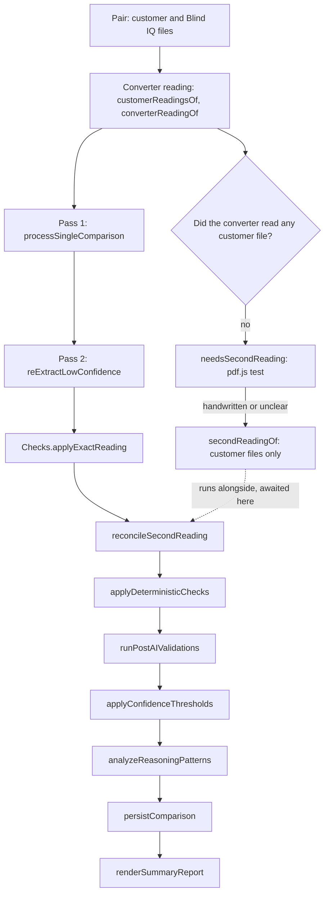

# Comparison pipeline

What happens between a capturer pressing **Run comparisons** and the report on screen: how the uploaded documents are read, which AI calls are made and in what order, the rule checks and validations that follow, what's saved to Firestore and how the report is drawn. It all starts in `index.html` → `runAllComparisons`.

Terms such as [BDO number](../glossary.md), Control 1 / Control 2 and NOT_SPECIFIED are explained in the [glossary](../glossary.md).

## What capturers upload

A run is made of up to 10 **pairs**. Each pair is one order: the customer's document(s) on the left and the Blind IQ order document(s) on the right. The Blind IQ document is BlindIQ's "ORDER CONFIRMATION" printout. A side can hold several files; the prompt tells the AI to treat all of a pair's Blind IQ files as one consolidated order.

- **Accepted files:** PDF, JPEG and PNG. The file inputs say so (`accept=".pdf,.jpg,.jpeg,.png"`) and `handleFiles` keeps only `application/pdf`, `image/jpeg` and `image/png`; anything else is dropped without a message. Spreadsheets can't be compared, even though the converter can read them.
- **Replacing, not adding:** choosing or dropping files again replaces that side's list.
- **Starting:** **Run comparisons** is enabled once every pair has at least one file on each side (`checkCompareButtonState`).

How each file is read:

| File | Read by | How |
|---|---|---|
| Customer PDF in a dealer layout the converter knows | The converter's fixed parsers: `BiqUI.biqReadCustomerFile` in `js/biq-converter-ui.js` | Parsed without AI, then turned into prompt text by `describeConverterReading`. A BlindIQ Online export is read exactly and also feeds `applyExactReading` |
| Every customer file | Gemini, in Pass 1 and Pass 2 | Sent whole, base64-encoded, as `inlineData` with its MIME type |
| Customer files, when the converter read none of them | `needsSecondReading` (pdf.js), then possibly `secondReadingOf` (Gemini) | A test for handwriting or scans, then a customer-only AI reading |
| Every Blind IQ file | Gemini, in Pass 1 and Pass 2 | Sent whole as `inlineData`; nothing else reads it |

## The run: runAllComparisons

1. Hides the upload card, shows the summary with skeleton loaders, a status line and `#top-progress-bar`.
2. Loads the three reference tables once for the whole run: `getFabricProperties` (a `Map` by lower-case fabric name), `getMotorProperties` (an array) and `getTubeProperties` (a `Map` by lower-case blind type).
3. Runs `processOne(index)` for each pair, **two pairs at a time** (`CONCURRENCY = 2`, in chunks awaited with `Promise.allSettled`). `processOne` calls `runComparisonPipeline`, then `persistComparison`, and stores `{ status: 'success', data }` in `summaryResultsCache`. If anything throws, it stores `{ status: 'failed', error, orderNumber: 'Pair N' }` and queues the pair for a retry.
4. Retries the failed pairs **once each, one at a time**, through the same pipeline and save. A pair that fails again stays failed.
5. Calls `renderSummaryReport(summaryResultsCache)`, shows **Start new comparison**, and opens the critical-errors modal if any order has critical issues (fresh runs only, never from the history).

## One comparison: runComparisonPipeline

`runComparisonPipeline(pair, props)` is the single path for fresh runs and retries.



| Step | Function | Where | What it does |
|---|---|---|---|
| 1 | `customerReadingsOf`, `converterReadingOf` | `index.html` | Runs `BiqUI.biqReadCustomerFile` on each customer file and joins `describeConverterReading` for each one it recognised. Unrecognised layouts and images give nothing |
| 2 | `needsSecondReading`, then `secondReadingOf` | `js/comparison-checks.js`, `index.html` | Only when `SECOND_READING` (in `js/config.js`) is true **and** the converter read none of the customer files. Started here, not awaited |
| 3 | `processSingleComparison` | `index.html` | Pass 1: both documents, the full prompt, the response schema |
| 4 | `reExtractLowConfidence` | `index.html` | Pass 2: a focused second look at items with several low-confidence fields |
| 5 | `Checks.applyExactReading` | `js/comparison-checks.js` | BlindIQ Online exports: the customer's exact values replace the AI's reading. Sets `_exactChanges` (a count) when anything changed |
| 6 | `reconcileSecondReading` | `js/comparison-checks.js` | Awaits step 2 and flags fields where Pass 1 copied Blind IQ's value but the customer-only reading clearly differs. Sets `_secondReading` |
| 7 | `applyDeterministicChecks` | `js/comparison-checks.js` | Rule matches for formatting, rule flags for known mistakes. Gets the converter's catalogue from `BiqUI.biqComparisonCatalogue()`. Sets `_autoMatched` and `_ruleFlags` (counts) |
| 8 | `runPostAIValidations` | `index.html` (+ `js/outdoor-motors.js`) | Fabric, colour, controls, weight and torque, motors, valances, the Zip X motor table |
| 9 | `applyConfidenceThresholds` | `index.html` | Critical NOT_SPECIFIED → OMISSION; a MATCH under 0.75 confidence → NOTE |
| 10 | `analyzeReasoningPatterns` | `index.html` | Looks for warning phrases in the AI's reasoning. Sets `_reasoningFlags` |

Why this order, where the code or `CLAUDE.md` gives a reason:

- The exact reading comes before the rule checks because Russel asked that "the rules and checks should be applied" to BlindIQ Online orders too.
- The rule checks treat a NOT_SPECIFIED on a critical field as a flag, because `applyConfidenceThresholds` turns it into an OMISSION afterwards.
- The validations run after the rule checks, and saving comes last, so the history keeps every flag the live report showed (the comments in `processSingleComparison` and `persistComparison`).

The rule checks and the second reading are described in [Comparison rule checks](rule-checks.md); the validations, thresholds and reasoning patterns in [Comparison validations](validations.md).

## The AI calls

Every AI call goes to the proxy, `PROXY_API_URL` in `js/config.js`, with a body of `{ model, payload }`, where `payload` is a Gemini `generateContent` request. The proxy adds the API key and safety settings and returns Gemini's status and body unchanged; see [Backend proxy](../backend-proxy.md).

```js
// The shape shared by every comparison call (index.html)
const parts = [
  { text: prompt },
  { text: '\n--- START CUSTOMER FILE: order.pdf ---' },
  { inlineData: { mimeType: 'application/pdf', data: base64 } },
  { text: '\n--- START BLIND IQ FILE: confirmation.pdf ---' },
  { inlineData: { mimeType: 'application/pdf', data: base64 } }
];
const body = {
  model: COMPARISON_MODEL,
  payload: {
    contents: [{ role: 'user', parts }],
    generationConfig: { responseMimeType: 'application/json', responseSchema: schema }
  }
};
// the answer is JSON text in result.candidates[0].content.parts[0].text
```

`generationConfig` also gets a low `temperature` when the model is an older Gemini 2.x model (`isGemini3` in `js/config.js`); Gemini 3 and later run at their default. See [Comparison AI context](ai-context.md#models-and-temperatures).

| Call | Function | Model constant | Documents sent | Response schema | Temperature on 2.x | Attempts |
|---|---|---|---|---|---|---|
| Pass 1 | `processSingleComparison` | `COMPARISON_MODEL` | Customer and Blind IQ | `schema` (below) | 0.1 | 3, waiting 2 s then 4 s |
| Pass 2 | `reExtractLowConfidence` | `COMPARISON_MODEL` | Customer and Blind IQ | `focusedSchema` (line items only) | 0.2 | 1; on any failure Pass 1 stands |
| Second reading | `secondReadingOf` | `COMPARISON_MODEL` | Customer only | `secondReadingSchema()` | 0.1 | 2, 3 s apart; on failure the step is skipped |

The files are read into base64 by `fileToB64` separately for each call. Two more AI calls sit outside the pipeline: the rewrite of a capturer's correction and the consolidation of AI guidelines (both on `EXTRACTION_MODEL`; see [History, feedback and reference data](history-feedback-and-reference-data.md)). The converter's own calls are described in [Converter overview](../converter/overview.md).

### Pass 1: what comes back

Every compared field is a **comparison field**: `customerValue` (string), `blindIQValue` (string), `result` (one of `RESULT_VALUES`) and `confidence` (0 to 1).

| Key | Type | Required | Meaning |
|---|---|---|---|
| `bdoOrderNumber` | string | Yes | Blind Designs' order number from the Blind IQ document; empty when not found (the prompt says never to invent one) |
| `customerOrderNumber` | comparison field | Yes | The customer's purchase order reference on both documents |
| `specialInstructions` | comparison field | No | Notes and instructions on both documents |
| `valanceInstruction` | `{ required, evidence }` | No | Whether the customer says **all** blinds get valances, with the exact wording |
| `lineItems` | array | Yes | One object per blind (below) |
| `sundries` | array of `{ item, quantity }` | No | Sundry lines; `item` is a comparison field |

Each line item has `reasoning` (written first: the AI lists every field side by side) and eleven comparison fields, all required: `item` (the line letter), `location`, `qty`, `width`, `drop`, `colour`, `control1` (the left-hand "Control" column on the Blind IQ document), `control2` (the right-hand one), `blindType`, `range` and `fix`. `specifications` is an array of `{ specName, specComparison }`, one for each "Key=Value" option on the line under the Blind IQ row.

After the call, `processSingleComparison`:

- parses the proxy's text, and throws if there are no `candidates`, naming `promptFeedback.blockReason` or the API's `error.message` when present;
- parses the model's JSON answer;
- removes phantom lines that have neither an item letter nor a blind type on either side;
- records `modelUsed` (Gemini's `modelVersion`, else the requested model);
- logs timings to the console as `[OrderBot Perf]`;
- does **not** save. Saving is left to `persistComparison`, after every check.

### Pass 2: reExtractLowConfidence

- **Trigger:** a line item with **two or more** of its eleven primary fields under 0.80 confidence. No such item, no call.
- **Prompt:** names each item and the fields to re-check, repeats the key rules (the two Control columns, item letters, reasoning first, a one-line NOT_SPECIFIED rule) and adds `READING_RULES` and `BD_STANDARDS`. It doesn't include the guidelines, the corrections or the converter reading.
- **Merge:** items are matched by Blind IQ's item letter. A field is replaced only when Pass 2 is more confident; replaced fields carry `_fromPass2: true`, and the reasoning becomes "[Pass 1] … [Pass 2] …". Options (`specifications`) are never merged.
- **Critical fields (v2.4):** a MISMATCH or OMISSION on a critical field isn't cleared by a Pass 2 MATCH. Most missed mistakes looked like an AI agreeing with Blind IQ, so the flag stays and the second look is kept beside it in `pass2` (`customerValue`, `result`, `confidence`), which the report shows in a tooltip.

### Second reading: secondReadingOf

The customer document read on its own, with no Blind IQ document to lean on, for orders that are handwritten or unclear. It runs while Pass 1 and Pass 2 are under way and costs about a third of a comparison, which is why Russel limited it to those orders. Errors in the legibility test or the call are logged ("second reading skipped") and the comparison carries on without it. When it ran, the result gets `_secondReading = { lines, flags, why }`, where `why` is the reason the file counted as unclear (for example `photo` or `scan`). The test and the reconciliation are in [Comparison rule checks](rule-checks.md).

## Errors and retries

| Where | What happens |
|---|---|
| Pass 1 | Up to three attempts, waiting 2 s and then 4 s. The code is written to stop at once on errors other than 429 and 5xx, but that `throw` is caught by the same loop's `catch`, so **every** failure (4xx, 5xx, network) is retried. After the third attempt the error goes up to `processOne` |
| Pass 1 answer | A model answer that isn't valid JSON throws in `processSingleComparison` and fails the pair (no retry inside the call) |
| Pass 2 | One attempt; any failure is logged and Pass 1's result stands |
| Second reading | Two attempts; then skipped |
| Saving | If `persistComparison` throws, the pair counts as failed and the retry runs the whole pipeline, AI calls included, again |
| The pair | One retry pass after the batch; a pair that still fails is shown as "Pair N - FAILED" with the error message |

The `fetch` calls have no timeout of their own. The proxy accepts request bodies up to 10 MB, so a pair with very large scans can fail there; see [Backend proxy](../backend-proxy.md).

## What is saved: persistComparison

`persistComparison(data)` adds one new document to `orderbot_comparisons` for every comparison; checking the same order again adds another. It writes everything on the result object (the AI's answer with every annotation the checks added), plus:

| Field | Value |
|---|---|
| `timestamp` | The save time as an ISO string |
| `userId` | The browser's anonymous Firebase user ID |
| `bdoOrderNumber` | The BDO number, or `UNKNOWN-<customer order number>`, or `UNKNOWN-<milliseconds>` when neither was found (with a warning toast) |
| `bdoOrderNumberLower` | The same, lower case, for the history search |
| `customerOrderNumberLower` | The customer's order number (customer side, else Blind IQ side), lower case |
| `promptVersion` | `PROMPT_VERSION` from `js/config.js` |

The uploaded documents themselves aren't stored, nor are their file names. The full document shape is in [Data model](../data-model.md).

## Result values

`RESULT_VALUES` in `js/comparison-context.js` is the `enum` for every `result` in the Pass 1 and Pass 2 schemas.

| Result | Meaning | How a cell shows it | A flag? |
|---|---|---|---|
| `MATCH` | The same, as read by the AI or by a rule | Plain; a percentage badge when confidence is under 90% | No |
| `MISMATCH` | The customer stated a value and Blind IQ has a different one | Red, "MISMATCH" badge, "(vs customer value)" after Blind IQ's value | Yes |
| `OMISSION` | The customer asks for something Blind IQ lacks, or a critical field is missing | Orange, "OMISSION" badge | Yes |
| `NOTE` | Information: a MATCH the AI was unsure of (under 0.75), a rule's note, or the AI's own note | No badge of its own; a percentage badge when confidence is under 90% | No |
| `NOT_SPECIFIED` | The customer document doesn't mention the field at all; never allowed for a critical field | Grey, "not on order" badge | No |

A MISMATCH or OMISSION on one of the [critical fields](validations.md#critical-fields-and-how-critical-issues-surface) also gets the `.critical-cell` outline.

The checks add these annotations, all saved with the result:

| Annotation | Level | Set by | Details |
|---|---|---|---|
| `aiResult`, `aiCustomerValue` | Field | The rule checks and the exact reading | [Rule checks](rule-checks.md#how-results-are-annotated) |
| `autoMatched`, `ruleFlag` | Field | `applyDeterministicChecks` | The rule's reason, shown as "By rule: …" |
| `secondReading` | Field | `reconcileSecondReading` | Both readings, shown as "2nd reading" |
| `exact` | Field | `applyExactReading` | The value came from the BlindIQ Online order |
| `pass2`, `_fromPass2` | Field | `reExtractLowConfidence` | See Pass 2 above |
| `confidenceOverride`, `notSpecifiedCritical` | Field | `applyConfidenceThresholds` | [Validations](validations.md#applyconfidencethresholds) |
| `fabricValidation`, `colourValidation`, `controlValidation`, `chainValidation`, `torqueValidation`, `minWidthValidation`, `motorTableValidation`, `valanceValidation`, `motorValidation`; `blindWeight`, `requiredTorque`, `requiredTorqueSafety`, `motorTable` | Line item | `runPostAIValidations` | [Validations](validations.md) |
| `modelUsed`, `quoteAccepted`, `exactReading`, `_exactChanges`, `_secondReading`, `_autoMatched`, `_ruleFlags`, `_reasoningFlags`, `motorValidation`, `valanceValidation` | Order | Various | As above |

## Rendering

### The summary: renderSummaryReport

One collapsible entry per pair. The header shows the BDO number, a badge with the model (`modelUsed`; records without one show "GEMINI-2.5-PRO") and a status:

- **MISMATCH** (red) when any line field or option is a MISMATCH or OMISSION, or any validation raised an alert: a line validation, a Zip X motor table result that isn't information, the order-level motor or valance alert, or a failed sundry check. Alerts add "(ACTION REQUIRED)".
- **LOW CONFIDENCE** (orange) otherwise, when any field or option that isn't NOT_SPECIFIED is under 90% confidence.
- **MATCH** (green) otherwise.

An "AI flagged:" strip lists `_reasoningFlags`. A failed pair shows "Pair N - FAILED" with the error. The detailed report is only drawn the first time an entry is opened (`renderReportTable`, then `setupReportInteraction`).

### The report: renderReportTable

The same function draws fresh results and [history](history-feedback-and-reference-data.md) entries, top to bottom:

1. The **CRITICAL FIELD CHECK** box (`criticalSummaryHtml`), when there are critical issues.
2. Order-level alerts: motor coverage, and the "valances on all blinds" alert or pass.
3. **Order Number Comparison**: the customer's and Blind IQ's order references, with the result.
4. **Special Instructions**, when either document has any.
5. Each line item: its validation banners (fabric, colour, control, a blue weight and torque strip, torque, Zip X motor table, minimum width, chain, valance), an eleven-cell row (Item, QTY, Location, Blind Type, Range, Colour, Width, Drop, Control 1, Control 2, Fix) showing Blind IQ's values, the options line ("Name=Value", separated by "|", coloured by result) and an **AI Reasoning Log** toggle.
6. **Sundries Comparison**: quantity, Blind IQ's description and the result.

Cell tooltips explain where a result came from, in this order of precedence: the second reading; Pass 2's second look on a flag; "By rule: …" for a rule match or note; "By rule: …" for a rule flag. A value from a BlindIQ Online export gets its own tooltip when the AI had read something else or the field is flagged.

Clicking any cell or option opens the correction modal; see [History, feedback and reference data](history-feedback-and-reference-data.md).

### Critical summary and end-of-run modal

`collectCriticalIssues(data)` and `collectSundryFails(data)` gather, per line, the MISMATCH and OMISSION results on critical fields and every validation error. They feed both the CRITICAL FIELD CHECK box at the top of every report and, after a fresh run, `showCriticalModal`, which lists the affected lines per order in `#critical-modal`. Details are in [Comparison validations](validations.md#critical-fields-and-how-critical-issues-surface).

## Known weak spots

- Every Pass 1 failure is retried, including 4xx errors the code meant to fail fast.
- No client-side timeouts on the AI calls.
- A failed save re-runs the whole comparison, AI calls included, in the retry pass.
- Spreadsheets can't be uploaded for comparison, and re-selecting files replaces rather than adds.
- The second reading only runs when the converter read **none** of a pair's customer files.
- Parts of the report are built as HTML strings. New rendering code must escape AI and Firestore text (`escapeHtml` or `textContent`); see [Security](../security.md).
- An option (specification) with an OMISSION result has no colour of its own: it's shown in the match colour with "(Omission)" after it.
- The per-line motor messages in `motorValidation` (adapter, controller, accessory and dependency alerts) aren't drawn on the line itself; they appear only in the CRITICAL FIELD CHECK box and the end-of-run modal.
- Sundry cells can show a "VALIDATED" or "ERRORS FOUND" panel from a `validationLog`, but no current code writes `validationLog`.

## Related pages

- [Comparison AI context](ai-context.md)
- [Comparison rule checks](rule-checks.md)
- [Comparison validations](validations.md)
- [History, feedback and reference data](history-feedback-and-reference-data.md)
- [User interface](../app/user-interface.md)
- [Backend proxy](../backend-proxy.md)
- [AI models](../ai-models.md)
- [Data model](../data-model.md)
- [Converter overview](../converter/overview.md)
- [Glossary](../glossary.md)
- [Security](../security.md)
