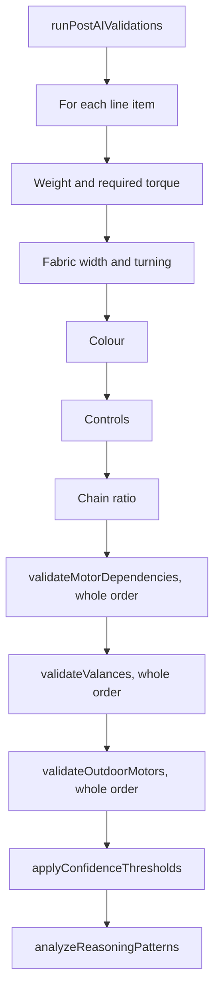

# Comparison validations

After the AI and the rule checks, `runPostAIValidations` in `index.html` checks each order as captured in Blind IQ against Blind Designs' reference data and product rules: fabric widths, colours, controls, weight and motor torque, motors and their accessories, valances and the Zip X motor table. Then `applyConfidenceThresholds` and `analyzeReasoningPatterns` run, and the critical-field sweep decides what is shown most loudly.

Blinds terms (range, fabric turning, Out of Warranty, coupled and intermediate brackets, One Touch Dual) are explained in the [glossary](../glossary.md).

## Where validations run

`runPostAIValidations(comparisonData, fabricProperties, motorProperties, tubeProperties)` is step 8 of [the pipeline](pipeline.md). The three tables are loaded once per run (see [History, feedback and reference data](history-feedback-and-reference-data.md#fabric-motor-and-tube-properties)).

- **It checks Blind IQ's side.** The validations read `blindIQValue` (the valance check falls back to the customer's value when Blind IQ's is unreadable): they check the order as captured, not the customer's document.
- **It mostly adds, rather than changes.** Results go into new properties on the line item or the order. Only the control checks also change a field's `result` (to MISMATCH).
- **It's shared with the converter.** `initBiqConverter` receives `runPostAIValidations`, and the converter's torque and spec checks run it on its own order (`biqToComparisonShape`). A change here changes both. See [Converter user interface](../converter/user-interface.md).
- It has no DOM access, so it could move into a `js/` module with its own node tests.

## The checks, in order

### Weight and required torque

Computed once per line and reused by the chain check, the motor torque check and the blue information strip in the report.

- Needs the fabric table. The fabric is looked up by **Blind IQ's Range**, lower case, against `fabricName`.
- The tube is looked up by Blind IQ's blind type: the exact key first, else the longest tube-table key contained in the blind type ("Element Roller Sys 40" finds "Element Roller"), skipping a key whose diameter contradicts a "40" or "55" in the type's name.
- **Weight** (kg) = width (m) × drop (m) × fabric weight + width (m) × 0.280 (the aluminium bottom bar, in kg per metre). Calculated for roller blinds, and for any blind whose tube is found.
- **Required torque** (Nm) = weight × 9.81 × tube radius (m), and **with a 20% safety margin** for the comparison with motors. Only when the tube is found.
- Stored as `blindWeight`, `requiredTorque` and `requiredTorqueSafety` (strings with two decimals).

### Fabric width, turning and Out of Warranty

When the blind is wider than the fabric's roll (`fabricWidth`), the fabric's `canTurn` decides:

| `canTurn` | Drop within the roll width | Drop over the roll width |
|---|---|---|
| `No` | Error: the fabric can't be turned | Error: the fabric can't be turned |
| `Yes` | Fine | Error: the blind can't be made |
| `Out` | Warning: turning is Out of Warranty | Error: the blind can't be made |

Other values of `canTurn` switch the check off for that fabric. The result is `fabricValidation = { type, message }`.

### Colour

An error (`colourValidation`) when Blind IQ's colour is empty, "N/A" or "-", unless the blind type is in `BLIND_TYPE_EXCLUSIONS_FOR_COLOUR_CHECK`.

### Controls

Four rules, all writing `controlValidation` (type `error`):

1. **Both controls required.** Blind types in `BLIND_TYPES_REQUIRING_DUAL_CONTROL` need Control 1 **and** Control 2. An empty one becomes a MISMATCH.
2. **Two motors, or the same control twice.** For any blind type with both controls filled: both containing "motor" is an error ("a motorised blind has one motor and one fixed/intermediate side"), and so are two identical controls. Both cells become MISMATCH.
3. **A drive is required.** Blind types in `BLIND_TYPES_REQUIRING_CONTROL_VALIDATION` need "chain", "motor" or "dual" in one of their controls. A **coupled** blind is accepted without a drive when the line before or after it is also coupled and carries the chain, motor or dual: two blinds on a coupled bracket run off one drive. A coupled blind without such a neighbour is an error of its own.
4. **Chain ratio** (`chainValidation`, matching the Roller System Selector). For roller blinds on a chain with a known weight: over 8 kg is an error (too heavy for a chain: System 55 with an Easi-Lift spring, or motorise); over 4 kg is a warning that a heavy-duty 1.5:1 chain is needed, unless "1.5" already appears in the controls or the options.

### Motors and their accessories: validateMotorDependencies

Runs when the motor table has rows and the comparison has a sundries list, and stops at once if no blind is motorised. A blind is **motorised** when Blind IQ's controls contain "motor" or "dual".

**Reading the sundries.** Each sundry's Blind IQ description is sorted into one bucket:

| Bucket | When |
|---|---|
| Motor (one per unit) | The description contains a `motorName` from the motor table, and isn't an adapter ("adapter" or "adaptor") |
| Adapter kit (counted by quantity) | It mentions "adapter" or "adaptor" |
| Controller | It mentions "remote", "switch" or "hub" |
| Accessory | It mentions "accessory" |
| Other dependency | Anything else |

A motor is recognised by its name in the table, not by the word "motor", because many catalogue motor names don't contain it (an order with 7 One Touch Dual and 7 Sonesse motors once counted only 7).

**Coverage** (order level, `motorValidation.global`): there must be at least as many adapter kits as motorised blinds, always; and at least as many motors, when the order has any motors at all. No motors and enough adapter kits means the customer supplies the motors.

**The One Touch Dual rule** (Paul, 5 August 2026). One Touch Dual motors (the 1.1, 2 and 3 Nm family) have a thinner motor head, so a Roller System 40 blind taking one must be specified "LH Dual" or "RH Dual"; specified "LH Motor" or "RH Motor", the blind is made too narrow.

- When the order has One Touch Dual motors and more System 40 blinds specified with a plain motor than there are other motors to go round, each plain-motor blind gets an error and its motor control becomes a MISMATCH. When every motor on the order is a Dual, the message says so outright; otherwise it asks the capturer to confirm which blinds take the Dual motors. Mixed orders are legitimate (Russel, 7 August 2026): only counts that can't work are flagged.
- The reverse: more System 40 blinds specified Dual than One Touch Dual motors on the order is also an error, because a Dual width deduction with a standard motor is wrong too. (These cells aren't set to MISMATCH.)

**Per blind.** Motors are paired with blinds largest first: the biggest blind by area gets the motor with the highest torque. For each pair:

| Check | Result |
|---|---|
| No motor-table row for this motor **and** Blind IQ's blind type (exact name, any case) | "Motor Alert: No properties found…"; the other checks are skipped |
| The motor's `torque` is under `requiredTorqueSafety` | `torqueValidation` |
| The blind is narrower than the motor's `minWidth` | `minWidthValidation` |
| No ordered adapter kit contains any of the row's `adapterKit` entries ("adaptor" and "adapter" are treated alike) | "Adapter Alert" |
| None of the blind's controls equals one of the row's `blindControl` entries | "Control Alert: Missing valid control…" |
| No ordered controller contains any of the row's `controlOptions` | "Controller Alert" |
| An ordered accessory contains none of the row's `accessories` | "Accessory Alert: Incompatible accessory…" |
| No other dependency contains any of the row's `otherDependencies` | "Dependency Alert" |

An empty list in the table means that check passes. The alerts are collected as strings in the line's `motorValidation` array.

### Valances: validateValances

Runs only when Pass 1 found an instruction that **all** blinds get valances (`valanceInstruction.required`), and quotes it (`evidence`). The rules were corrected on 6 August 2026 (Russel) after false alarms on cassette orders:

- A valance ordered **as part of the blind** (a valance or cassette in the line's options, or in its blind type or range) satisfies the instruction with no size check: the factory sizes it to the blind.
- A **standalone valance line** has valance, pelmet, fascia or cassette wording and no drop, or a drop under 200 mm. Its width counts once per unit of its quantity (capped at 50).
- Every other blind needs, for each unit of its quantity, an unused standalone valance **10–15 mm wider** than itself (it was wrongly 20–25 mm before). Otherwise it gets an error naming the nearest unused valance width, or a warning when its own width can't be read.
- The order gets `valanceValidation.global` (an alert with the number of blinds that failed) or `valanceValidation.globalOk` (all passed, with any spare valances counted). Differences in valance type aren't flagged: when the customer didn't choose one, that's the capturer's call.

### Outdoor motors: the Zip X motor table

`validateOutdoorMotors` from `js/outdoor-motors.js` runs last. For motorised Free Hang, Zip X, Channel X and Wire X blinds it replaces the weight-based torque estimate with the motor from the price list's table, and sets `motorTableValidation` (`error`, `warning` or `info`). It's described in [Comparison rule checks](rule-checks.md#the-zip-x-motor-table-jsoutdoor-motorsjs).

## The lists in js/constants.js

| Constant | Value (October 2026) | Used by |
|---|---|---|
| `BLIND_TYPE_EXCLUSIONS_FOR_COLOUR_CHECK` | `element double roller`, `curtain glide curtain ripple`, `curtain somfy`, `curtain motion` | The colour check: these types don't need an item colour (a double roller's fabrics are options) |
| `BLIND_TYPES_REQUIRING_CONTROL_VALIDATION` | `element roller`, `roller system 40`, `roller system 55`, `element vison`, `vision blind`, `romashade`, `outdoor channel x`, `outdoor free hang`, `outdoor zip x`, `outdoor wire x`, `outdoor widescreen` | Control rule 3: a chain, motor or dual is required |
| `BLIND_TYPES_REQUIRING_DUAL_CONTROL` | `element roller sys 40`, `roller system 40`, `roller system 55`, `element double roller`, `outdoor free hang`, `element vision`, `vision blind` | Control rule 1: both controls required |
| `CRITICAL_FIELDS` | `blindType`, `range`, `colour`, `qty`, `width`, `drop`, `control1`, `control2` | See [Critical fields](#critical-fields-and-how-critical-issues-surface) |
| `CACHE_TTL_MS` | 5 minutes | The prompt cache; see [History, feedback and reference data](history-feedback-and-reference-data.md#the-feedback-and-guideline-cache) |

### The names must match Blind IQ's

The three blind type lists are compared **by exact name**: Blind IQ's blind type as the AI read it from the confirmation, lower-cased and trimmed, must be in the list (`Array.prototype.includes`). They aren't compared by BlindIQ ID, and there's no fuzzy matching. When BlindIQ renames a type, the lists quietly stop matching it:

- a type dropped from `BLIND_TYPES_REQUIRING_CONTROL_VALIDATION` or `BLIND_TYPES_REQUIRING_DUAL_CONTROL` silently loses its control checks;
- a type dropped from `BLIND_TYPE_EXCLUSIONS_FOR_COLOUR_CHECK` starts raising false "no colour" errors.

This has already happened once: BlindIQ renamed its Element blind types on 1 August 2026, keeping their IDs (`BT_RENAMED` in `js/comparison-checks.js` lists five: Element Roller Sys 40 → Roller System 40, Element Wood → Wood Venetian, Element Retro → Retro Venetian, Element Vision → Vision Blind, Element 35mm Aluminium → 35mm Aluminium). The lists carry some old and new names side by side. Things to check:

- `element vison` is a typo and can't match the correctly spelt name.
- Unverified: whether `element double roller` and `element roller` are still names Blind IQ prints. The converter itself uses both "Element Double Roller" and "Double Roller Blind".
- The motor and tube tables depend on the same names: a motor row's `blindType` must equal Blind IQ's blind type, and tube keys must be contained in it.

After each catalogue refresh or BlindIQ rename, compare the lists with the blind type names on recent Blind IQ confirmations (the catalogue refresh also carries `blindTypeNames`). Matching by ID, or through the converter's catalogue, would remove this risk; that's an idea, not current behaviour.

## applyConfidenceThresholds

Runs after the validations, on the eleven primary fields and every option:

- **Critical fields are never "not on the order".** A NOT_SPECIFIED on a critical field becomes an OMISSION, marked `notSpecifiedCritical: true`.
- **Unsure matches become notes.** A MATCH with confidence under 0.75 becomes a NOTE, marked `confidenceOverride: true`. This applies to rule matches too: the rules don't change the AI's confidence.

The confidence thresholds used across the comparison:

| Threshold | Where | Effect |
|---|---|---|
| 0.75 | `applyConfidenceThresholds` | MATCH → NOTE |
| 0.80 | `reExtractLowConfidence` | Two or more fields under it trigger Pass 2 |
| 0.80 / 0.85 | `reconcileSecondReading` | Minimum confidence of a second reading for sizes and quantities / colours |
| 0.90 | `renderSummaryReport`, `renderReportTable` | Under it, a field shows its percentage and the order can be "LOW CONFIDENCE" |

## analyzeReasoningPatterns

Searches each line's `reasoning` with three regular expressions:

| Pattern | Looks for |
|---|---|
| Control column confusion | "control" followed later by "shift", "wrong", "swap" or "mix" |
| Phantom row detected | "blank", "empty", "spacer" or "separator" followed later by "row" |
| Dimension uncertainty | "width" or "drop" directly followed by "could be", "is unclear", "is unsure", "might be" or "is ambiguous" |

Three or more dimension-uncertainty hits collapse into one document-level flag: "Handwritten or low-confidence document — N items need manual verification". The result is stored in `_reasoningFlags` and shown as the "AI flagged:" strip in the run summary only (not in history). It's a text heuristic: the prompt forbids hedging words, so the uncertainty pattern catches the AI breaking that rule, and the other two patterns can also match ordinary explanations.

## Critical fields and how critical issues surface

`CRITICAL_FIELDS` are the order capturers' critical fields, set by Paul on 5 August 2026: product type, range, colour, quantity, width and drop, plus both controls after the One Touch Dual incident. They're treated specially in several places:

- the prompt never allows NOT_SPECIFIED for them (`NOT_SPECIFIED_RULES`), and `applyConfidenceThresholds` enforces it;
- Pass 2 can't clear a flag on them by agreeing with Blind IQ;
- the rule checks count a NOT_SPECIFIED on them as a flag.

They surface in three ways:

1. **Cell highlight.** A MISMATCH or OMISSION on a critical field gets `.critical-cell`: a red outline that pulses three times (not at all for users who prefer reduced motion).
2. **The CRITICAL FIELD CHECK box** at the top of every report, fresh or from the history (`criticalSummaryHtml`).
3. **The end-of-run modal** `#critical-modal`, after a fresh run only (`showCriticalModal`), listing the affected lines order by order, with a **Review the report** button.

Both the box and the modal are built from:

- `collectCriticalIssues(data)`: for each line, every MISMATCH or OMISSION on a critical field (with both values), every message from `fabricValidation`, `colourValidation`, `controlValidation`, `torqueValidation`, `motorTableValidation`, `minWidthValidation`, `chainValidation` and `valanceValidation` whose type is `error` or unset (warnings and information are left out), and every string in `motorValidation`. `CRITICAL_FIELD_LABELS` gives the field names shown.
- `collectSundryFails(data)`: failed entries in a sundry's `validationLog`. No current code writes `validationLog`, so in practice this list is empty.

The order-level alerts (motor coverage and the valance instruction) aren't part of this sweep. They appear as banners at the top of the report and make the run summary say "(ACTION REQUIRED)".

## Changing a validation safely

- **Check whether it's data, not code.** Many changes only need a different row in the fabric, motor or tube table (see [History, feedback and reference data](history-feedback-and-reference-data.md)).
- **Remember the converter** runs the same function.
- **Keep the property names** (`fabricValidation` and so on) and the `{ type, message }` shape: the renderer, the critical sweep, the history and the converter's check results all read them, and old saved comparisons keep the old shape.
- **Prefer extracting before extending.** Moving the pure parts into a `js/` module (named exports, no DOM) lets them be tested in node in the regression package. See [Testing](../testing.md).
- **Follow the manual end-to-end check** after the change: upload → compare → view results → history search.

## Known weak spots

- Name matching against Blind IQ's printed blind types, ranges and sundry names (above). A range that isn't in the fabric table gets no weight, torque or fabric check, and nothing says so in the comparison (the converter does list missing fabrics).
- Widths and drops are read as the first run of digits in Blind IQ's value.
- Motors are paired with blinds by size and torque order, not by which line each motor is for.
- The per-line `motorValidation` messages aren't drawn on the line, only in the critical box and modal.
- The reverse One Touch Dual check doesn't mark the control cells.

## Related pages

- [Comparison pipeline](pipeline.md)
- [Comparison rule checks](rule-checks.md)
- [Comparison AI context](ai-context.md)
- [History, feedback and reference data](history-feedback-and-reference-data.md)
- [Converter user interface](../converter/user-interface.md)
- [Mappings and catalogue](../converter/mappings-and-catalogue.md)
- [Glossary](../glossary.md)
