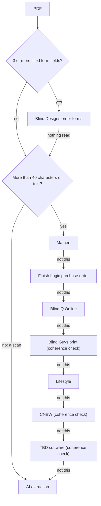

# Dealer formats

The converter reads nine document layouts deterministically, each with its own parser and normaliser in `js/biq-converter.js`, and sends everything else to the AI. This page lists every layout, how it is recognised, and the quirks its code handles, then explains how to add a new one.

For the stages around this (detection, the shared rule pipeline, the XML) see the [Converter overview](overview.md). Terms such as range, fix and control drop are in the [Glossary](../glossary.md).

## Summary

| Format | File | Recognised by | Parse → normalise | `source` | Notes |
|---|---|---|---|---|---|
| Blind Guys order workbook | `.xlsx` / `.xls` | A header row with "Item #" and "Location" in the first 15 rows of the first sheet | `biqParseBlindGuysRows` → `biqNormalizeBlindGuys` | `blindguys` | One sheet per product: roller, double roller, wood venetian, aluminium venetian, vertical, shutter (outdoor, Romashade and cellular sheets go through the roller reader) |
| Blind Guys workbook printed to PDF | `.pdf` | Text with "ORDERNo/Ref:", "Item #" and "Finished Width/Height"; must pass `biqTbdCoherent` | `biqBgPrintToRows` → the workbook reader above | `blindguys` | Rebuilds the spreadsheet grid from the text, so the print converts like the workbook |
| Mathéo order sheet | `.pdf` | "Mathéo" or "matheoblinds" in the text, plus a header line with "#", "Location" and "Price" | `biqParseMatheoItems` → `biqNormalizeMatheo` | `matheo` | One layout per product; the "BD …" title and each row's price group decide the blind type |
| Finish Logic purchase order ("Online Purchase Order": TBD, Galaxy Blinds, any dealer) | `.pdf` | The "Online Purchase Order:" banner and the Item … Price header, without BlindIQ Online's "IQ Link ID" label | `biqParseBdPo` → `biqNormalizeBdPo` | `bdpo` | Printed in BlindIQ's own names with "K=V\|" options and ZIQ sundry codes; checked against the PO's Blind Total; notes filtered at export |
| BlindIQ Online export | `.pdf` (`BlindIQ_ExportedCO_<IQ Link ID>.pdf`) | "Online Purchase Order:" and "IQ Link ID" | `biqParseBiqOnline` → `biqNormalizeBiqOnline` | `biqonline` | Marked `exact`; the comparison takes it as printed |
| Lifestyle Blinds | `.pdf` | "lifestyleblinds", or "PURCHASE ORDER" with "AUTONEER" | `biqParseLifestyle` → `biqNormalizeLifestyle` | `lifestyle` | Product, range and colour are encoded in one Description |
| Curtain & Blind Workshop (CNBW) | `.pdf` | "curtain and blind workshop", "cnbw.co.za" or "goldcut"; must pass `biqCnbwCoherent` | `biqParseCnbw` → `biqNormalizeCnbw` | `cnbw` | Roller, outdoor, shutter, venetian and double roller sheets; several template generations |
| TBD ordering software ("BLINDS ORDER" / "OUTDOOR ORDER") | `.pdf` | "ORDER" and "Options:" in the text, plus an Item / Location / Qty / Description header; must pass `biqTbdCoherent` | `biqParseTbd` → `biqNormalizeTbd` | `tbd` | Licensed to other dealers (Galaxy Blinds), so detection never uses the company name |
| Blind Designs order forms | fillable `.pdf` | 3 or more filled form fields; `biqDetectForm` picks the form by its field names | Element form: `biqParseBDFields` → `biqNormalizeBDForm`; curtain, outdoor, shutter forms: `biqParseSpecForm` (`js/biq-form-specs.js`) | `bdform` | Field names are the AcroForm contract in `BIQ_FORM_SPECS` |
| Anything else | images, scans, other PDFs and spreadsheets | No layout above recognised it | `aiExtract` (UI module) → `biqAiResultToOrder` | `ai` | Read by Gemini; verify every value |
| Manual entry | — | The "+ New blank order" button | `biqBlankOrder` | `manual` | AI name matching doesn't run automatically |

## Detection order

`biqDetectPdf` in `js/biq-converter-ui.js` tries the layouts in a fixed order and stops at the first that recognises the document. The editor and the comparison share it, so a new layout reaches both at once.

Order matters. The TBD software signature ("ORDER" plus "Options:") is the loosest, so it comes last. The Finish Logic purchase order and BlindIQ Online exports share the "Online Purchase Order:" title. The export's own "IQ Link ID" label (a text item of its own; the words in a dealer's note don't count) leaves it to `biqParseBiqOnline`, and a document whose From column is Blind Designs is never read as a dealer's PO, so an export placed by TBD itself is still read as an export. Parsers added after October 2026 are called through the `BiqConv` namespace with a guard (as `biqParseBiqOnline` is), so a browser still holding the previous `js/biq-converter.js` just skips that layout instead of failing to load.

## Blind Guys order workbook

`biqParseBlindGuysRows(rows)` takes the first sheet as an array of rows. It reads the header labels in the first 8 rows ("Customer Name:", "OrderNo/Ref:", "Address:", "Order Date:", "Company", "Product", "Sales Rep"), finds the column header row, and keys every row with an Item # by its column titles. The Product cell picks the sheet kind: double roller, shutter, aluminium venetian, wood venetian, vertical, else roller.

`biqNormalizeBlindGuys` sets the customer from "Company" (the Blind Guys branch), the end client from "Customer Name", a "Sales rep" order note, and "EXPRESS (3 day delivery) +10%" when any row asks for Express. Then one reader per kind:

- **Roller sheets** (`biqBgRoller`, also used for outdoor, Romashade and cellular sheets):
  - Fabric is split into range and colour (`biqSplitFabric`); the Type column is the blind type ("System 40" is an alias).
  - A stated Mechanism Colour sets `_hwFromOrder`, so even White counts as the order's.
  - "Control Length" can be a custom length ("Custom: 3640"), which wins over the formula.
  - The 70 mm cassette column ("System 40 70mm Cassette" or "Closed Cassette") becomes the cassette option.
  - "Extra Brackets = Intermediate / Coupled" sets the bracket option under the blind type's own key (`biqBracketOptionKey`).
  - "Upgrade Mechanism" goes to a note and `_upgradeAsk`; the 1.5:1 rule decides later.
  - The Motor, Remotes and Accessory columns become motor sundries; the motor text is kept in `_motorText` for the One Touch Dual rule.
  - The valance column group (Valance Type, Colour, Width, Fix, Returns, Top Board, Mitres, End Cap Colour, LH / RH Side) is staged in `_valance`. A row with valance columns but no type, fabric or drop is a valance-only row and is rebuilt in place as the valance.
  - Romashade and cellular sheets give the drive as "Control Type" plus "Control Side", which become Control 1 and Control 2. "Stack" becomes Stack Choice and "Back Bar Colour" Back Bars.
  - Any other column is copied as an option under its own name, and flagged later if BlindIQ has no such option.
- **Double roller sheet:** "Configuration Front Blind" says whether the front fabric is the blockout or the view fabric; Bottom Bar Colour, Cassette Colour, Fabric Insert and Roll Type Front / Back are read; "Extras" becomes a line note, never a sundry. A line note that runs over several rows ("Please use one Cassette across" / "all 3 blinds.") is joined and given to every row of the run, only when the upper note ends on a word no sentence ends with (`BIQ_NOTE_RUNS_ON`).
- **Wood venetian sheet** (`biqBgVenetian`): Element Wood; the slat colour is the colour. The sheet has no range, so the range is taken later from the colour when one live range sells it (`biqInferRangeFromColour`), otherwise it is flagged. Control Side and Operation are Control 1 and 2. "Valance Length" is Val Size, and returns are read from both "Valance Returns" and the sheet's misspelt "Valancce Returns". Hold downs, ladder tape, mitres and mixed slats are mapped. Cut-outs are written as BlindIQ does, "<width> x <drop from bottom>" (`biqBgCutOuts`). Second and third colours go to the notes.
- **Aluminium venetian sheet** (`biqBgAluVenetian`): a 50 mm slat is a Retro Venetian, otherwise 35mm Aluminium. The Type column is the range; perforated or textured wording takes the type's own perforated range. Valance and bottom bar type and colour, Cleat, Remove Valance and hold downs are read.
- **Vertical sheet** (`biqBgVertical`): 90mm Vertical Blind. Control Side is Control 1, Stacking is Control 2 (Stack Left / Right / Split). "Mono Command = Yes" sets Control = Mono-command. A vane width other than 90 mm goes to the notes.
- **Shutter sheet** (`biqBgShutter`):
  - Three-point measurements ("T: 526|M: 526|B: 526") take the smallest figure, with the measurements in the notes and an amber "confirm" (`biqTripleSize`).
  - The range is the panel count ("4 Panel Hinged", plus " Tier on Tier").
  - Columns are matched to the range's own option names; Rebate "left over right" becomes "LH over RH".
  - Rear Frame Cover is None on any frame but Multi L.
  - The Configuration column gives the hinge layout as Control 1 (`biqShutterHingeControl`). Sizes are never rounded.

## Blind Guys workbook printed to PDF

Some Blind Guys orders arrive as the workbook printed or flattened to PDF, so the form fields are gone. Before this reader existed they went to the AI, which dropped the 70 mm cassette column on every blind. `biqBgPrintToRows(textItems)`:

- groups the text into lines and clusters the header band's words into columns, joining wrapped headers top-down ("System 40" over "70mm Cassette" becomes the workbook's "System 40 70mm Cassette");
- turns the lines above the header into label/value rows, so the workbook reader finds the header labels;
- anchors every data line to the nearest item-code line (3 or 4 digits in the Item # column), skipping repeated header bands;
- puts short words in a column by its left edge and long text by its centre (line notes start left of their own header).

The rows then go through `biqParseBlindGuysRows` and `biqNormalizeBlindGuys` exactly as a workbook does.

## Mathéo order sheet

Mathéo's sheet changes with the product ordered (roller, designer roller, double roller, venetian, Vision, Allusion, cellular, valance, Zip X, Free Hang, Urban shutter).

**Parser** (`biqParseMatheoItems`):

- Header metadata: "PO#", "Quote #", "Job #", "Date", the Mathéo company line, the end client ("Name: … Tel"), and the product title ("BD Roller Blind", "BD Designer Roller Blind", "BD Valances Linear"…).
- Columns are found from the header line. Split words ("Locatio" + "n") are tolerated, and words closer than a real column gap form one title. Dense layouts (the 25-column Urban shutter sheet, whose headers wrap over six lines) are anchored on a canonical column list, `BIQ_MATHEO_LAYOUTS`.
- Cells may start up to about 17 px left of their header.
- Page furniture that repeats on every page (the order header, the dealer's address) is dropped wherever it reappears.
- Priced accessory blocks under a row ("1. Wire Side Guides - Floor fix …") belong to the row above.
- Remarks printed in the left margin ("Back material: 5 Screen Platinum") and "Hinge Configurator:" lines go to the row's notes.

**Normaliser** (`biqNormalizeMatheo`):

- The order number is the PO number, else the quote number; "Quote …" and "Job …" go to the order notes. The customer is the company line, else "Mathéo Blinds & Awnings".
- **Blind type** comes from the title. The row's Type is a price group, which can change it: "Sys 55" is a Roller System 55, "Double" a double roller, and on the venetian sheet "Alu" and "Retro" pick those products. The price group is also kept in the notes.
- **Range:** "BD Element ", "BD E ", "BD " and "Element " prefixes are stripped until the material resolves. Hinged shutters take the panel count from the price group ("Urban (6P)…" is "6 Panel Hinged"). Allusion fabrics named without a vane width take the 107mm range (90mm when the line says so). Designer rollers take "Designer Fab <group letter>" with the colour as fabric plus colour ("Argent Gold 2050mm @"), but only when that colour is on the Designer range.
- **Controls:** words the narrow Controls cell wraps mid-word ("Inte rmediate") are joined first.
  - Intermediate wording is read side by side ("LH Chain & RH Intermediate").
  - "Dual" beats the generic motor wording.
  - "RH Motor" means a motor on the right with a pin on the left.
  - Venetians name only the side ("LHS" is Left).
  - Allusion Monocommand is "Wand Lh And Rh", a cord is "Cord Right" / "Cord Left", and stacks go to Control 2.
- **Hardware:**
  - H/ware Colour is Mech Colour and sets `_hwFromOrder`.
  - A "Covered Aluminium" bottom bar is the aluminium bar in the hardware colour (Grey hardware gives Silver, Beige gives White, noted).
  - With no bar on the sheet, the bar follows the hardware.
  - The Cassette cell ("2400mm | Sys 40 70mm Cassette") means a fitted cassette, never a colour.
  - A Fabric Insert length means Yes.
  - "Bracket Covers = Std" means nothing to remove.
- **Double rollers:** the row's material and colour is one fabric and the remark under the row names the other (`_drTexts`, read by `biqApplyDoubleRollers`). The chain column and Cord Tidy go to the notes, and the cassette colour is the hardware colour.
- **Outdoor sheets:**
  - "Brackets: Black" is the Bracket Colour.
  - A column titled like one of the sheet's options goes there.
  - A Crank Handle cell that names an option of its own ("Pull Pole 1.5m") sets that option and leaves no crank.
  - "Handle" is Hold Downs when its text is one of those values.
  - The sheet's Control option mirrors the Controls column, and a motorised blind gets Crank Handle None.
- **Shutter sheet:** the Tilt Bar cell carries both the bar position and the tilt grouping. "Style" is BlindIQ's Rebate. Mid rail positions ("997 & 1997") set Middle Rail and its positions. The hinge configuration gives Control 1.
- **Accessory rows** become the sheet's Wire Side Guides option where it has one, otherwise sundry lines (motor parts resolve in the motor sundry types). Prices are ignored; BlindIQ prices for itself.
- **Valance sheet** (`biqMatheoValance`): each row is a BlindIQ Valance line, and "Type of Blind" is filled as Roller Blind and noted, because the sheet doesn't print it.

## Finish Logic purchase order ("Online Purchase Order")

Finish Logic, a quoting app for blind dealers built by the owner of Total Blind Designs (TBD), prints a PO in BlindIQ's own vocabulary: exact blind type, range, colour and control names, the sheet's options as "K=V|K=V|" lines under each item, a SUNDRIES section with ZIQ stock codes, and a "Blind Total". TBD has sent these since August 2026, Galaxy Blinds since late August, and any dealer that adopts Finish Logic sends the same layout. Evidence and decisions: `CLAUDE.md` ("Converter: Finish Logic purchase orders") and the Claude project doc `claude/orderbot-finish-logic-compatibility-2026-10.md`.

**Parser** (`biqParseBdPo`):

- Recognised by the layout (the banner and the Item … Price header), not by a dealer's name. The customer is the Name in the PO's From column (`biqBdpoDealer`); a PO without one is still read, as TBD's when the page names TBD.
- The order number is the dealer's job number at the start of the file name when that dealer's pattern is known (`BIQ_BDPO_JOB_RE`: Galaxy's L or H plus 5 digits, "H17314 [client].pdf" → H17314), else the "Quote Ref", else the title's reference. `biqNormalizeBdPo` takes the file name for this. Order and required dates are read, plus the operator and the "FINAL MEASURED" watermark (both become order notes).
- Columns are anchored on a fixed title list. The header has two "Control" columns: the first is Control 1, the second Control 2.
- A money amount right of the Fix column is the price. A five-figure outdoor price used to land in Fix ("Reveal 24,642.00").
- The repeated column header, the "ONLINE PURCHASE ORDER" banner and the watermark are skipped at every page break, so they can't bleed into the open row.
- "K=V|" lines (and their wraps) belong to the item above; "Notes:" in that run starts the item's notes.
- **An item row always starts a new blind:** a letter under Item and a quantity under QTY end any open option run, even one without its closing "|". Finish Logic's own remarks after a line's options stay on the line as "Finish Logic: …" for the capturer; BlindIQ doesn't get them.

**Normaliser** (`biqNormalizeBdPo`):

- A missing drop on a valance or curtain track is 0, and "Stack …" in the first Control column is Control 2.
- **Double rollers** (`biqBdpoDoubleRoller`): the blockout fabric's family is the range. "Block-out Range" plus the first colour is Blockout Fabric, "Screen Range" plus the second is View Fabric, Mech Colour is Cassette Colour, and the item colour is cleared.
- A note that is only a chain length ("Chains must be 1100mm long") becomes the control drop on a chain-driven line, from 300 to 6000 mm (`biqBdpoChainNote`).
- **Options:**
  - No of Runners, Tape Length and Stack Size are dropped, because BlindIQ calculates them.
  - Motorisation keys (`BIQ_TBD_SUNDRY_KEYS`: Motor, Adaptor, Charger, Remote, Wall Switch, Smart Hub, Smart Plug…) become notes, and also sundry lines unless marked "Not BD Supply".
  - "Joined To=Blind N" counts blinds (a valance is a line of its own) and pairs the partners the PO names (`_bdpoJoin`, `_joinWith`, then `biqApplyBracketPairs`), but only when both lines state coupled sides that meet (one Rh Coupled, the other Lh Coupled): the bracket is costed and no control is touched. Anything else is left to the consecutive pairing, as before. "Joined To=g (Coupled)" works too.
  - "Cassette Fix" fills an empty Fix.
  - "Motor Side" on a curtain track is Control 1 Lh / Rh Motor.
  - "Runner Type and Spacing (Front / Back Track)" fill the one BlindIQ key from the front track, with a different back value noted.
  - A Crank Handle the sheet offers is the option, not a sundry.
  - Three Finish Logic option names are re-keyed (`biqBdpoSheetKey`): Top Board, 1 x Custom Angle Bend and Magnetic Hold Down. It also takes the one sheet value that ends with the printed one (Galaxy's "Top Board=90mm" → Yes 90mm).
  - Anything else not on the sheet becomes a note.
- A valance with a top board is Face fixed. Coupled controls set Coupled Bracket Yes.
- **Finish Logic's range names** (`BIQ_BDPO_RANGES`, `biqBdpoRange`), used only when the printed range doesn't resolve for the blind type: Linear 65mm / 108mm → Linear Valance, Roman Panel Headrail (Price) → Roman Headrail, Ripple Glydea 60kg → Glydea 220v 60 Ripple. The line notes what was read as what, for the capturer only. A mapping alias added later takes over.
- **Crank Handle None** on a line whose sheet requires a crank handle when the PO gives that line no crank or handle option at all. A handle the sheet doesn't offer stays a problem, and an amber heads-up appears when no blind on the PO has a handle.
- **Motorised curtain tracks** (Curtain Somfy) keep White on their colourless range, as the capturers always did; any other colour is still flagged.
- **The Blind Total check:** the lines and SUNDRIES must add up to the PO's Blind Total within R1. If they don't, a problem asks the capturer to compare the order with the PDF, because a blind or sundry may not have been read. Adding, deleting or swapping a line or a sundry clears it (`_poLine`, `_poSundry`, `_bdpoTotal`).
- **Sundries:** the SUNDRIES section resolves by ZIQ code or name in the orderable sundries. Hardware named only in the options is added as further lines, de-duplicated by stock code and then by resolved ID, and summed across blinds.
- The notes the converter writes from TBD's options are recorded in `_bdpoGen`, so `biqExportItemNotes` can leave them out of the XML. A line with no fix on a range that takes one is a problem for this source only.

**Still open:** the shared coupled-pair function every layout uses (`biqApplyCoupledPair`) can lose a drive when it has to rewrite a pair whose sides aren't both stated. The Finish Logic pairing never rewrites controls, so it doesn't reach that path ([Known issues and roadmap](../known-issues-and-roadmap.md)).

## TBD ordering software ("BLINDS ORDER")

TBD license their ordering software to other dealers, so the letterhead varies (Total Blind Design, Galaxy Blinds…) and the heading is "<X> ORDER" (BLINDS / OUTDOOR). The Finish Logic review suggests this is Finish Logic's older layout (Galaxy Blinds sent it in July 2026).

**Parser** (`biqParseTbd`):

- Detection keys off the layout: an Item / Location / Qty / Description header plus "Options:" lines.
- The dimension cell is a whole "1455 × 1210" or its pieces. Free text landing there is a colour overflowing its column, and a wide drop overflowing into Fix is moved back.
- Diagonal watermarks and the repeated letterhead are discarded, so a page break inside a wrapped Options line doesn't glue the next page's title into an option.
- Options split only on a pipe with spaces either side, because values can contain bare pipes ("(1.1|2|3Nm)").

**Normaliser** (`biqNormalizeTbd(mappings, p, fileName)`):

- The two-line description is product plus range, in either order. The product maps through `BIQ_TBD_TYPES`, and wood slats through `BIQ_TBD_WOOD_RANGES` ("50mm Wood" is Classic).
- Double rollers print "Blockout + 5 Screen" with "White / Dune Grey": fabric N takes colour N, kept in `_drTexts` for the double roller reader.
- BlindIQ IDs printed before the options ("BlindIQ: Type 25 · Range … · Colour … · Fix …") set those fields through `biqApplyBlindIqIds`, using only IDs the catalogue knows. The printed Ctrl pair is ignored: it reads 9/18 whatever the Controls column says.
- **Options:**
  - Left End / Right End / Joined To are consumed.
  - Valance keys are staged (`_valance`) with a "VALANCE (capture as its own line)" note.
  - Motorisation keys become sundry lines, after expanding TBD shorthand with `biqTbdExpand` (1TD is One Touch Dual, ZB Zigbee, M&T Matter, WF Wire Free).
  - A repeated key keeps the first value and puts the rest in an "Also:" note.
  - Everything else is copied as-is, being BlindIQ-shaped already.
- **Controls** come from Left End / Right End (`BIQ_TBD_DRIVE`; "Control" means Chain), else the Controls cell ("LHC", "RHM", "L:Mtr R:Int", "Lh Pin / Rh Chain"). A missing side is a pin.
- "Joined To = Blind N" pairs consecutive lines through `_bracketWith`; any other pairing is noted for the capturer.
- **Order number:** these documents print none, so it is the job number at the start of the file name (`biqJobNumberFromFileName`: "L17084 Rob.pdf" gives L17084), else the document's "Name:" field. It is never invented.

## Galaxy Blinds

Galaxy Blinds' documents are Finish Logic output. Their older "BLINDS ORDER" layout is read by `biqParseTbd`, and their newer "Online Purchase Order" by `biqParseBdPo`, like TBD's, with the job number from the file name as the order number. Customer matching strips legal suffixes for the suggestion ("Galaxy Blinds" against "Galaxy Blinds (Pty) Ltd") but never auto-matches; see [Mappings and catalogue](mappings-and-catalogue.md#customers).

## Finish Logic

Finish Logic produces both layouts above: the "Online Purchase Order" (read for every dealer by `biqParseBdPo`, since the `finish-logic-2026-10` change) and the older "BLINDS ORDER" (`biqParseTbd`). A dealer that starts sending Finish Logic POs needs nothing new in the code, unless it names its files by job number, in which case add its pattern to `BIQ_BDPO_JOB_RE`.

## BlindIQ Online export (exact)

A dealer's order captured in BlindIQ Online arrives as `BlindIQ_ExportedCO_<IQ Link ID>.pdf`. It is printed in BlindIQ's own names, with the options set on the order as "K=V|" lines and ZIQ codes under Sundries. Capturers re-key these orders, so the comparison checks the re-keyed order against this export exactly ([Rule checks](../comparison/rule-checks.md)).

**Parser** (`biqParseBiqOnline`):

- Values are centred under their headers, so each text item goes to the nearest header centre. This uses the text widths `biqDetectPdf` keeps (`biqHeaderCols`, `biqNearestCol`).
- Items are one to three capital letters and may run over several pages; page furniture is skipped.
- It reads the "To" block's name (the dealer), the order and required dates, delivery method, packing type, quote ref, operator, the IQ Link ID, the Sundries table (item, quantity, code, sundry type, sundry) and the Order Message.

**Normaliser** (`biqNormalizeBiqOnline`):

- Sets `exact` and `iqLinkId`.
- Starts each line's options from the sheet defaults, then applies the printed options and keeps them in `exactOptions`, because an option at its sheet default isn't printed.
- Resolves sundries by stock code or name, keeping the printed name in `exactName`.

`biqReadCustomerFile` returns an exact order as printed, without the rule pipeline. In the editor, however, `refresh()` runs the full pipeline on it like any other order.

## Blind Designs order forms

Blind Designs' own fillable PDFs are read from their form fields, not their text. `BIQ_FORM_SPECS` in `js/biq-form-specs.js` holds the field names, generated from the blank forms. `biqDetectForm` recognises a form by fields only it has:

| Form | Detected by fields | Reader |
|---|---|---|
| Curtain | "Manual Track Avant 1" | `biqParseSpecForm` |
| Outdoor | "Cassette none", "freehang crank none" | `biqParseSpecForm` |
| Shutter | "Rebate NA", "Tilt grouped", "Louvre 63" | `biqParseSpecForm` |
| Element (blinds) | "Blind Type A", "Range A" | `biqParseBDFields` → `biqNormalizeBDForm` |

**Element form.**

- `biqParseBDFields` reads the header fields and groups the row fields by base name and row ("Width A", "Width 8"). The rows run A–G then 8–15 (`BD_ROW_SEQUENCE`).
- The anonymous "Option A<n>" checkboxes are decoded by `biqElementGridOptions` into (row, option) pairs from `BIQ_FORM_SPECS.element.optionCols`: Roll Type Waterfall, Steel Ball Chain, the 70 mm cassette, Remove Bracket Covers, and a "Sys 40 1.5:1 / Sys 32" column.
- `biqNormalizeBDForm` letters the items a, b, c…
- On roller-type blinds "Left" is Lh Chain / Rh Pin and "Right" is Lh Pin / Rh Chain; venetian-family blinds keep the side word as Control 1.
- A Hardware value is Mech Colour (Hardware on venetians) and sets `_hwFromOrder`. The template's White bottom bar and double-roller cassette are cleared so they follow the hardware.
- A Valance Size cell sets Val Size and `_valSizeStated`: on a venetian "No" is kept, "Std" becomes the blind width + 15 mm and a width is kept, rounded to 5 mm ([Converter rules](rules.md#wood-and-retro-venetians)). Valance Return "N" or "LR" is read with the value synonyms.
- On a Retro Venetian the "Val Type / Colour" cell is the valance and bottom bar colour ("Aluminium: Stone Grey").
- Cut Left / Right and Wire Guides are mapped.
- A double roller's second fabric written on the next, size-less row is merged into the blind above (`biqMergeDoubleRollerRows`), and valances are staged and expanded.

**Curtain, outdoor and shutter forms.** `biqParseSpecForm` walks the spec's field list, where each field has an action: text, fix, a control, an option, track, runner, style, panels, sundry flag or sundry quantity.

- Curtains are Curtain Ripple or Curtain Glide on a manual track, or Curtain Somfy with the range "<track> Ripple / Glide" when motorised, with control drop 0.
- Shutters are Urban Hinged Shutter with the range "<N> Panel Hinged" (Tier on Tier, café and full-length styles are handled), with control drop 0.
- Outdoor blinds take the product ticked (Free Hang, Zip X, Channel X, Wire X). Extrusion rows (L angles, square posts) become unresolved sundry lines with "Qty x Length" in the notes.

## Lifestyle Blinds

`biqParseLifestyle` reads a uniform table: everything left of the Qty column is the Description; Qty, Mount, Width, Drop, C, Location and Cost go to their nearest column. `biqNormalizeLifestyle` (customer "Lifestyle Blinds", lines numbered 1, 2, 3…):

- splits the Description ("ELEMENT ROLLER 5 SCREEN - DUNE GREY") into blind type, range and colour (`biqLifestyleDesc`);
- reads a range whose words are in another order ("FILTER OXFORD" is Oxford Filter); otherwise takes the fabric half (`biqLifestyleFabric`) through the fabric splitter, and treats a description with no range at all as a colour-only line;
- gives a plain "VENETIAN" to whichever venetian product sells that colour;
- reads the C column's L / R as Lh Chain / Rh Pin or Lh Pin / Rh Chain, and Mount as the fix;
- turns a valance row with a width into a real Valance line (Linear or Half Round from the wording); without a width it goes to the order notes;
- gives a "SYS 40 70MM CASSETTE - GREY" row to the blind with the same location and width, as its cassette option (and Fabric Insert when it says so);
- puts brackets, cut-out specifications and rows without sizes in the order notes, and an Express row in an "EXPRESS ORDER (5 working days)" note.

## Curtain & Blind Workshop (CNBW)

`biqParseCnbw` works out the sheet from its header and title: shutter, double roller ("Fabric Type 1 / 2" or "double roller order"), outdoor (a Motorised column on a non-roller sheet), venetian ("Type of Blind" or "venetian blinds order"), else roller.

- **Columns:** the legacy roller, outdoor and shutter templates use fixed x-anchors (`BIQ_CNBW_COLS`). Newer templates (the venetian and double roller sheets, or any header with roll type, insert, component, cassette or waterfall columns, or more than one Colour column) are anchored on the header line itself (`biqCnbwHeaderCols`).
- **Merged headers** ("Window Width", "control Chain") become merged anchors that the normaliser splits.
- On the roller sheet, the three "Colour" columns run fabric, cassette and components, left to right.

`biqNormalizeCnbw` (customer "Curtain and Blind Workshop", lines numbered):

- **Shutters:** Urban Hinged Shutter, "<N> Panel Hinged", and the frame in the notes.
- **Venetians:** 35 mm is Element 35mm Aluminium (range Standard), else Element Wood with the range from the slat wording (default Classic). The side is Control 1 Left / Right, and Control 2 is Motor only when stated.
- **Double rollers:** the fix can be printed at the end of the second colour ("white grey recess"). A Motorized cell naming a motor makes a motor sundry. The front and back fabrics are Blockout and View Fabric, with the range from the blockout. The cassette colour comes from the cassette colour column, else the Cassette cell, else the Components colour (Grey is Silver).
- **Rollers and outdoor:**
  - "Roll type" holds the fabric on most sheets, unless a separate fabric column exists.
  - Fabric plus colour is split into range and colour.
  - A motor named in the Motorised or control cell makes the drive a motor and a sundry.
  - The Chain column gives Roll Type or Steel Ball Chain.
  - "Components" is the hardware colour, and it clears the template's White bar.
  - A cassette Yes or colour sets Cassette Colour, folded onto the range's own cassette option later.

The sheet's valance columns are parsed but not used. `biqCnbwCoherent` accepts the result only when at least half the lines have a width and a fix that resolves; otherwise the document goes to the AI.

## AI path

Anything not recognised, every image, and every scan (a PDF with 40 or fewer characters of text) is read by Gemini. `aiExtract` sends the file with the prompt from `biqBuildExtractionPrompt` and the schema `BIQ_EXTRACTION_SCHEMA`.

**The prompt** lists the live blind types and each one's live ranges from `biqExtractionVocabulary`, in BlindIQ's spelling, and teaches the AI the dealer conventions the deterministic readers know:

- range and colour kept apart;
- "Left" / "Right" on rollers means chain left / right;
- the control columns per product family;
- "F/F" is Face and "I/R" is Reveal;
- hardware colour is never defaulted;
- dealer column names (Comp Col, Bott Bar Col, Cass Col…);
- a valance on a blind line given as Valance options;
- a double roller as one line with Blockout Fabric and View Fabric;
- the BD order form's second-fabric row;
- Windovert's dealer-versus-supplier header.

**`biqAiResultToOrder`** builds the order:

- It falls back to the fabric splitter when the AI left the colour empty.
- It keeps the first run of digits of each size.
- Option strings "Key=Value" become options, and a bare option becomes "Key = Yes".
- It records the options the AI stated (`_givenOpts`) and a stated Val Size (`_valSizeStated`).
- It merges double-roller second-fabric rows (`biqMergeDoubleRollerRows` with `copySizes`).
- It resolves AI sundries in the motor sundry types first, then once in the whole orderable catalogue.
- It stages and expands valances.

After the load, AI name matching (`aiDiscern`) runs on any names still unresolved. The source badge says "AI-extracted (verify against document)". See [AI models](../ai-models.md).

## Not supported

- Blind Guys' UBL XML order files (item 9 of the October 2026 double roller work, still to do). An `.xml` file gets "Unsupported file type".
- Word documents, e-mails and any extension other than `.xlsx`, `.xls`, `.pdf` or the image types.
- More than one file at a time: only the first dropped file is read.

## How to add a new dealer layout

1. **Collect samples and the truth.** Get several real documents covering every product sheet the dealer uses, and what BlindIQ finally stored for those orders. Keep them out of this repository: they are business data and belong in the regression package (see [Testing](../testing.md)).
2. **Write the parser** in `js/biq-converter.js` under PARSERS, as `export function biqParse<Name>(textItems)` (or `(rows)` for a spreadsheet).
   - Check a specific signature first and return `null` quickly. Use the layout's content, not the company name, when the software is shared between dealers.
   - Anchor the columns on the header row's word positions, skip page furniture that repeats on every page, and keep notes and remarks with their row.
   - Return `{ meta, rows }`.
3. **Write the normaliser**, `export function biqNormalize<Name>(mappings, p)`.
   - Start from `biqBlankOrder()`, set a new `source` identifier and a `sourceDesc`, and fill the header.
   - Per row: `biqBlankItem(code)`, the fields, options from `biqTemplateFor2(mappings, blindType, range)`, and the control drop from `biqComputeControlDropV2` with `_cdAuto` set when the order gave no length.
   - Set the provenance markers the shared rules respect (`_hwFromOrder`, `_valSizeStated`), send motor parts through `biqAddMotorSundry(…, true)`, and finish with `biqStageInlineValances` and `biqExpandValances` if the dealer orders valances on blind lines.
   - Keep layout knowledge here and leave everything else to the shared pipeline.
4. **Add a coherence check** if the dealer's templates vary, so a layout that maps badly falls through to the AI (see `biqTbdCoherent`, `biqCnbwCoherent`).
5. **Wire it into detection** in `biqDetectPdf` or `biqDetectXlsx` (`js/biq-converter-ui.js`).
   - Choose its position: more specific signatures go before looser ones, and in particular before `biqParseTbd`.
   - Call it through the `BiqConv` namespace with a guard, as `biqParseBiqOnline` is called.
   - Detection is shared with the comparison, so the new reading reaches the comparison's AI at the same time.
6. **Don't change the shared pipeline for one dealer.** A rule that is true for every layout goes in the pipeline, and then into both `refresh()` and `biqRunRulePipeline`. If the dealer's own notes shouldn't reach BlindIQ, follow the TBD purchase-order pattern: record the notes you generate and filter them in `biqExportItemNotes` by `order.source`.
7. **Test.**
   - Add a node test (`biq-<name>.test.mjs`) to the regression package, and run the whole suite against the known baseline.
   - Replay the real documents and compare line by line with what BlindIQ stored.
   - Load a sample in the editor and run a comparison on it.
8. **Document and deploy.** Update this page and `CLAUDE.md`, and ship it as its own change ([Development workflow](../development-workflow.md), [Deployment](../deployment.md)).

## Related pages

- [Converter overview](overview.md)
- [Converter rules](rules.md)
- [Mappings and catalogue](mappings-and-catalogue.md)
- [XML export](xml-export.md)
- [Converter user interface](user-interface.md)
- [Converter reading and AI context](../comparison/ai-context.md)
- [Testing](../testing.md)
- [Glossary](../glossary.md)
