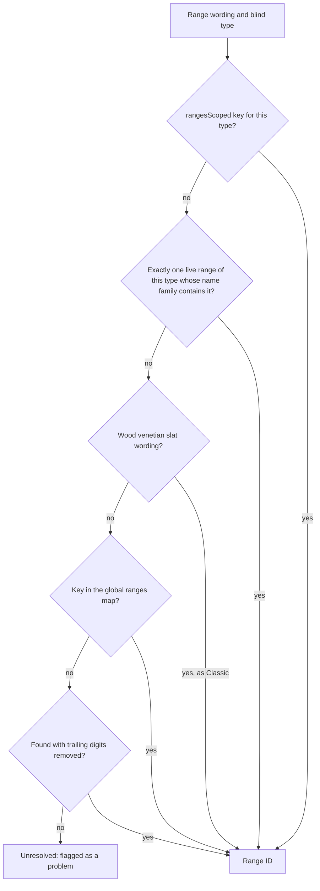

# Mappings and catalogue

The converter turns names into BlindIQ IDs through one object, the mappings: dealer-wording dictionaries plus a copy of BlindIQ's own catalogue (names, links between types, ranges, colours and fixes, option sheets, retired flags). It is stored in the Firestore collection `orderbot_biq_mappings`. This page describes every category and its shape, how resolution works, where the catalogue comes from, and the risks of importing it.

## Source of truth: BlindIQ's database

BlindIQ's SQL Server database is the source of truth for anything BlindIQ defines: its IDs, names, which ranges belong to which type, which colours and fixes a range offers, the option sheets, and what is retired. The converter only holds a copy.

- **Regenerate, don't hand-edit.** When BlindIQ's catalogue changes, run the read-only SQL extract again, generate a fresh import file from it, and load it with the mapping manager's **Import mappings file**. Don't edit catalogue data in Firestore or type it into the mapping manager. The extract scripts and the generated files live outside this repository (see [Runbooks](../operations/runbooks.md)).
- **What the mapping manager is for.** Dealer wording that isn't a BlindIQ name ("Wood 50", "System 40", a dealer's spelling of a customer), and the customer accounts. Even there an ID must be a real BlindIQ record: the manager refuses one the catalogue doesn't have (`biqCatalogueHasId`).
- **Why.** The first mappings were a snapshot taken before BlindIQ's December 2025 to January 2026 catalogue clean-up, in which retired types got a "Z " prefix and were hidden, and the "Element …" products took the classic names. That drift caused every phantom-option and wrong-ID incident of August 2026. On 7 August 2026 the mappings were rebuilt from a SQL extract. The 9 October 2026 refresh (`biq-catalogue-refresh-2026-10-09.json`) added the linkage and retirement categories.

## How it's stored and loaded

| Aspect | Detail |
|---|---|
| Collection | `orderbot_biq_mappings` |
| Documents | One per category, with the category name as the ID (`blindTypes`, `sundries`…). A category larger than about 700,000 characters (`SHARD_LIMIT`; a Firestore document holds about 1 MB) continues in `<category>__2`, `<category>__3`… |
| Document fields | `json` (the category object as a JSON string), `shards` (how many documents the category uses), `updatedAt` (ISO time) |
| Loading (`loadMappings`) | Start from a deep copy of `BIQ_SEED_MAPPINGS`, then merge every document into its category with `Object.assign`. The base name before `__` decides the category, so any category in Firestore is loaded, declared or not. An empty collection is seeded from `BIQ_SEED_MAPPINGS` (in admin mode). |
| Live sync | An `onSnapshot` listener merges every changed document the same way, then re-renders and re-runs the open order's pipeline. |
| Writing (`saveCategory`) | Admin mode only; capture sessions never write. It rewrites the whole category, sharded, and empties stale higher shards. A "shrink guard" first re-reads the stored documents: if this tab is missing more than 20 keys and more than 25% of them (a partial load), it adopts them before saving. |
| Related collection | `orderbot_customer_formats`, one document `all` with `json` and `updatedAt`: the per-customer format profiles (`biqLearnFormat`, `biqApplyFormatProfile`) |

Writes are gated by the converter's admin mode, a browser setting (`biq_admin`) rather than a security control. How Firestore itself is protected is covered in [Security](../security.md).

## Category reference

The categories declared in `BIQ_SEED_MAPPINGS` and `BIQ_MAPPING_CATEGORIES` (the mapping manager's tabs, both in `js/biq-converter.js`), plus the name tables the catalogue refresh brings with it. Keys of name dictionaries are lower case (`biqLc`). IDs are numbers; `-1` means "none" for fixes and controls.

### Name dictionaries (dealer wording → ID)

| Category | Shape | Used by | Manager tab |
|---|---|---|---|
| `blindTypes` | name → blind type ID | `biqResolve` (plus code aliases in `BIQ_ALIASES.blindTypes` and a "BD " prefix strip) | yes |
| `ranges` | name → range ID, for names that are unique across blind types | `biqResolveRange` (fallback), `biqRangeNamesFor` | yes |
| `rangesScoped` | `"<blindTypeId>\|<range name>"` → range ID | `biqResolveRange` (first), `biqScopedRangeFamily`, `biqTypeFormula`; AI matches are learned here | yes |
| `colours` | `"<range>\|<colour>"` → colour ID, or `"\|<colour>"` for a colour with no range | `biqResolveColour` | yes |
| `fixes` | name → fix ID (`none` → -1) | `biqResolve` (plus `BIQ_ALIASES.fixes`) | yes |
| `control1`, `control2` | name → control ID (`none` → -1) | `biqResolve`, `biqResolveControlScoped` | yes |
| `deliveryMethods`, `packingTypes` | name → ID | `biqResolve`, header problems | yes |
| `fabricSplits` | combined fabric → `{ range, colour }` | `biqSplitFabric` (checked first); written by the fabric-split dialog | no |

### Customers

`customers` maps a dealer name to its BlindIQ account: `{ customer, address, operator }` (customer, delivery address and operator IDs), optionally with `dm` and `pt` (default delivery method and packing type, from BlindIQ's customer address table) and `ops` (`[[operatorId, name], …]` for the operator picker). A second spelling of the same dealer is stored as a pointer, `{ alias: "<canonical key>" }`, so there is one record per account. The book holds about 9,000 names, so it is sharded.

`biqResolveCustomer` follows an alias to the canonical record. `biqSuggestCustomer` offers a match only when stripping legal suffixes ("(Pty) Ltd", "cc", "t/a …") and plurals leaves exactly one candidate, and even then only as a suggestion: the customer decides who is billed, so a near miss is never auto-matched and the AI never matches customers. `biqCanonicalCustomerName` gives the name the order is rewritten to.

### Catalogue names (from the catalogue refresh)

Not declared in `BIQ_SEED_MAPPINGS` and not manager tabs; they arrive with the import file. (`sundryNames` is the same kind of table for sundries; see [Sundries](#sundries).)

| Category | Shape | Used by |
|---|---|---|
| `blindTypeNames`, `rangeNames`, `colourNames`, `fixNames`, `controlNames` | ID → BlindIQ's name | `biqCanonicalize`, `biqCatalogueHasId`, name-based rules (for example `/^roller system (40\|55)$/`) |

### Catalogue links and status (from the catalogue refresh)

Declared empty in `BIQ_SEED_MAPPINGS` and not manager tabs. Every rule that reads them stays silent until they are imported.

| Category | Shape | BlindIQ source (per `CLAUDE.md` and code comments) | Used by |
|---|---|---|---|
| `rangeColours` | range ID → `[colour IDs]`; `[]` = the range takes no colour | `Relate_Range_Colours` | `biqRangeColourIds`, `biqResolveColour`, `biqRangesWithColour`, `biqRemapRetiredRanges` |
| `rangeFixes` | range ID → `[fix IDs]`; `[]` = no item fix | `Relate_Range_Fixes` | `biqRangeFixIds`, `biqRepairTopFix`, `biqPerfectFitFix`, problems |
| `rangeBlindType` | range ID → blind type ID | `BlindRanges.BR_BlindType_Link` | `biqCatalogueHasId` (ranges), scoping, problems |
| `blindTypeHidden`, `rangeHidden`, `colourHidden` | ID → 1 (retired) or 0 | `BT_Hidden`, `BR_Hidden`, `CO_Hidden` | retired-item problems, live-range lists |
| `sundryInactive` | sundry ID → 1 (inactive) or 0 | `Sundries.SY_Active` | `biqMotorSundryView`, `biqOrderableSundryView`, problems |
| `sizeWarnings` | blind type ID → `[{ dim, op, level, v, msg }]` (`dim` `'w'` or `'d'`, `op` `'lt'` or `'gt'`) | BlindTypes size columns and `SizeWarnings` | `biqSizeWarnings` |
| `controlsScoped` | `"<typeId>"` or `"<typeId>\|<rangeId>"` → `[control IDs]` or `{ c1: [...], c2: [...] }` | `Range_Controls` | `biqControlAllowed`, `biqAllowedControlNames`, `biqResolveControlScoped` |
| `fixesScoped` | declared, empty | — | nothing reads it |

### Option sheets and formulas

| Category | Shape | Used by | Manager tab |
|---|---|---|---|
| `variantSheetIndex` | `"<typeId>\|<rangeId>"` → matrix (sheet) ID | `biqVariantSpec`, double roller sheets, live-range lists | yes (view) |
| `variantTemplateSheets` | matrix ID → `[{ k, values, def, req }]` | `biqVariantSpec` | yes (view) |
| `variantTemplates` | blind type ID → `[{ k, values, def, req }]`, the union over the type's ranges | `biqVariantSpec` fallback | yes (view) |
| `rangeFormulas` | range ID → control-drop formula ("[drop]*0.75", "[drop]*0.66", "[drop]-N", a number, "0") | `biqComputeControlDropV2`, `biqTypeFormula` | yes (view) |

In an option spec entry, `k` is BlindIQ's option key, spelt exactly as BlindIQ has it (some carry odd spacing, such as the retired Roller System 40's `Intermediate/Coupled  Bracket`, with two spaces). `values` lists the allowed values (`[]` means free text), `def` is the sheet default and `req` marks a required option. These source tables come from BlindIQ's `MatrixTriggers` and `Matrix_Price_NN` sheets. They show as manager tabs only for viewing: the tab's Add row stores a number, which is the wrong shape for them.

### Sundries

| Category | Shape | Used by |
|---|---|---|
| `sundries` | name or stock code (lower case) → `{ sundry, type }` | `biqResolveSundry`, `biqFuzzySundry`, the sundry views |
| `sundryTypes` | type name → sundry type ID; the code looks up the seven motor type names and `components motor` (13 when absent) | `biqMotorSundryView`, `biqOrderableSundryView` |
| `sundryNames` | sundry ID → BlindIQ's name | sundry notes (`biqAddMotorSundry`, `biqCanonicalize`), `biqExportSundryNotes` |

`sundries` values must be objects. An import file with plain numbers breaks the type filter in `biqMotorSundryView`.

## How resolution works

Every function takes the mappings object first. The name resolvers (`biqResolve`, `biqResolveRange`, `biqResolveColour`, `biqResolveControlScoped`) return `{ id, known }`, plus flags such as `empty`, `alias`, `scoped` or `bogus`; the sundry lookups return `{ sundry, type }`.

| Function | Order of attempts |
|---|---|
| `biqResolve(mappings, cat, name)` | 1. the exact key; 2. a code alias (`BIQ_ALIASES`, for blind types and fixes); 3. for blind types, the name without a leading "BD ". For blind types, fixes and controls an ID that isn't a BlindIQ record is skipped and returned as `bogus`. |
| `biqResolveRange(mappings, blindType, range)` | See the diagram below. A range is always tried within the blind type first, because BlindIQ repeats range names across types ("Sheerweave 4500" exists 12 times). |
| `biqResolveColour(mappings, range, colour, blindType)` | 1. `"range\|colour"`; 2. within the range's own colour list (`rangeColours` + `colourNames`): the exact name, a unique match ignoring spaces and dashes, then a unique match without the roll-width suffix ("Argent Gold" = "Argent Gold 2050mm @", a live colour winning over a retired twin); 3. `"\|colour"`; 4. a spacing-insensitive match that is unique in the whole map. When the range's list is known the result carries `onRange: true / false`. |
| `biqVariantSpec(mappings, blindType, range)` | The range's own sheet (`variantSheetIndex` → `variantTemplateSheets`), else the type's union template (`variantTemplates`), else `null`. Comma-joined value lists are split once per sheet (`biqSplitSpecValues`). `biqTemplateFor2` turns the spec into `[key, default]` pairs, with hard-coded templates (`biqTemplateFor`) as the last resort. |
| `biqResolveControlScoped(mappings, side, name, blindType, range)` | `biqResolve`, then swaps a twin record for the ID the range's control list holds. |
| `biqFuzzySundry(mappings, text)` | The exact key, then the key + " #", then every word of the text found in a catalogue key. Single digits and letters are matched as whole tokens; longer tokens as substrings. Several keys naming one item count as one; otherwise the plainest match wins, except between colour variants. A second pass canonicalises spellings. Several hits with no winner are `{ ambiguous }`. |
| `biqMotorSundryView(mappings)` | A view with only the sundries of the seven motor order types (`BIQ_MOTOR_ORDER_TYPES`) that are active. Falls back to everything when `sundryTypes` isn't loaded. |
| `biqOrderableSundryView(mappings)` | Every active sundry except type 13 "components motor" factory records; used for every non-motor lookup. |
| `biqCatalogueHasId(mappings, cat, id)` | `true` / `false` against the catalogue's ID tables (`BIQ_ID_TABLES`: ranges → `rangeBlindType`, blind types → `blindTypeNames`, fixes → `fixNames`, controls → `controlNames`, colours → `colourNames`), or `null` when that table isn't imported (then nothing is checked). |

A caveat on `biqFuzzySundry`: because tokens of two or more characters match as substrings, "30" also matches inside "3nm/30". The 12 October 2026 code review gives "Sonesse 30 RTS 3Nm/30" resolving to "Sonesse 40 Rts 3nm/30" as an example of the wrong part being picked when the right one isn't in the view.

How `biqResolveRange` tries a range:

In `biqResolveRange`:

- The "name family" step (`biqScopedRangeFamily`) finds "5 Screen" on Roller System 55 as its own "5 Screen / Aventus 5%". It never uses a retired range.
- The wood venetian step (`biqWoodRangeWording`) is skipped when the global map holds a real range of this type for the wording, because a deliberate mapping wins.
- The trailing-digits step handles names like "Duo Screen40".
- At every step an ID that isn't a BlindIQ range is skipped (the next way is tried) and reported in `bogus`. `biqCollectWarnings` names each such mapping once per order so an admin can delete it.

Other lookups built on the same data:

- `biqRangesWithColour`: the live, orderable ranges of a type that carry a colour.
- `biqInferRangeFromColour`: the range from the colour.
- `biqCatalogueLookups`: the live ranges and ranges-for-colour lists the comparison's rule checks use, through `biqComparisonCatalogue`.
- `biqExtractionVocabulary`: the live types and ranges listed in the AI extraction prompt.

## Bad IDs

The mapping manager's ID box once accepted any number. On 14 October 2026 the live mappings held placeholders: ranges "wood 50" and "bd urban shutter" → 8888, "cotton white" → 7777, and a blind type → 8888. "Wood 50" → 8888 went out on 61 wood venetian lines of 19 orders. Since then:

- the blind type, range, fix and control resolvers skip an ID that `biqCatalogueHasId` says isn't a BlindIQ record, and `biqCollectWarnings` names the mapping;
- the manager marks such entries "not in BlindIQ" and refuses an unknown ID in the assign dialog, the Add row and bulk paste (`biqIdProblem` in the UI module);
- consequence: a brand-new BlindIQ item needs a fresh catalogue import before it can be mapped by ID.

## Retired ("Z ") items

BlindIQ retires an item by hiding it, and retired blind types were also renamed with a "Z " prefix. The converter handles them like this:

| Situation | What happens | Where |
|---|---|---|
| Retired blind type | Problem; when the name without "Z " resolves to a live type, the message names it | `biqCollectProblems` (`blindTypeHidden`) |
| Retired range or colour | Problem | `biqCollectProblems` (`rangeHidden`, `colourHidden`) |
| Retired range, or a colour its live range no longer carries, with exactly one twin "<range> <colour>" on the type's live "Discontinued" range | Moved there, noted "(confirm stock)", amber heads-up | `biqRemapRetiredRanges` |
| Inactive sundry | Excluded from the motor and orderable sundry views the converter's own lookups use; a problem if it is on a line | `biqOrderableSundryView`, `biqMotorSundryView`, `biqCollectProblems` |
| Lookups and prompts | Retired ranges are never offered: not as a name-family match, not to the AI, not in live-range lists; "Discontinued…" ranges aren't offered to the AI either | `biqScopedRangeFamily`, `biqExtractionVocabulary`, `biqRangesWithColour`, `biqCatalogueLookups` |
| Name-based rules | Accept the "Z " prefix (for example `^(z\s+)?wood venetian$`) | `biqWoodRangeWording`, `biqVenetianValSize` |

Retired types keep their IDs in `BIQ_TYPE_OF_BLIND_BY_ID` (for example 5, the retired Roller System 40), so a valance ordered with one still gets the right "Type of Blind".

## Importing a mappings file

**Import mappings file** (`importMappingsFile`, admin only) reads a JSON object of `{ "<category>": { … }, … }`. For each category whose value is an object it does `Object.assign` into the loaded category and saves the whole category. **Export mappings file** writes the whole loaded object as `BlindIQ_mappings_<date>.json`.

**Semantics: merge per category, nothing deleted.** A key in the file replaces the same key; a key not in the file stays.

**Risks:**

- **Stale data survives.** An item BlindIQ deleted, a range moved to another type, a matrix sheet withdrawn: the old entry stays until someone removes it. Only categories with a manager tab have a delete button.
- **An old file reverts the catalogue.** A code review on 12 October 2026 found that re-importing the June 2026 export would map Roller System 40 back to 5 (the retired type) and Wood Venetian to 1, its old ID.
- **Imports overwrite learned entries.** A file's value for a key replaces an admin's mapping or an AI-learned alias for the same key.
- **Shapes aren't validated.** A malformed category (plain numbers in `sundries`, a missing link table) silently changes or disables rules. Many checks stay silent when their category is empty, so a partial import looks fine. Import the categories of an extract together.
- **No history or undo.** Export the current mappings before an import, so you can restore them.
- **Deletions don't reach open tabs.** From the code: live sync merges changed documents into each open tab and never removes keys, so a key deleted on one PC stays in another tab's memory until it is reloaded. A save from that tab writes the deleted key back. Reload other open converter tabs after deleting mappings.

The repository's `data/designer-aliases.json` (a `rangesScoped` import file) and `data/sundry-names.json` (a bare ID → name table) aren't read by any code. Unverified: whether they are still needed.

## Caches on the mappings object

To stay fast, the core caches lookup indexes on the mappings object as non-enumerable properties, so they never reach an export or Firestore:

| Property | Built by | Rebuilt when |
|---|---|---|
| `_rangeFamilyIdx` | `biqScopedRangeFamily` | the number of keys in `rangesScoped`, `rangeHidden` or `rangeBlindType` changes |
| `_colourRangeIdx` | `biqRangesWithColour` | the number of keys in `rangeColours`, `rangeBlindType`, `rangeHidden` or `variantSheetIndex` changes |
| `_drSheets` | double roller rules | key counts change, or a referenced sheet, name or hidden flag changes |
| `_orderableSundries` | `biqOrderableSundryView` | the number of sundries or inactive flags changes |
| `_colourSquash` | `biqResolveColour` | never: built once per mappings object |
| `_custIdx` | `biqSuggestCustomer` | never: built once per mappings object |

Signatures based on key counts miss a change that keeps the counts equal, and the last two are never rebuilt. In practice a mapping change during a session can take a page reload to reach these lookups. Option specs are also cached per sheet array in a module-level `WeakMap` (`BIQ_SPEC_SPLIT`), which a new import replaces naturally.

## IDs hard-coded in the code

Most rules work by name, but a few BlindIQ IDs are written into the code. If BlindIQ ever renumbers them, these places need changing:

| ID | Meaning | Where |
|---|---|---|
| 14, 27 | The two valance products (`CLAUDE.md` calls 27 "Z Valance"; code comments call it "Element Valance") | `biqGenerateXML`, `biqCollectProblems`, `biqNormalizeBdPo` |
| 13, 17, 18, 20 | Curtain tracks (no drop) | as above |
| 28 | Double Roller Blind | `BIQ_DR_TYPE_ID`, `biqBdpoDoubleRoller` |
| 24 | Wood Venetian, when the name tables aren't loaded | `biqWoodRangeWording` |
| 32 and its control IDs | Cellular Free Hang control matrix seed | `BIQ_CONTROLS_SCOPED_SEED` |
| 13 (sundry type) | Components Motor, when `sundryTypes` doesn't name it | `biqOrderableSundryView`, `biqCollectProblems` |
| Parent type IDs | Valance "Type of Blind" vocabulary | `BIQ_TYPE_OF_BLIND_BY_ID` |
| 1 | Supplier on every line | `biqGenerateXML` |

## Related pages

- [Converter overview](overview.md)
- [Converter rules](rules.md)
- [Dealer formats](dealer-formats.md)
- [Converter user interface](user-interface.md)
- [Data model](../data-model.md)
- [Security](../security.md)
- [Runbooks](../operations/runbooks.md)
- [Known issues and roadmap](../known-issues-and-roadmap.md)
- [Glossary](../glossary.md)
