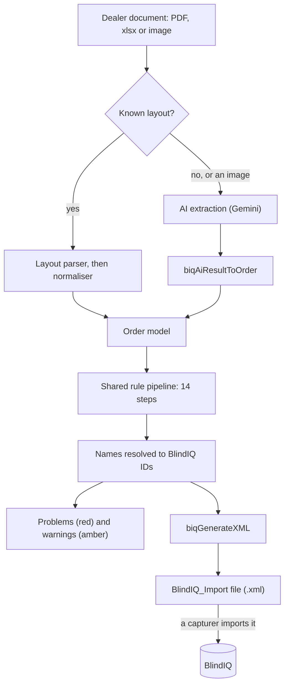

# BlindIQ XML converter: overview

The BlindIQ XML converter turns a dealer's order document (a PDF, a spreadsheet or a photo) into a BlindIQ order, applies Blind Designs' rules to it, resolves every name to a BlindIQ ID and writes the XML file that BlindIQ's importer reads. This page explains the stages, the order model the code works on, and the conventions every rule follows; the layouts, rules, mappings and XML each have their own page.

In the app the converter is the collapsible "BlindIQ XML converter" section of the Orders view. `CLAUDE.md` still calls it "the Drawings tab"; the Drawings view is now the bend & blind visualiser, which is unrelated.

## Where the code lives

| File | What it holds |
|---|---|
| `js/biq-converter.js` | The core, about 6,500 lines. It imports nothing. Helpers, the seed mappings, name-to-ID resolution, one parser and one normaliser per dealer layout, the AI extraction prompt and schema, the business rules, `biqCollectProblems` and `biqCollectWarnings`, `biqGenerateXML`, the bridge to the comparison's validations, the AI name-matching helpers and the per-customer format learner. |
| `js/biq-form-specs.js` | `BIQ_FORM_SPECS`, the field names of Blind Designs' four fillable PDF order forms (generated from the blank forms; don't hand-edit the field names), and its interpreter: `biqDetectForm`, `biqParseSpecForm`, `biqElementGridOptions`. It imports a few helpers from the core. |
| `js/biq-converter-ui.js` | The browser side: file intake and layout detection (`biqDetectXlsx`, `biqDetectPdf`), the two AI calls, the editor and its `refresh()`, the mappings manager and every Firestore read and write, plus two exports the comparison uses (`biqReadCustomerFile`, `biqComparisonCatalogue`). See [Converter user interface](user-interface.md). |
| `index.html` | Loads SheetJS and pdf.js from cdnjs, holds the empty `#biq-converter-section`, and calls `initBiqConverter(deps)` with Firebase, the proxy URL, the two model names and the page's validation helpers. |

`js/biq-converter.js` reads top to bottom in this order (its section comments):

1. Tiny helpers, seed mappings, mapping resolution.
2. The order model, fabric splitting and double rollers.
3. PARSERS: Blind Guys, Mathéo, TBD purchase order, BlindIQ Online, BD order form, Lifestyle, Curtain & Blind Workshop, TBD ordering software, valance staging, the printable preview.
4. AI EXTRACTION.
5. VALIDATION + XML GENERATION: customers, size warnings, problems, warnings, the XML and the TBD note filters.
6. ORDERBOT BRIDGE and AI DISCERNMENT.
7. SHUTTER CONFIGURATION + OPTION DEFAULTS, including Perfect Fit and Out of Warranty.
8. CONTROL INFERENCE, control availability and side conventions, shared brackets.
9. Per-customer FORMAT PROFILES, then `biqCanonicalize`.

## How an order flows

The pipeline, the problems and the XML are recomputed on every edit, so the screen always shows what the file would contain.

## Stage 1: reading the file

`handleFiles` in `js/biq-converter-ui.js` dispatches on the file extension. Only the first dropped file is read.

| Extension | What happens |
|---|---|
| `.xlsx`, `.xls` | `biqDetectXlsx` reads the first sheet with SheetJS as rows (`header: 1`) and tries the Blind Guys workbook parser. No match: a toast, then the AI path. |
| `.pdf` | `biqDetectPdf` (below). No match: the AI path. |
| `.png`, `.jpg`, `.jpeg`, `.tif`, `.tiff`, `.bmp`, `.webp` | Straight to the AI path. |
| anything else | "Unsupported file type" toast. |

`biqDetectPdf` works in two passes with pdf.js:

1. **Form fields.** It collects every AcroForm field (`getAnnotations`) from every page. With 3 or more filled fields it tries Blind Designs' own forms: `biqDetectForm` recognises the curtain, outdoor and shutter forms (read by `biqParseSpecForm`); anything else goes to the Element form reader (`biqParseBDFields` plus `biqNormalizeBDForm`).
2. **Text with positions.** It collects `getTextContent` items from every page as `{ s, x, y, w }` (text, position, width). Each page's `y` is shifted down by 10,000 per page so the pages stay in reading order. With more than 40 non-space characters it tries the text layouts in a fixed order; the first that recognises the document wins. The order and each layout's signature are in [Dealer formats](dealer-formats.md).

Three text layouts must also pass a coherence check before they are trusted: the TBD ordering software and the Blind Guys workbook printed to PDF (`biqTbdCoherent`: most lines have a width and a blind type that resolves), and Curtain & Blind Workshop (`biqCnbwCoherent`: most lines have a width and a fix that resolves). A layout that maps badly goes to the AI instead of producing confident but wrong data.

The AI path (`aiExtract` in the UI module) sends the file to Gemini with a prompt built by `biqBuildExtractionPrompt` and the schema `BIQ_EXTRACTION_SCHEMA`, and turns the JSON answer into the order model with `biqAiResultToOrder`. See [AI in the converter](#ai-in-the-converter).

The comparison reads customer files through the same detection: `biqReadCustomerFile` calls `biqDetectXlsx` / `biqDetectPdf`, never the AI, and returns `null` for images and unrecognised layouts. See [Converter reading and AI context](../comparison/ai-context.md).

## Stage 2: parsing and normalising

Every deterministic layout has two functions:

- **`biqParse<Layout>`** works on the raw input (text items, rows or form fields) and returns layout-shaped rows and header metadata, or `null` when the document isn't that layout. Parsers know about columns, page furniture and wrapped cells, nothing about BlindIQ.
- **`biqNormalize<Layout>(mappings, parsed)`** builds the order model: it fills the fields, builds each line's options from the BlindIQ option sheet (`biqTemplateFor2`), works out the control drop (`biqComputeControlDropV2`), and calls shared helpers such as `biqSplitFabric`, `biqAddMotorSundry`, `biqStageInlineValances` / `biqExpandValances` and `biqMergeDoubleRollerRows`. It sets `order.source` to the layout's identifier (for example `'matheo'` or `'bdpo'`).

Layout-specific knowledge stays in the normaliser. Anything that is true whatever the layout belongs in the shared pipeline.

## Stage 3: the shared rule pipeline

Every order, whichever way it was read, then goes through the same 14 steps. In the editor they run in `refresh()`; for the comparison's converter reading they run in `biqRunRulePipeline` (both in `js/biq-converter-ui.js`). Most steps call further rules; the [Converter rules](rules.md) page lists them by subject.

| # | Step | What it does |
|---|---|---|
| 1 | `biqStampOriginals` | Snapshots the dealer's wording (`_orig`) once, before anything rewrites it. |
| 2 | `biqReSplitFabrics` | Splits a combined fabric ("5 Screen Charcoal Grey") into range and colour, or reads it as a colour-only fabric; then `biqInferRangeFromColour`, `biqRemapRetiredRanges` and `biqApplyDoubleRollers`. |
| 3 | `biqRecomputeControlDrops` | Rounds sizes to 5 mm steps once (`biqRoundSizes`) and recomputes automatic control drops. |
| 4 | `biqAssignSundryCodes` | Gives sundry lines without a code the next item code. |
| 5 | `biqApplyCustomerDefaults` | Canonical customer name, the customer's default delivery method and packing type, courier means Boxed. |
| 6 | `biqApplyShutterConfig` | Reads a shutter configuration string ("LTLTRTR") into a range and a note. |
| 7 | `biqFoldOptionSynonyms` | Moves dealer option names onto BlindIQ's keys and values; then `biqFoldCassette`, `biqCassetteFromNotes` (AI readings) and `biqApplyHardwareColours`. |
| 8 | `biqApplyBracketPairs` | Intermediate and coupled brackets: options on the type's own key, pairing, partners, costing. |
| 9 | `biqApplyOptionDefaults` | Perfect Fit, Top fix, Out of Warranty, standard values and option defaults. |
| 10 | `biqNormalizeControlSides` | Re-encodes controls in the convention of the line's type and range. |
| 11 | `biqInferControls` | Venetian operation, One Touch Dual, motorised double rollers, then the pin opposite a single drive. |
| 12 | `biqApplyControlMatrix` | Replaces an illegal control with BlindIQ's only legal value for that side, or with the only manual drive family it allows there. |
| 13 | `biqApplyFormatProfile` | Fills still-unresolved fields from this customer's learned format profile. |
| 14 | `biqCanonicalize` | Rewrites every name that resolves into BlindIQ's own spelling, and resolved sundries' notes into BlindIQ's sundry name. |

**Keep `refresh()` and `biqRunRulePipeline` in step.** The two lists must name the same steps in the same order (the comment on `biqRunRulePipeline` says so). If they drift, the comparison's AI is told something different from what the capturer sees in the editor. When you add a step, add it to both and to the regression tests.

Three properties follow from running on every edit:

- **Every step must be idempotent.** `refresh()` runs after each change (header edits are debounced by 350 ms), and again when another PC changes the mappings. Running the pipeline twice must give the same order as running it once.
- **No step may fight the capturer.** See [Decided once per line](#decided-once-per-line-the-capturers-value-wins).
- **Order matters, and one pass doesn't always settle.** For example `biqApplyFormatProfile` (step 13) runs after `biqApplyOptionDefaults` (step 9), so a blind type filled from a profile only gets its option defaults on the next run. The editor runs again on the next change; `biqRunRulePipeline` runs once.

`biqGenerateXML` itself also calls `biqAssignSundryCodes` and `biqApplyCustomerDefaults`, so generating the XML can change the order it is given.

## Stage 4: resolving names to BlindIQ IDs

The order model holds names, never IDs. Names are resolved against the mappings (Firestore `orderbot_biq_mappings` merged over `BIQ_SEED_MAPPINGS`) whenever an ID is needed:

| What | Function |
|---|---|
| Blind type, fix, Control 1, Control 2, delivery method, packing type | `biqResolve(mappings, category, name)` |
| Range (scoped to the blind type first) | `biqResolveRange(mappings, blindType, range)` |
| Colour (within the range's own list first) | `biqResolveColour(mappings, range, colour, blindType)` |
| Control ID to export (twin records) | `biqResolveControlScoped` |
| Customer account | `biqResolveCustomer` |
| Option sheet of a line | `biqVariantSpec(mappings, blindType, range)` |
| Sundries | `biqResolveSundry`, `biqFuzzySundry`, `biqAddMotorSundry` |

A name that doesn't resolve stays as the dealer wrote it, is flagged, and goes into the XML as an empty link: the converter never invents an ID. Once a name resolves, `biqCanonicalize` replaces it with BlindIQ's own spelling. Details, including how BlindIQ's catalogue gets into the mappings, are in [Mappings and catalogue](mappings-and-catalogue.md).

## Stage 5: problems and warnings

| | `biqCollectProblems(mappings, order)` | `biqCollectWarnings(mappings, order)` |
|---|---|---|
| Shown as | Red list: "things to fix before this order is import-ready" | Amber "BlindIQ heads-ups" |
| Meaning | The XML would be wrong or incomplete. For example: an unmapped name, a retired type, range or colour, a range that belongs to another blind type, a colour or fix the range doesn't offer, a control the type and range don't allow, a required option missing, an option value that will not import (`biqDroppedVariants`), an unpaired bracket, a valance still waiting for its own line, a missing or invalid width, drop or quantity, a size BlindIQ says can't be made, an empty customer, order number, delivery method or packing type, a sundry without IDs or one that is inactive or a factory component | Worth a look but not wrong. For example: BlindIQ's advisory size limits, a mapping whose ID isn't a BlindIQ record (ignored), a retired colour moved to its Discontinued twin, a converter-chosen intermediate partner, an Upgrade Mechanism request not applied, a narrow, long roller, double roller fabric, roll type and motor decisions |
| Each entry | `{ t }` text, plus `cat` / `name` (a "map it now" link) or `split` (a "split it now" link) | `{ t, sev: 'warn' }` |
| Blocks the download? | No | No |
| Blocks the server automation? | Yes, per the code comment on `biqCollectWarnings` and `CLAUDE.md` | No |

The browser never blocks the download: `downloadXML` always writes the file, and capturers finish unknowns in BlindIQ. The June 2026 server automation (outside this repo) treats every problem as blocking, which is why a heads-up must never be added to `biqCollectProblems`. See [XML export](xml-export.md#what-stops-an-export).

## Stage 6: the XML

`biqGenerateXML(mappings, order)` writes a `BlindIQExport_CO` document: one `CustomerOrders` header, one `CustomerOrderItems` element per line and one `CustomerOrderSundries` element per sundry. Options go through `biqEmittedVariants`, and TBD purchase orders have their notes filtered. See [XML export](xml-export.md).

## Optional: torque and spec checks

The "Run torque & spec checks" button (`runChecks` in the UI module) wraps the order with `biqToComparisonShape`, runs the comparison's `runPostAIValidations` (fabric, colour, control, chain, torque and motor checks) on it with the fabric, motor and tube property tables, and pulls the flags back onto the lines with `biqExtractCheckResults`. Nothing in the order changes. See [Validations](../comparison/validations.md).

## The order model

Every layout and the AI produce the same plain object. All values are strings (`qty: '1'`, `width: '1200'`), notes are fragments joined by `' | '`, and options are an array of `[key, value]` pairs in the order BlindIQ's option sheet lists them.

### Order

Created by `biqBlankOrder()`.

| Field | Meaning |
|---|---|
| `source`, `sourceDesc` | Layout identifier (`'manual'`, `'blindguys'`, `'matheo'`, `'bdpo'`, `'biqonline'`, `'bdform'`, `'lifestyle'`, `'cnbw'`, `'tbd'`, `'ai'`) and a human label for the badge |
| `customer` | The dealer (BlindIQ customer account) as written; rewritten to the canonical account name once it resolves |
| `orderNumber`, `client` | The dealer's order reference, and the end client or job |
| `orderDate`, `requiredDate` | ISO dates (`biqParseDate`) |
| `deliveryMethod`, `packingType`, `address` | Delivery header; the address may be multi-line |
| `notes` | Order notes |
| `orderId` | `'0'`; BlindIQ assigns the real ID on import |
| `items`, `sundries` | Blind lines and sundry lines |
| `exact`, `iqLinkId` | BlindIQ Online exports only: the order is taken as printed |

### Item (one blind line)

Created by `biqBlankItem(code)`.

| Field | Meaning |
|---|---|
| `code` | Item letter or number ("a", "0001") |
| `qty`, `location` | Quantity and room or window |
| `blindType`, `range`, `colour` | Names, resolved to IDs at export |
| `width`, `drop` | Millimetres |
| `fix` | Fix name (Reveal, Face, Gasket 18mm, …) |
| `control1`, `control2` | BlindIQ's Control 1 and Control 2 names (see [Converter rules](rules.md#controls-and-drives) for the conventions) |
| `controlDrop` | Millimetres |
| `variants` | `[[key, value], …]`, the line's options |
| `notes` | Line notes for the factory and the capturer |
| `exactOptions` | BlindIQ Online only: the options printed on the order |

### Sundry (one part line)

`{ code, qty, type, sundry, notes }`: `type` is the BlindIQ sundry type ID, `sundry` the sundry ID (both strings, empty when unresolved), and `notes` BlindIQ's own name once resolved. `_src` keeps the dealer's wording, `_ai` an AI match, and `exactName` (BlindIQ Online) the printed name.

### Underscore fields

Fields starting with `_` are the converter's bookkeeping. They never reach the XML, but several decide what the rules do on the next run, so treat them as part of the model.

| Group | Fields (on the item unless noted) | Purpose |
|---|---|---|
| Original wording | `_orig`, `_origFabric`, `_origRange`; `_sourceText` on the order | What the dealer wrote before any rule. `_orig` is set once by `biqStampOriginals` and used by the format learner, the Perfect Fit rule, the double roller reader and the bogus-mapping warning. `_sourceText` (set by the UI) is the document text the format learner checks a correction against. |
| Staging set by parsers | `_valance`, `_valanceOnlyRow`, `_valanceLine`, `_autoWidth`, `_drTexts`, `_motorText`, `_drMotorText`, `_upgradeAsk`, `_bdpoGen`, `_cdNote`, `_bracketWith`, `_givenOpts`, `_sizeChecks` | Information a layout read that a later rule acts on. `_valance` holds a valance as `"Valance Key=Value"` strings until `biqExpandValances` places it; `_valanceLine` records where it went so it is never placed twice. `_bdpoGen` lists the notes the converter wrote from TBD's options, for the export filter. `_sizeChecks` holds amber messages. |
| Provenance markers | `_hwFromOrder`, `_hwFromCassette`, `_barToHardware`, `_valSizeStated` | The order stated this value (or deliberately left it out), so a default must not replace it. `_hwFromOrder` marks a hardware colour read off the order, even White. |
| Decided-once flags | `_sizeRounded`, `_opDecided`, `_dualDecided`, `_mechDecided`, `_trackDefaulted`, `_vControlDecided`, `_cellWhite`, `_upgradeDecided`, `_valSizeDecided`, `_intPartnerDecided`, `_drMotorDecided`, `_drRead`, `_drCassNoteDecided`, `_rbcChecked`, `_scribe…` | Set the first time a rule decides a line, so it never decides again. |
| Signatures | `_oowSig`, `_railSig`, `_pfUfSig`, `_drRangeFor` | The inputs a rule last decided on; the rule decides again only when they change. |
| Converter-set values | `_cdAuto`, `_valSizeAuto`, `_oowAuto`, `_drMotorAuto`, `_drMotorNote`; `_ptAuto` on the order | The converter chose this value, so it may still follow its inputs or withdraw it. A value the capturer typed has no marker and is left alone. |
| Results read by problems and warnings | `_discontinued`, `_intPartnerOf`, `_drFabricCheck`, `_drRollCheck`, `_drMotorCheck`, `_bracketOdd`, `_bracketRole` | Shown as problems or warnings, or (`_bracketRole`) used to keep the control rules off a bracket pair. |
| AI matches | `_ai`, `_aiOrig` | Name-matching results per field, and the wording they replaced (see [AI in the converter](#ai-in-the-converter)). |
| Write-only markers | `_rangeInferred`, `_ctlInferred`, `_ctlConvention`, `_ctlMatrixed`, `_optDefaulted`, `_optCoerced`, `_cfgPanels`, `_tbdProduct`, `_colour2` | Set but not read anywhere in this repository. |

Parsers also put underscore keys on their raw rows (`_opts`, `_notes`, `_remark`, `_accessories`, `_hingeCfg`); those never reach the order model.

## Decided once per line: the capturer's value wins

Because the pipeline reruns on every edit, a rule that simply "sets X when Y" would overwrite the capturer's correction a moment later. Every rule that writes a value therefore uses one of these patterns:

1. **Fill only what is empty.** Most defaults set an option only when it has no value; an explicit value on the order always wins.
2. **Decide once.** A flag (`_mechDecided`, `_opDecided`, `_trackDefaulted`, …) is set the first time the rule looks at the line. Example: `biqApplyVenetianOperation` sets Split or Grouped by width once; a capturer's change afterwards stays.
3. **Decide again only when the inputs change.** A signature records the inputs. Example: Out of Warranty in `biqApplyOptionDefaults` stores `type|range|colour|width|drop` in `_oowSig`; while those don't change, a capturer's own tick or untick stays.
4. **Remember what the converter set.** An auto marker lets the converter keep its own value up to date without touching the capturer's. Examples: `_cdAuto` (the control drop is recomputed while it is the converter's; typing a control drop clears it), `_valSizeAuto` (a venetian valance width of blind width + 15 mm follows later width changes), `_oowAuto` (an automatic Out of Warranty tick is removed when the blind comes back within the limits).
5. **Respect what the order stated.** Provenance markers such as `_hwFromOrder` stop a default from replacing a stated value, even one that equals the default.

When you add a rule, decide which pattern it needs, note anything assumed on the line ("— confirm"), and put a doubtful decision in `biqCollectWarnings`, not in `biqCollectProblems`.

## A DOM-free core, and why it matters

`js/biq-converter.js` has no imports and doesn't touch `document`, `window`, `fetch`, `localStorage` or Firestore. Everything it needs is passed in: the mappings object, the order, and for the format learner the profiles. It is not strictly pure, though:

- it changes the order it is given in place (that is how the pipeline works);
- it caches lookup indexes on the mappings object as non-enumerable properties (`_rangeFamilyIdx`, `_colourRangeIdx`, `_drSheets`, `_orderableSundries`, `_colourSquash`, `_custIdx`; see [Mappings and catalogue](mappings-and-catalogue.md#caches-on-the-mappings-object));
- `biqLearnFormat` and `biqOrderPreviewHtml` read the clock.

Keeping DOM, network and storage out of it is what lets the same code run in four places:

- **The editor**, through `js/biq-converter-ui.js`.
- **The comparison**, through `biqReadCustomerFile` and `biqComparisonCatalogue`, so the AI is told the converter's reading in BlindIQ's names. See [Converter reading and AI context](../comparison/ai-context.md).
- **Node regression tests** (`biq-*.test.mjs` in `orderbot-tests.zip`, kept outside this repo because their fixtures are business data) and the replay analyses behind the rules. See [Testing](../testing.md).
- **The June 2026 server automation** (`convert-cli.mjs`, outside this repo). A code review of 12 October 2026 found it runs only 4 of the 14 pipeline steps and reads 3 of the 9 layouts, and recommended retiring it. Unverified from this repository.

Keep new code DOM-free. If a rule needs data, pass it in from the UI module as the mappings and profiles are.

## AI in the converter

The converter makes two Gemini calls, both from `js/biq-converter-ui.js` through the proxy (`PROXY_API_URL`). The core only builds the prompts and applies the answers.

| Call | Model constant | Prompt and schema | When | What happens to the answer |
|---|---|---|---|---|
| Extraction (`aiExtract`) | `EXTRACTION_MODEL` | `biqBuildExtractionPrompt` with the vocabulary from `biqExtractionVocabulary` (live blind types, their live ranges and their BlindIQ option names); `BIQ_EXTRACTION_SCHEMA`; the file as base64 inline data | An image, or a PDF or spreadsheet no layout recognised | `biqAiResultToOrder` builds the order; the pipeline then runs as for any layout |
| Name matching (`aiDiscern`) | `COMPARISON_MODEL` (falls back to `EXTRACTION_MODEL`) | `biqBuildDiscernPrompt` over the slots from `biqBuildDiscernment` (each unresolved name with a shortlist of real catalogue names); `BIQ_DISCERN_SCHEMA` | Automatically after any non-manual order loads with unresolved names, and from the "AI match names" button | `biqApplyDiscernment`: confidence 0.85 or more is applied and marked amber, 0.5 to 0.85 is offered as a suggestion, less is ignored |

Both make up to three attempts (extraction retries only on 429 and 5xx errors), and pin a low temperature only for pre-Gemini-3 models (`isGemini3`). The name-matching prompt tells the AI to pick only from each shortlist; a name it returns that isn't a catalogue name simply stays unresolved and flagged. The customer account is never AI-matched, because it decides who is billed. In admin mode, matches the capturer kept are saved as mappings when the XML is downloaded (`biqLearnFromAI`). See [AI models](../ai-models.md).

## Known limitations

- The AI path and the curtain, outdoor and shutter order form reader (`biqParseSpecForm`) take the first run of digits as a size, so "1 200" or "1,200" becomes 1.
- The XML escaping doesn't strip control characters, and sundry codes stop at "z". See [XML export](xml-export.md#known-gaps).
- The shared coupled-pair function (`biqApplyCoupledPair`) can lose a drive when it rewrites a pair whose sides aren't both stated. See [Dealer formats](dealer-formats.md#finish-logic-purchase-order-online-purchase-order).

The full list is in [Known issues and roadmap](../known-issues-and-roadmap.md).

## Related pages

- [Dealer formats](dealer-formats.md)
- [Converter rules](rules.md)
- [Mappings and catalogue](mappings-and-catalogue.md)
- [XML export](xml-export.md)
- [Converter user interface](user-interface.md)
- [Converter reading and AI context](../comparison/ai-context.md)
- [AI models](../ai-models.md)
- [Data model](../data-model.md)
- [Testing](../testing.md)
- [Glossary](../glossary.md)
