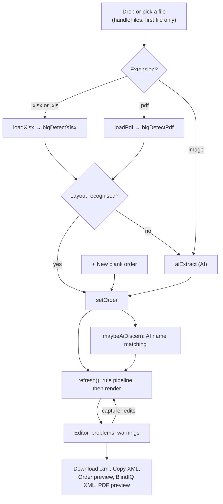
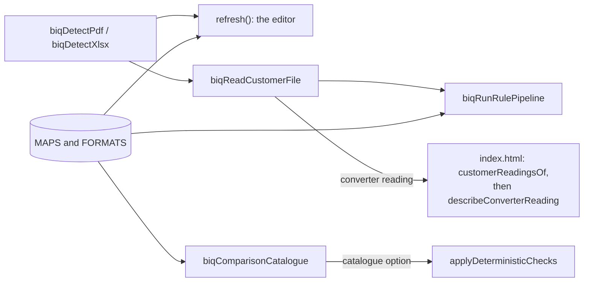

# Converter user interface

`js/biq-converter-ui.js` draws the BlindIQ XML converter: the collapsible "BlindIQ XML converter" card in the Orders view. It turns a customer's order file into an editable [BlindIQ](../glossary.md) order, shows what still needs fixing, and produces the XML that order capturers import into BlindIQ. It also holds the admin mapping tools, and it lends its file reading to the order comparison.

> **Naming.** `CLAUDE.md` and some code comments call this "the Drawings tab". Today the **Drawings** pill shows the Bend & Blind Visualiser, which comes from a separate repository (`bd-tools`). The converter is a section of the **Orders** view.

This page covers the screen, its state and its Firestore traffic. Parsing, rules, mappings and the XML format have their own pages: [overview](overview.md), [dealer formats](dealer-formats.md), [rules](rules.md), [mappings and catalogue](mappings-and-catalogue.md) and [XML export](xml-export.md). Trade and BlindIQ terms used here (dealer, range, sundry, control drop, catalogue refresh and so on) are defined in the [glossary](../glossary.md).

## Where it lives

| Piece | Where |
|---|---|
| Card and header | `index.html`: `#biq-converter-section`, with the header `#biq-converter-header` and an empty body `#biq-converter-content` |
| Open or closed | `index.html` → `setupCollapsible`, stored in `localStorage` as `ob_biq_open` |
| Everything inside the card | `js/biq-converter-ui.js` → `injectMarkup` writes it into `#biq-converter-content` |
| Dialogs | Added to `<body>` by `injectMarkup`: `#biq-assignmodal` (assign an ID), `#biq-fsplitmodal` (split a fabric), `#biq-mapmodal` (mappings manager), `#biq-copymodal` (copy options) |
| Styles | A `<style id="biq-css">` block in `<head>`. Class names start with `biq-`. |
| Converter core | `js/biq-converter.js` (no DOM code) and `js/biq-form-specs.js` |
| Libraries | The globals `XLSX` (SheetJS) and `pdfjsLib` (PDF.js). `index.html` loads both and sets the PDF.js worker. |

The page's collapsible fixes the card's `max-height` when it opens. `fitCollapsible` lifts that limit while the card is open, because the editor keeps growing.

## Start-up and injected dependencies

`index.html` calls `BiqUI.initBiqConverter(deps)` once, near the end of its module script, after Firebase has started. `initBiqConverter` keeps the dependencies in the module variable `D`, then runs `injectMarkup`, `bindEvents`, `loadMappings` and `loadFormats`. The last two are async and aren't awaited.

| Dependency | Used for |
|---|---|
| `db`, `collection`, `doc`, `getDocs`, `setDoc`, `onSnapshot` | Firestore: the mappings and the customer format profiles |
| `PROXY_API_URL`, `EXTRACTION_MODEL`, `COMPARISON_MODEL` | The two AI calls (see [AI from the converter](#ai-from-the-converter)) |
| `getFabricProperties`, `getMotorProperties`, `getTubeProperties`, `runPostAIValidations` | "Run torque & spec checks", which reuses the comparison's validations |
| `showToast` | Every message |
| `showConfirmModal` | Passed in but unused. The admin switch uses the browser's `confirm()`. |

Why inject them: the module imports nothing from Firebase or from `index.html`. The Firebase SDK's version and set-up stay in one place, `db` can be missing (the converter then runs on its built-in seed mappings and says so), and the module can be loaded with fakes in a test. The file's header comment states the rule: it "touches nothing outside its own section/modals".

Two guards protect against a browser that still holds an old copy of a file for a few minutes after a deploy:

- `index.html` imports this module as a namespace (`import * as BiqUI`) and checks that `BiqUI.biqReadCustomerFile` exists before calling it.
- This module imports the core twice: by name, and as the namespace `BiqConv`. Core functions added after October 2026 are looked up on `BiqConv` when they're needed: `biqParseBiqOnline`, `biqNormalizeBiqOnline`, `biqExportOrderNotes` and `biqExportItemNotes`.

A namespace import only survives a missing export. A syntax error in this module or in the core still stops the page's whole module script.

## Module state

| Variable | Holds |
|---|---|
| `D` | The injected dependencies |
| `MAPS` | The live mappings: a deep copy of `BIQ_SEED_MAPPINGS`, merged with every `orderbot_biq_mappings` document and kept current by `onSnapshot` |
| `FORMATS` | The per-customer format profiles from `orderbot_customer_formats/all` |
| `order` | The order being edited, in the shape of `biqBlankOrder` and `biqBlankItem`: header fields, `items` and `sundries` |
| `checkResults` | The last torque and spec check; reset to `null` when another order is loaded |
| `assignCtx`, `fsCtx`, `copySrc` | The context of the open assign, fabric-split and copy-options dialogs |
| `mapTab` | The mappings manager's current tab (starts at `blindTypes`) |
| `lastFileName`, `lastSourceText` | The file just read and its text, for "Send to mapping" and for format learning |
| `aiBusy`, `refTimer` | The AI-matching guard and the 350 ms refresh debounce |

`$` is `document.getElementById`, and `escH` is the HTML escaper.

## The flow

Any other file type gets a toast and nothing else happens.

### Layout detection

`biqDetectXlsx(buf)` and `biqDetectPdf(buf, fileName)` are shared by the editor (`loadXlsx`, `loadPdf`) and by the comparison (`biqReadCustomerFile`). They never call the AI. Each returns `{ order, format, sourceText }`, with `order` set to `null` when no layout matches.

Spreadsheets: SheetJS reads the first sheet, and the Blind Guys parser (`biqParseBlindGuysRows`, `biqNormalizeBlindGuys`) tries it. If it doesn't match, `loadXlsx` falls back to the AI with a toast.

PDFs are tried in this order, and the first match wins:

| Step | Test | Parser | `format` label |
|---|---|---|---|
| 1 | At least 3 filled form fields, and `biqDetectForm` names a form other than `element` | `biqParseSpecForm` | "order form (…)" |
| 2 | Filled form fields, when step 1 found nothing | `biqParseBDFields`, `biqNormalizeBDForm` (with `biqElementGridOptions`) | "Blind Designs order form" |
| 3 | The PDF has more than 40 characters of text (this test covers steps 3 to 9) | `biqParseMatheoItems`, `biqNormalizeMatheo` | "Mathéo order sheet" |
| 4 | | `biqParseBdPo`, `biqNormalizeBdPo`: Finish Logic purchase orders (TBD, Galaxy Blinds, any dealer) | "Blind Designs online purchase order" |
| 5 | | `BiqConv.biqParseBiqOnline`, `BiqConv.biqNormalizeBiqOnline` | "BlindIQ Online order" |
| 6 | | `biqBgPrintToRows`, then the Blind Guys parser; kept only if `biqTbdCoherent` agrees | "Blind Guys sheet (PDF)" |
| 7 | | `biqParseLifestyle`, `biqNormalizeLifestyle` | "Lifestyle order" |
| 8 | | `biqParseCnbw`, `biqNormalizeCnbw`; kept only if `biqCnbwCoherent` agrees | "Curtain & Blind Workshop order" |
| 9 | | `biqParseTbd`, `biqNormalizeTbd`; kept only if `biqTbdCoherent` agrees | "TBD order" |

If nothing matches, `loadPdf` sends the file to the AI without a toast. Step 4's toast still says "Blind Designs online purchase order"; the order's own source label reads "Finish Logic purchase order (<dealer>)". What each layout looks like is in [dealer-formats.md](dealer-formats.md).

The text of a recognised file goes into `lastSourceText`, and `setOrder` stores it on the order as `_sourceText`. For an AI read it's the AI's JSON. `biqLearnFormat` uses it so it only learns wording that was really on the document.

## The order editor

`setOrder(o)` makes `o` the current order, shows `#biq-editor`, fills the header (`renderHeader`) and runs `refresh()`. It then starts AI name matching (`maybeAiDiscern`), unless the order was typed in by hand (`source` is `manual`).

| Area | What it shows | Code |
|---|---|---|
| Source badge | Where the order came from (`sourceDesc`) | `renderHeader` |
| Header | Customer (the dealer), order number, order and required dates (with a "+14 days" button), delivery method, packing type, end client, BlindIQ order ID (0 means BlindIQ assigns one), address and notes. Tags for the customer, delivery method and packing type. | `renderHeader`, `readHeader`, `renderCustomerTag` |
| Blind items | One row per line: code, qty, location, blind type, range, colour, width, drop, fix, Control L, Control R and control drop. A tag under each catalogue field, and an "opts" button with a red count of options that won't import. | `renderItems`, `prodTag`, `aiChip` |
| Options panel | The line's option keys and values, with suggested values, "+ option", "Copy options to other lines", "Bracket w/ next", the item notes, and "BlindIQ gets: …" when the exported note differs | `renderItems`, `openCopyOptions`, `exportItemNotes` |
| Sundries | Code, qty, type ID, sundry ID and notes, with the customer's own wording under the notes and a 🔍 search | `renderItems` |
| Problems | A red list from `biqCollectProblems`, with "split it now" and "map it now" links, or a green banner saying the XML is ready to import | `renderProblems` |
| Warnings | An amber "BlindIQ heads-up" list from `biqCollectWarnings`. It never blocks anything. | `renderProblems` |
| Checks | "✨ AI match names" and "Run torque & spec checks" | `aiDiscern`, `runChecks`, `renderChecks` |
| Output | The "Order preview" and "BlindIQ XML" tabs, "Copy XML", "🖨 PDF preview" and "⬇ Download .xml" | `renderPreview`, `downloadXML` |

A row turns red when a torque or spec check flags the line with anything more than a warning, and amber for a warning or an AI auto-match.

The tags come from `prodTag` and `idTag`. In capture mode they show ✓, "unknown" or "not on range", with no IDs. In admin mode they show the BlindIQ ID or "? find", "+ find", "? assign" or "⚠ … not on range". A click on a line's tag opens the catalogue search; on the customer, delivery method or packing type tag it opens the assign dialog. "Not on range" means the colour resolves to a real BlindIQ ID that BlindIQ doesn't offer on that range, so it would import the wrong fabric.

### refresh(): the rule pipeline

Every change runs the whole pipeline again. Field edits call `refresh()` straight away. Typing in the header and option values goes through `scheduleRefresh`, a 350 ms debounce.

1. `readHeader`, then `biqStampOriginals`, which keeps the dealer's original wording in `_orig` the first time
2. `biqReSplitFabrics`, `biqRecomputeControlDrops`, `biqAssignSundryCodes`
3. `biqApplyCustomerDefaults`, then `renderHeaderValuesOnly` shows any delivery method or packing type it filled in
4. `biqApplyShutterConfig`, `biqFoldOptionSynonyms`, `biqApplyBracketPairs`, `biqApplyOptionDefaults`
5. `biqNormalizeControlSides`, `biqInferControls`, `biqApplyControlMatrix`
6. `biqApplyFormatProfile`, which fills fields that don't resolve from the customer's learned profile in `FORMATS`
7. `biqCanonicalize`
8. Render: `renderCustomerTag`, `renderItems`, `renderProblems`, `renderChecks`, `renderPreview`, and the XML (`biqPrettyXML(biqGenerateXML(MAPS, order))`, written with `textContent`)

`biqRunRulePipeline(o)` is the same list without the header and rendering steps. The comparison uses it (see [What the comparison uses](#what-the-comparison-uses)). The rules themselves are in [rules.md](rules.md).

Because the pipeline runs after every edit, each rule must give the same result when it runs again, and must not overwrite a capturer's edit. The core records what it decided on the item, for example `_orig`, `_cdAuto` (the control drop is still automatic; the editor sets it from whether the box is empty), `_hwFromOrder`, `_oowSig`, `_railSig`, `_valSizeStated` and `_bdpoGen`.

### Outputs

| Button | What happens |
|---|---|
| ⬇ Download .xml (`downloadXML`) | Runs `refresh()`. In admin mode only, it then learns: `biqLearnFromAI` saves the AI's matches to their categories, and `biqLearnFormat` updates the customer's profile. Then it downloads `BlindIQ_Import_<order number>.xml`, with characters other than letters, digits, `_` and `-` replaced by `_`. The download is never blocked: an unknown name exports as an empty link, never an invented ID. |
| Copy XML | Puts `biqGenerateXML(MAPS, order)` on the clipboard |
| Order preview | `renderPreview`: "Purchase Order — BlindIQ import preview", built from what will be imported: `biqEmittedVariants`, the exported notes (`exportOrderNotes`, `exportItemNotes`) and `biqOrderNumberForBiq` |
| BlindIQ XML | The XML, pretty-printed by `biqPrettyXML` |
| 🖨 PDF preview | Opens a window with `biqOrderPreviewHtml(MAPS, order)` and calls `print()`, so the capturer can save a PDF. Pop-ups must be allowed. |

The XML format is in [xml-export.md](xml-export.md). `biqImportSafetyScan` is imported but the UI doesn't call it.

## AI from the converter

Both calls go through the proxy (`D.PROXY_API_URL`) with the standard `{ model, payload }` body ([backend-proxy.md](../backend-proxy.md)). Both ask for JSON that matches a response schema, and both set a low temperature only for Gemini 2.x models (`isGemini3` from `js/config.js`). The models are described in [ai-models.md](../ai-models.md).

| | Document extraction (`aiExtract`) | Name matching (`aiDiscern`) |
|---|---|---|
| When | An image, a PDF that no layout matches (scans, handwriting, unknown dealers), or a spreadsheet the Blind Guys parser doesn't recognise | Automatically after `setOrder` when names don't resolve (not for orders typed by hand), and on "✨ AI match names" |
| Model | `EXTRACTION_MODEL` | `COMPARISON_MODEL`, falling back to `EXTRACTION_MODEL` |
| Prompt | `biqBuildExtractionPrompt`, given the live ranges and blind types from `biqExtractionVocabulary(MAPS)` | `biqBuildDiscernPrompt(slots)`, with the slots from `biqBuildDiscernment(MAPS, order)` |
| Input | The whole file as base64 `inlineData`, with the browser's MIME type for it | Text only |
| Schema | `BIQ_EXTRACTION_SCHEMA` | `BIQ_DISCERN_SCHEMA` |
| Temperature on 2.x models | 0.1 | 0 |
| Result | `biqAiResultToOrder(MAPS, ai)`, then `setOrder`. A toast asks the capturer to check every value. | `biqApplyDiscernment` with `autoAt` 0.85 and `suggestAt` 0.5. A match at 0.85 or more is applied and shown amber ("AI 92%"). One from 0.5 up to 0.85 is offered as a suggestion chip. |
| Retries | Up to 3 attempts, 2 s and then 4 s apart | Up to 3 attempts, 1.5 s and then 3 s apart |

In `aiExtract`, the test meant to stop on a status that isn't worth retrying throws inside the same `try`, so in practice every failed attempt is retried.

An auto-matched field keeps the dealer's original wording in `_aiOrig`, so an admin can undo it ("↩ undo AI") from the catalogue search.

Unverified: spreadsheets (`.xlsx`, `.xls`) and TIFF or BMP images go to Gemini as inline data with their own MIME types. Whether Gemini accepts those types isn't confirmed, so those fallbacks may fail with an API error.

## Torque and spec checks

"Run torque & spec checks" (`runChecks`) loads the fabric, motor and tube tables through the injected getters and converts the order with `biqToComparisonShape`. It then runs the comparison's own `runPostAIValidations` on that copy and reads the flags back with `biqExtractCheckResults`.

- Flags appear under each line, with blind weights and the torque needed summarised.
- Ranges with no fabric properties are listed, because their weight and torque can't be worked out.
- The flags stay until the checks run again or another order is loaded.

The validations are described in [comparison/validations.md](../comparison/validations.md).

## Admin mode and capture mode

The ruling (Paul and Russel, 21 August 2026) is that capturers convert and only admins map. Every wrong-product incident on record came through the mapping tools in untrained hands, so capture sessions get no mapping tools and never write to the shared database.

- **The switch.** The "Admin" link (`biqTryUnlock`) asks for confirmation, sets the `localStorage` key `biq_admin` to `1` and reloads the page. There has been no PIN since 10 October 2026. Clicking "🔓 admin" removes the key. `biqIsAdmin()` reads it, and `biqLockUi` shows or hides "⚙ BlindIQ ID mappings".
- **The cost report.** The same key makes `index.html` load the [Cost report console](../cost-report-console.md).
- **Not access control.** Admin mode is a browser setting for convenience. See [security.md](../security.md).

| | Capture mode | Admin mode |
|---|---|---|
| Tags | ✓, unknown or not on range | BlindIQ IDs. A click searches the catalogue (`openProductPicker`) or assigns an ID (`openAssign`). |
| AI chips | Information only | A click accepts a suggestion (`biqAcceptSuggestion`) or checks and undoes an auto-match. "✓ Accept & save" on a sundry (`acceptSaveSundry`). |
| Unknown names | "✉ Send to mapping" (`biqSendToMapping`) opens a pre-filled email to the mappings owner, listing the order's mapping problems. The capturer attaches the PDF. | Mapped on the spot |
| Saving to Firestore | Never: `saveCategory` and `saveFormats` return straight away | Every mapping change, learned match and format profile |
| Learning on download | None | `biqLearnFromAI`, `biqLearnFormat` |

Capturers can still edit every field of their order, search the sundry list (🔍) to fill a sundry's IDs, and split a combined fabric name for the order in hand. Those changes stay in that tab's `MAPS`. The click handler in `bindEvents` also refuses the mapping actions in capture mode, as defence in depth, with a toast pointing to "Send to mapping".

### What admins can do

- **Pick from the catalogue** (`openProductPicker`, `applyProductPick`). Search a field's category, apply the pick to the line, and learn the dealer's wording for next time. Ranges are learned in `rangesScoped` as `<blindTypeId>|<wording>`, colours in `colours` as `<range>|<wording>` (the range part is empty when the range doesn't resolve), and everything else under its own category.
- **Assign IDs** (`openAssign`, `saveAssign`).
  - Customers: the customer, address and (optional) operator IDs. Picking an existing account stores the dealer's wording as an alias, `{ alias }`.
  - Sundries: `{ sundry, type }`.
  - Other categories: a numeric ID. `biqIdProblem` checks a typed ID against the imported catalogue (`biqCatalogueHasId`), so a placeholder such as 8888 is refused once the catalogue refresh is loaded.
- **Split a fabric** (`openFabricSplit`, `saveFabricSplit`). Click the last word of the range. This saves `fabricSplits`, and optionally `ranges` and `colours`.
- **Use the mappings manager** (`openMappings`). There's one tab per `BIQ_MAPPING_CATEGORIES` entry except `fabricSplits`.
  - Each tab searches its entries (showing 150 at a time), marks IDs that BlindIQ doesn't have as "not in BlindIQ", deletes entries (✕), and adds one row at a time.
  - **Bulk paste** takes lines of "Name, ID", "Name = ID" or tab-separated text straight from Excel, and checks each ID.
  - The Customers tab searches names, IDs and aliases, and has its own add row with three numeric IDs.
  - **Export mappings file** downloads `MAPS` as `BlindIQ_mappings_<date>.json`.
  - **Import mappings file** (`importMappingsFile`) merges every top-level key of a JSON file into `MAPS` with `Object.assign`, and saves each one. Nothing is deleted. This is how the catalogue refresh is applied ([mappings-and-catalogue.md](mappings-and-catalogue.md)).

The Add row and bulk paste always store a plain number. On tabs whose values are objects (Sundries, and the option templates and sheets), that's the wrong shape: `CLAUDE.md` notes that plain-number sundries break `biqMotorSundryView`'s type filter. Use the assign dialog or an import file there instead.

## Firestore: read, subscribe and write

| Function | Collection | What it does |
|---|---|---|
| `loadMappings` | `orderbot_biq_mappings` | `MAPS` starts as a deep copy of `BIQ_SEED_MAPPINGS` (`freshSeeds`). `getDocs` reads every document, and `applyCategoryDoc` parses each one's `json` and merges it into the category named by the document ID (the part before `__`). An empty collection is seeded from the built-in seeds, which only happens in admin mode because it goes through `saveCategory`. Then `onSnapshot` on the whole collection merges every change, rebuilds the name lists, refreshes the open order and redraws an open mappings manager. |
| `saveCategory(cat)` | `orderbot_biq_mappings` | Admin only. Re-reads the stored documents first (the shrink guard), splits the category into shards of at most `SHARD_LIMIT` (700,000) characters, and writes `cat`, `cat__2` and so on with `setDoc`. |
| `loadFormats` | `orderbot_customer_formats` | Reads the collection, keeps the document `all`, and subscribes to changes with `onSnapshot` |
| `saveFormats` | `orderbot_customer_formats` | Admin only. Writes `all` with `setDoc`. A failure is only logged to the console. |

The shrink guard dates from 12 August 2026, when a tab that had loaded only some of the `customers` shards saved its partial copy and about 6,900 customer names disappeared. Before writing, `saveCategory` checks whether this tab is missing more than 20 stored keys and more than 25% of the stored set. If it is, it merges them back first and asks the user to refresh. After writing, it overwrites stale higher shards with an empty object, because the loader merges every shard it finds.

Live updates only add and change keys (`Object.assign`). They never remove one. A mapping deleted on one PC stays in every other open tab until that tab reloads, and if one of those tabs then saves the same category, the deleted entry is written back. After deleting mappings, reload the other admin tabs.

If `D.db` is missing because Firebase didn't start, the converter works on the seeds alone and says so in a toast. Document shapes are in [data-model.md](../data-model.md).

## What the comparison uses

- **`biqReadCustomerFile(f)`** returns `{ order, format, defaults, exact }` or `null`.
  - It runs the same layout detection as the editor, then `biqRunRulePipeline`. A BlindIQ Online order (`exact`) skips the rules and stays exactly as printed.
  - `defaults` holds, for each line, the default option values of the line's sheet (`biqTemplateFor2(MAPS, it.blindType, it.range)`), so the comparison can mark an option "(default)".
  - It never calls the AI and never touches the editor. It returns `null` for images, scans, unknown layouts and errors (an error is logged as a warning).
  - `index.html` calls it for each customer file in `customerReadingsOf`, and `describeConverterReading` (`js/comparison-context.js`) turns the result into prompt text. See [comparison/ai-context.md](../comparison/ai-context.md).
- **`biqComparisonCatalogue()`** returns `biqCatalogueLookups(MAPS)`, an object with `liveRanges` and `rangesForColour`, or `null` if `MAPS` doesn't exist yet. `runComparisonPipeline` passes it to `applyDeterministicChecks` ([comparison/rule-checks.md](../comparison/rule-checks.md)).
- **Shared data.** Both read the same `MAPS` and `FORMATS` as the editor, so a mapping change also changes the next comparison. `MAPS` holds the seeds from the moment `initBiqConverter` runs, and Firestore's data once the first read returns. A comparison started in the first seconds after the page loads may therefore read with the seeds only.

## Changing this module safely

- **Keep `refresh()` and `biqRunRulePipeline()` in step**: the same functions in the same order. A rule added to only one of them makes what capturers see differ from what the comparison is told.
- **Keep rules idempotent** and respect the markers listed above. `refresh()` runs them many times on one order.
- **Add a new layout in `biqDetectPdf` or `biqDetectXlsx`**, so the editor and the comparison both get it. Order matters, because the first parser that returns rows wins. For one release, call a new core function through `BiqConv.<name>` with a check that it exists.
- **Escape everything that came from a file, the AI or Firestore.** Use `escH` for HTML (it escapes `&`, `<`, `>` and `"`) and `textContent` for plain text. `escH` doesn't escape the apostrophe, and a few attributes (`data-biq-assign`, `data-biq-delmap`) are single-quoted, so a name containing an apostrophe breaks them. Put new attributes in double quotes. See [security.md](../security.md).
- **Write to Firestore only through `saveCategory` and `saveFormats`.** They carry the admin check, the shrink guard and the sharding.
- **Test with and without the catalogue refresh.** Checks that use it stay silent until it's imported.
- **Pass the range to `biqVariantSpec`.** The options panel calls `biqVariantSpec(MAPS, it.blindType)` without the range, so its suggestions and "required" marks come from the blind type's combined template. What's exported (`biqEmittedVariants`, `biqDroppedVariants`) uses the range's own sheet. `CLAUDE.md` says every item-level call passes `it.range`, so if you touch the panel, pass it.
- **Test.** The repo has no unit tests, and the converter's regression tests live outside it ([testing.md](../testing.md)). By hand: load one file of each layout, a scan and a blank order, and check the problems, the preview and the downloaded XML in both modes. Then run a comparison on a file the converter reads.

## Related pages

- [Converter overview](overview.md)
- [Dealer formats](dealer-formats.md)
- [Converter rules](rules.md)
- [Mappings and catalogue](mappings-and-catalogue.md)
- [XML export](xml-export.md)
- [User interface](../app/user-interface.md)
- [Comparison AI context](../comparison/ai-context.md)
- [Data model](../data-model.md)
- [Security](../security.md)
- [Glossary](../glossary.md)
