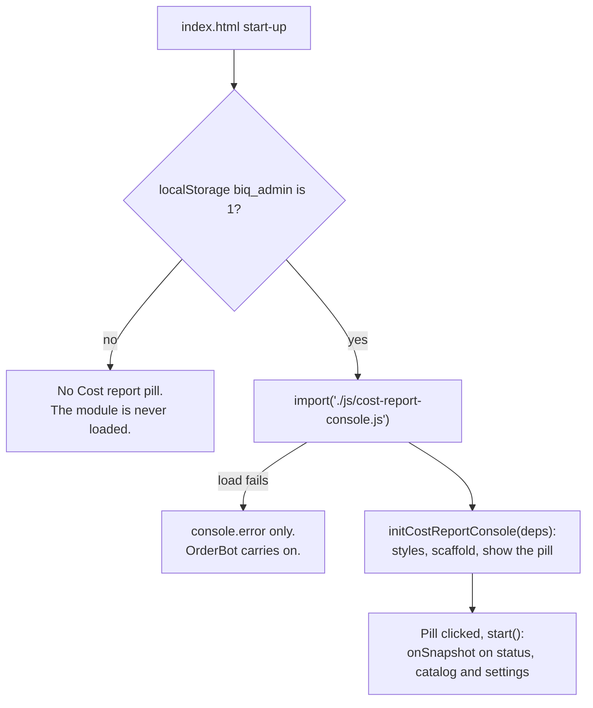
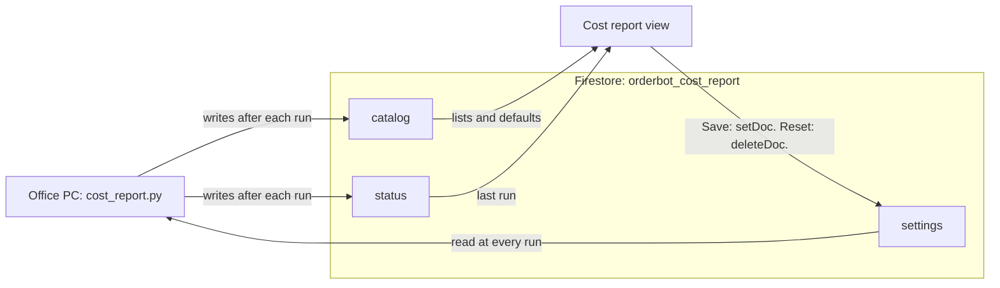

# Cost report console

The admin-only **Cost report** view (`js/cost-report-console.js`) is where the report's owner tunes the Daily Cost Report from OrderBot, instead of on the office PC. The page and the report never talk to each other directly: they share three documents in the Firestore collection `orderbot_cost_report`, under a contract that both sides must keep.

## The Daily Cost Report

- **What it is.** `cost_report.py` runs on the office PC. It isn't in this repository ([architecture.md](architecture.md) lists what lives elsewhere).
- **What it does.** It reads orders from [BlindIQ](glossary.md) and emails a PDF report. It flags an order when its material cost is above a set share of its net value, or when a line or the whole order is discounted more than a set number of points above the customer's discount rating.
- **Order types** are BlindIQ's kinds of order, as the PC publishes them. Each one can be checked, listed separately, or ignored.
- **Zero-charge orders** are error, warranty and showroom orders. Before version 1.4.0 the report called this list "error & showroom" orders, and its section key is still `internal`.
- **Owner.** Paul tunes the settings (`CLAUDE.md`). The saved settings record who saved them.
- **Spec.** The contract is written up in the Claude project document `claude/daily-cost-report/orderbot-console-spec.md`, in the Daily Cost Report project. Its current location needs confirming ([architecture.md](architecture.md)).

The report's versions, as `CLAUDE.md` and the module's header describe them:

| Version | What it added for this page |
|---|---|
| 1.1.0 | The contract's base shapes |
| 1.3.0 | Checks every 15 minutes (Monday to Saturday, 06:00 to 20:00) and emails once a day, at the first check after the send time on a send day (16:30 Monday to Friday by default). Publishes `catalog.defaults.schedule`. |
| 1.4.0 | A zero-charge list (first by default), a price check against BlindIQ's own list prices, and a cost-by-product page (weekly by default). The order of the report's sections can be set. Publishes `sectionOrder`, `priceCheck` and `trendsEvery` in `catalog.defaults`. |

## How the module is loaded

- `index.html` loads the module with a dynamic `import()` only in admin mode (`costReportAdmin` reads `biq_admin`, the same key as the converter's [admin mode](converter/user-interface.md#admin-mode-and-capture-mode)). It catches a failure, so a missing or broken module can't stop OrderBot from loading.
- `initCostReportConsole(deps)` is wrapped in its own `try`/`catch`. It does nothing unless `#cost-report-view` exists and `deps.isAdmin()` is true. It then adds its styles (`<style id="cost-report-styles">`), builds an empty scaffold and unhides the pill `#nav-cost-report`.
- Firestore is first read when the pill is clicked (`start`), not at page load.
- Switching views is done by the plain script at the end of `index.html`. A CSS rule in `index.html` (`#cost-report-view.hidden, #nav-cost-report.hidden`) hides the view and the pill even before Tailwind loads, so capturers never see them.

Injected dependencies, in the same style as the converter's `initBiqConverter`:

| Dependency | Used for |
|---|---|
| `db`, `doc`, `getDoc`, `setDoc`, `deleteDoc`, `onSnapshot`, `serverTimestamp` | The three documents |
| `showToast`, `showConfirmModal` | Messages and confirmations (both render text only) |
| `isAdmin` | The admin check |

## The Firestore contract

The collection name is exported as `COLLECTION`. It holds three documents:

| Document | Written by | Read by | Holds |
|---|---|---|---|
| `catalog` | The PC, after each run or on `--publish-catalog` | The page, live | The order, blind and sundry types with their use over the last 30 days, and the PC's defaults, including the capability keys |
| `status` | The PC, after each run | The page, live (and redrawn every 5 minutes while open) | The last run's outcome and counts |
| `settings` | The page only: `setDoc` on Save, `deleteDoc` on Reset | The PC, at every run. The page, to fill the form and to notice other people's saves. | The owner's choices |

The page never writes `catalog` or `status`.

### `settings`

Three rules shape this document:

- A missing key means the PC's default. That's why Reset deletes the whole document.
- Blind and sundry type tables only hold entries that differ from the default (switched on, no limit of its own).
- The page writes the whole document with `setDoc`, without merging (`toSettingsDoc` builds it).

| Key | Type and allowed values | Notes |
|---|---|---|
| `schema` | Number, always `1` (`SCHEMA`) | The 1.3.0 and 1.4.0 additions are optional keys, so it stayed at 1 |
| `costThresholdPct` | Number, 1 to 100, up to 2 decimals | "Material cost limit" |
| `discountMarginPts` | Number, 0 to 100, up to 2 decimals | "Discount margin", in points |
| `orderTypes` | Map of order type ID to `check`, `list` or `ignore` | Every published order type gets a value. Saved entries for IDs no longer published are kept. |
| `blindTypes`, `sundryTypes` | Map of type ID to an object with `include` (boolean) and, when set, `limitPct` (1 to 100) | Only switched-off types and types with their own limit. A switched-off type keeps a valid limit for later. Entries for IDs not published are kept. |
| `sections` | Map of section key to boolean | Without `sectionOrder`: `breakdown`, `internal` and `allOrders`. With it: each key of `sectionOrder` that has a default in `defaults.sections`, never `flagged`. Saved keys the page doesn't show are kept. |
| `details` | Map of key to boolean | `options`, `lineNotes`, `orderNotes`, `customerRef`, `capturedBy`, `rep`, `requiredDate`, `deliveryMethod` |
| `recipients` | Object with `to` and `cc`, each an array of addresses | `to` is left out when the list is empty, so the PC uses its own list (an explicit empty list would be reported as ignored on every report). Every address must be on `allowedRecipientDomains`. |
| `sendWhenNothingFlagged` | Boolean | With it off, the PC still sends when there's something else to look at (see the help text under the switch) |
| `reportTime` (1.3.0) | `"HH:MM"` | One of the PC's slots, from `schedule.earliest` to `schedule.latest` in steps of `stepMinutes` (06:00 to 19:00 according to `CLAUDE.md`). A saved time off the list stays selectable. |
| `reportDays` (1.3.0) | Array of `mon` … `sun`, in week order | Only days in `schedule.days` (Monday to Saturday according to `CLAUDE.md`), and at least one |
| `sectionOrder` (1.4.0) | Array of section keys | Always the full list the page shows, in the owner's order |
| `priceTolerancePct` (1.4.0) | Number, 0 to `priceCheck.maxTolerancePct` (50 when the PC gives no valid maximum), up to 2 decimals | A blank box saves the PC's default |
| `priceShowIncreases` (1.4.0) | Boolean | "Also list prices above the list" |
| `trendsEvery` (1.4.0) | `week` or `report` | Cost by product in the first report of each week, or in every report |
| `updatedAt` | Firestore server timestamp | Set with `serverTimestamp()`. Used to notice other people's saves. |
| `updatedBy` | String | The "Saving as" name, remembered in `localStorage` as `cr_name`. Defaults to `"Paul"`. |

When the PC doesn't offer a 1.3.0 or 1.4.0 feature, the page keeps any saved value for it exactly as it was.

### `catalog`

Written by the PC. The page reads:

| Field | Shape | Used for |
|---|---|---|
| `orderTypes`, `blindTypes`, `sundryTypes` | Arrays of rows with `id`, `name` and `used30` (uses in the last 30 days); blind and sundry rows may have `hidden` (retired) | The Order types and Product types panels, most used first (`sortByUsed`). Rows without an `id` are dropped, and retired rows sit behind "Show N retired". |
| `defaults` | Object | The PC's defaults: `costThresholdPct`, `discountMarginPts`, `orderTypes`, `sections`, `details`, `recipients`, `sendWhenNothingFlagged`, `allowedRecipientDomains`, `reportTime`, `reportDays`, and the capability keys below. `mergeDefaults` lays them over `FALLBACK_DEFAULTS` one field at a time, checking each. |

The form is built only once both `catalog` and `settings` have been read (`maybeSeed`). With no `catalog` yet, the page shows "Waiting for the office PC", with the hint to run `python cost_report.py --publish-catalog` on the PC with `[orderbot] enabled = yes` in its `config.ini`. Once the form is built, a new `catalog` rebuilds it, unless there are unsaved edits; then the new lists appear on the next save, discard or reload.

### Capability keys

The PC announces each newer feature by publishing a key in `catalog.defaults`. The page shows a control only when its key is there. Each key is checked before it's used (`cleanSchedule`, `cleanSectionKeys`, `cleanPriceCheck`, `trendsKey`), and a malformed value counts as absent.

| Key | From | Shape | With it, the page… | Without it |
|---|---|---|---|---|
| `schedule` | 1.3.0 | `earliest` and `latest` (`"HH:MM"`, earliest not after latest), `stepMinutes` (a whole number from 5 to 60) and `days` (day keys) | Shows the Schedule panel. The status card says "Sends at …" and warns when a send slot passed more than an hour ago with no run that day. The save message names the schedule. | No Schedule panel. Saved `reportTime` and `reportDays` are kept. The status card warns when the last run is more than a working day old. |
| `sectionOrder` | 1.4.0 | Array of section keys in their default order | Replaces the three section switches with an ordered list. Each section has ↑ and ↓ buttons and a switch, except `flagged`, which is "always in". A key the page doesn't know is shown by its name and keeps its place. Help texts say "zero-charge" instead of "error & showroom". | Three switches: `breakdown`, `internal`, `allOrders` |
| `priceCheck` | 1.4.0 | `tolerancePct`, `showIncreases`, `maxTolerancePct` | Shows the Price check panel, and the order types help mentions the price check | No panel. Saved values are kept. |
| `trendsEvery` | 1.4.0 | `week` or `report` (the default) | Shows "Cost by product: how often" | Not shown. A saved value is kept. |

### `status`

Written by the PC. Per `CLAUDE.md`, its messages are plain sentences the PC writes, never raw database errors, and it carries counts only, never rand amounts.

| Field | Shown as |
|---|---|
| `ok` | When `false`: "The last run failed", with `message` |
| `lastRunAt` | The run's time, printed like the PDF does ("Mon 19 Oct 16:30", `fmtWhen`) |
| `flagged`, `checked` | "8 flagged of 120" |
| `priceChanged` (1.4.0) | "3 price changes" |
| `emailedTo` | "sent to …" with first names made from the addresses (`friendlyNames`), or "not emailed" |
| `windowStart`, `windowEnd` | "Orders placed … – …" |
| `flaggedCost`, `flaggedDiscount` | "N on cost, M on discount" |
| `zeroCharge` (1.4.0) or `internal` | "N zero-charge", or "N error/showroom" |
| `excludedByProductType` | "N skipped by product type" |
| `priceNotChecked` (1.4.0) | "N lines not price-checked" |
| `trendsIncluded` (1.4.0) | "with cost by product" |
| `priceCheckError`, `activityLogError` (1.4.0) | Amber warnings: the price check couldn't run, or who raised a discount can't be shown because BlindIQ's activity log couldn't be read |
| `settingsUsed` | "Settings used: …" |
| `settingsIgnored` | "Ignored by the PC: …" (amber) |
| `scriptVersion`, `host` | "Cost report v1.4.0 · <host>" |

## The panels

| Panel | Shown | Controls | Settings keys |
|---|---|---|---|
| Last report | Always, at the top | None | Reads `status` |
| Limits: "What gets flagged" | Always | Material cost limit (%), Discount margin (pts) | `costThresholdPct`, `discountMarginPts` |
| Order types: "Which orders to check" | Always | Check, List separately or Ignore for each order type | `orderTypes` |
| Product types: "Include or exclude product types" | Always | For blind types and sundry types: a search, "All on" and "Switch all off" (for the rows the search shows), "Show N retired", and for each type an Include switch and an Own limit % | `blindTypes`, `sundryTypes` |
| Report content: "What the report shows" | Always | The section switches or the ordered list, "Cost by product: how often" (with `trendsEvery`), and eight detail switches | `sections`, `sectionOrder`, `trendsEvery`, `details` |
| Price check: "Prices changed from BlindIQ's list" | With `priceCheck` | Ignore differences under (%), Also list prices above the list | `priceTolerancePct`, `priceShowIncreases` |
| Schedule: "When the report is sent" | With `schedule` | Send at (a list of slots), On these days | `reportTime`, `reportDays` |
| Recipients: "Who gets the report" | Always | To and Cc address chips, Send even when nothing is flagged | `recipients`, `sendWhenNothingFlagged` |
| Conflict banner | When someone else saved | Load the latest | None |
| Actions | Always | Saving as, Discard changes, Reset to defaults, Save | `updatedBy` |

The app has no switch or chip components, so the module ships its own: `makeSwitch` builds a `button` with `role="switch"`, and the styles are scoped to `#cost-report-view`.

## Validation

`collectModel` checks the form on Save. The first error is shown as a toast and its box gets the focus, even if a search or the retired toggle was hiding it.

- **Number boxes** are plain text on purpose (`readNumber`). They take digits with up to two decimals, a decimal comma ("62,5") or a trailing "%". A `type="number"` box in Chromium reads "5,5" as 55.
- **Limits.** Material cost limit: 1 to 100. Discount margin: 0 to 100.
- **Own limit per type.** Blank, or 1 to 100. It's checked only while the type is switched on; an invalid limit on a switched-off type is dropped.
- **Price tolerance.** 0 to `maxTolerancePct`. Blank means the PC's default.
- **Schedule.** At least one day, and a time from the list.
- **Recipients** (`addAddresses`, `addressAllowed`).
  - An address must look like one (`emailLooksValid`) and be on `allowedRecipientDomains`. By default that's the company's own domain; an empty list allows any domain.
  - Several addresses can be pasted at once, separated by spaces, commas or semicolons.
  - An address typed but not yet added is added on Save.
  - A saved address outside the allowed domains shows red and must be removed before saving.

**Unsaved changes.** `isDirty` compares the form (`collectModel`) with the saved settings (`seedModel`) as canonical JSON (`canon`), so the order of keys never counts as a change. The page shows "Unsaved changes", and the browser asks before leaving (`beforeunload`).

## Saving, conflicts and reset

- **Save** (`onSave`, then `write`) reads `settings` again first. If someone else saved after this form was loaded (a different `updatedAt`, or the document appeared or disappeared), the page shows the conflict banner and asks whether to replace their version. The write is a `setDoc` of the document plus `updatedAt` and `updatedBy`, followed by a read-back to learn the server timestamp.
- **Echoes.** While a save or reset is in flight (`S.writing`), changes to `settings` from the listener are ignored. Later, a change that differs from the version the form was loaded from (`S.baseline`) shows the banner: "<name> saved these settings on …, after you opened this page".
- **Offline.** Firestore keeps the write and sends it when it's back online. After 10 seconds (`SLOW_SAVE_MS`) a toast says it's still saving.
- **Discard** rebuilds the form from the saved settings. **Load the latest** reads `settings` again. **Reset to defaults**, after a confirmation, deletes the `settings` document, so the PC uses its own defaults from the next report.

## Status warnings

- **With `schedule`:** `lastDueSlot` finds the latest send day and time that is at least an hour old (`MISSED_GRACE_MS`), looking back up to 14 days. If the last run is from before that day, the card is highlighted with a warning that the report "hasn't gone out" and "The office PC may be off."
- **Without it:** if more than 25 weekday hours (`STALE_AFTER_MS`, one working day plus an hour's grace, counted Monday to Friday by `weekdayMsBetween`) have passed since the last run, the card shows the same kind of warning.
- The card is redrawn every 5 minutes (`STATUS_RECHECK_MS`) while the page is open.

## Text only, never HTML

Every element is built by the module's `h()` helper, which puts text in as `textContent` or text nodes and never parses HTML. The module contains no `innerHTML`.

The reason: any anonymous OrderBot client can write `orderbot_cost_report`, so type names, messages and addresses read from it are untrusted. Anything that renders Firestore data on this page must keep to this rule. See [security.md](security.md).

## Changing the contract safely

The contract is shared with `cost_report.py`, so a change is two changes.

1. **Agree it in the spec first** (`claude/daily-cost-report/orderbot-console-spec.md`), and change both sides together.
2. **Only add optional keys**, and keep `schema` at 1. Changing a key's meaning or removing a key needs a new schema number that both sides handle.
3. **Gate each new control on a capability key** that the PC publishes in `catalog.defaults`, checked by a `clean…` function. The page then stays correct against an older PC, and an older page keeps working against a newer PC.
4. **Carry saved values forward.** `toSettingsDoc` writes the whole document, so any top-level key it doesn't write is lost on the next save, and so are unknown keys inside `details` and `recipients`. Ship the page change that writes or keeps a new key before the PC relies on it. (The page before 1.4.0 dropped the 1.4.0 keys whenever it saved.)
5. **Keep `FALLBACK_DEFAULTS` in step with the report's defaults.** They're used only until the PC publishes `catalog`. Its default To address is built into the file.
6. **Render with `h()`**, as text only.
7. **Test both sides.** The console's tests (jsdom, headless Chromium, and a round trip through `cost_report.py`'s own parsing) are in `tests.zip` in the "Cost report console 2026-10", "Cost report schedule 2026-10" and "Cost report layout 2026-10" review packages, outside this repo ([testing.md](testing.md)). By hand: switch admin mode on, open Cost report, change and save a setting, check the `settings` document, and check the next report's "Settings used" line.

The page goes live with `main` (GitHub Pages) and the script is updated on the PC, separately. Because every new control waits for its capability key, either can go first.

## Related pages

- [Data model](data-model.md)
- [User interface](app/user-interface.md)
- [Converter user interface](converter/user-interface.md)
- [Security](security.md)
- [Testing](testing.md)
- [Architecture](architecture.md)
- [Runbooks](operations/runbooks.md)
- [Glossary](glossary.md)
