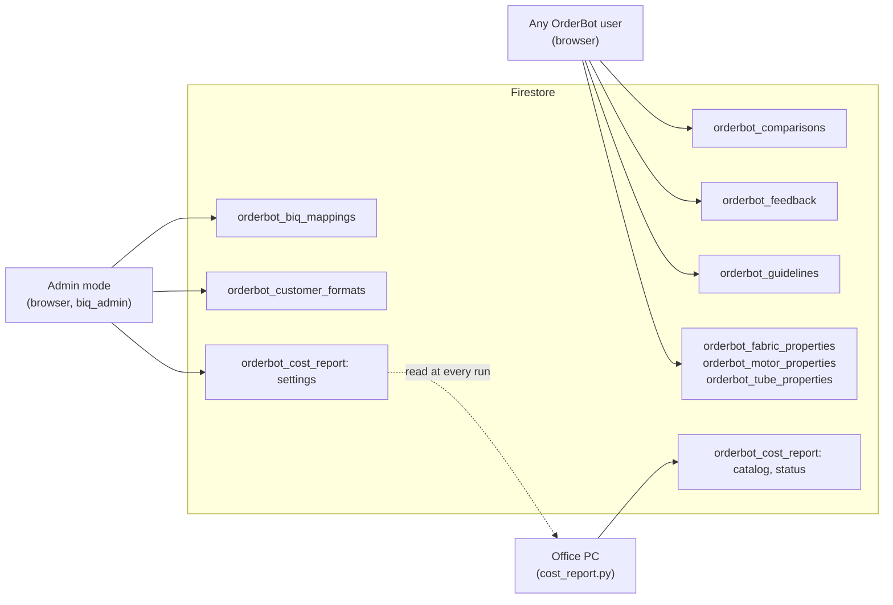

# Data model

OrderBot keeps its shared data in nine Firestore collections. The browser reads and writes them directly with the Firebase JS SDK (11.6.1), signed in anonymously, and the only other writer is the Daily Cost Report on the office PC. This page lists every collection, document and field the code uses, the queries it runs, the browser storage keys and the in-memory caches.

## Overview

- **Project.** The Firebase project and web keys are in `js/config.js` (`firebaseConfig`). `index.html` starts the app, Firestore (`getFirestore`, with default settings) and Auth, and passes Firestore's functions to the converter and cost report modules.
- **No server code** touches Firestore. The [backend proxy](backend-proxy.md) only talks to Gemini.
- **No enforced schema.** Documents are plain JSON with nothing enforcing their shape except the security rules, which aren't in this repo. Readers must cope with missing fields.
- **Timestamps.** Most collections store ISO 8601 strings from `new Date().toISOString()`. Only `orderbot_cost_report/settings` uses a server timestamp.

Every user reads all of these except `orderbot_cost_report`, which only the admin Cost report view and the PC read. The admin-only writes are enforced in the browser, not by Firestore.

## Collections at a glance

| Collection | Holds | Document IDs | Written by | Read by |
|---|---|---|---|---|
| `orderbot_comparisons` | One finished comparison per document | Automatic | `persistComparison` (`index.html`) | `findHistory` (`index.html`) |
| `orderbot_feedback` | Capturers' corrections | Automatic | The click handler of `#submit-feedback-btn` (`index.html`) | `processSingleComparison` (for the prompt), and the same handler (to find duplicates) |
| `orderbot_guidelines` | AI guidelines, one per document | Automatic | The handlers of `#save-guideline-btn` and the ✕ buttons (`index.html`) | `processSingleComparison`, `loadAndDisplayGuidelines` |
| `orderbot_fabric_properties` | Fabric weight, roll width and turning | Automatic | CSV upload, add, edit and delete (`index.html`) | `getFabricProperties`, `loadAndDisplayFabricProperties` |
| `orderbot_motor_properties` | Motor torque and what goes with it | Automatic | The same pattern | `getMotorProperties`, `loadAndDisplayMotorProperties` |
| `orderbot_tube_properties` | Tube diameter by blind type | Automatic | The same pattern | `getTubeProperties`, `loadAndDisplayTubeProperties` |
| `orderbot_biq_mappings` | The converter's mappings and BlindIQ catalogue | The category name, plus `<category>__2` and up for shards | `saveCategory` (`js/biq-converter-ui.js`, admin mode) | `loadMappings`, then `onSnapshot` |
| `orderbot_customer_formats` | Per-customer format profiles | `all` | `saveFormats` (admin mode) | `loadFormats`, then `onSnapshot` |
| `orderbot_cost_report` | The Daily Cost Report's settings and last run | `settings`, `catalog`, `status` | The page writes `settings`. The office PC writes `catalog` and `status`. | Both |

`CLAUDE.md`'s architecture sketch says six collections and its table lists seven. The code uses the nine above.

## orderbot_comparisons

`persistComparison(data)` writes one document per [comparison](glossary.md), after the whole pipeline (Pass 2, the rule checks and the validations), so history shows every flag the live report showed. The app never updates or deletes these documents.

| Field | Type | Notes |
|---|---|---|
| `bdoOrderNumber` | string | The [BDO number](glossary.md) the AI read. If it's missing, `UNKNOWN-<customer reference>` or `UNKNOWN-<milliseconds>`, with a warning toast. |
| `bdoOrderNumberLower` | string | Lower-case copy, for search |
| `customerOrderNumber` | object | A compared field (see below) |
| `customerOrderNumberLower` | string | The customer's reference in lower case, for search |
| `specialInstructions` | object | A compared field |
| `valanceInstruction` | object | `required` (boolean) and `evidence` (string) |
| `lineItems` | array | One per blind line: `reasoning` (string); the compared fields `item`, `location`, `qty`, `width`, `drop`, `colour`, `control1`, `control2`, `blindType`, `range` and `fix`; and `specifications`, an array of `specName` with `specComparison` |
| `sundries` | array | `item` (a compared field) and `quantity` (number). Validated motors also have `validationLog`. |
| `modelUsed` | string | Gemini's `modelVersion`, or else the model constant |
| `timestamp` | string | ISO 8601, when it was saved |
| `userId` | string | The anonymous Firebase user ID |
| `promptVersion` | string | `PROMPT_VERSION`, for example `v2.4` |
| Pipeline summaries | various | `_secondReading` (`lines`, `flags`, `why`), `_autoMatched`, `_ruleFlags` and `_exactChanges` (counts), `_reasoningFlags` (array) and `exactReading` (`source`, `lines`, `paired`) |
| Validation results | objects | For the order: `motorValidation` and `valanceValidation`. For each line: `fabricValidation`, `colourValidation`, `controlValidation`, `chainValidation`, `motorValidation`, `torqueValidation`, `minWidthValidation`, `valanceValidation` and `motorTableValidation`. |

A **compared field** has `customerValue`, `blindIQValue`, `result` and `confidence`. `result` is one of `RESULT_VALUES` (MATCH, MISMATCH, OMISSION, NOTE, NOT_SPECIFIED; see the [glossary](glossary.md)). The second pass, the rule checks and the confidence step may add `aiResult`, `aiCustomerValue`, `autoMatched`, `ruleFlag`, `secondReading`, `exact`, `pass2`, `_fromPass2`, `notSpecifiedCritical` and `confidenceOverride`. What these mean is in [comparison/pipeline.md](comparison/pipeline.md), [comparison/rule-checks.md](comparison/rule-checks.md) and [comparison/validations.md](comparison/validations.md).

`CLAUDE.md` says the prompt version is stored as `pv`. The code writes `promptVersion`.

**Search.** `findHistory` runs three equality queries at once: `bdoOrderNumberLower` equal to the lower-case search term, `customerOrderNumberLower` equal to it, and `bdoOrderNumber` equal to the upper-case term (the code calls this one `legacySnap`). It merges the results by document ID and sorts them by `timestamp` in the browser.

## orderbot_feedback

A capturer's correction of one compared field, made with the correction dialog in a report.

| Field | Type | Notes |
|---|---|---|
| `incorrectItem` | object | `lineItemIdentifier` (the `item` and `location` BlindIQ shows), `fieldName`, and `fieldData` (the compared field) |
| `userExplanation` | string | The capturer's own words |
| `enhancedExplanation` | string | The AI's rewrite as a rule (`EXTRACTION_MODEL`), or `RAW: ` followed by the capturer's words when that call failed |
| `fieldFingerprint` | string | The field name and the item letter, `<fieldName>_<item>`, in lower case |
| `imageSnippet` | string, optional | A pasted screenshot, as a base64 data URL |
| `userId` | string | The anonymous user ID |
| `timestamp` | string | ISO 8601 |

- **Duplicates.** Before adding, the handler queries `fieldFingerprint`. If one of the results has the same `userId`, it updates that document (`timestamp`, `userExplanation`, `enhancedExplanation` and `imageSnippet`) instead of adding another. Anonymous IDs belong to one browser, so the same correction from another PC becomes a new document.
- **Readers.** `processSingleComparison` loads the whole collection, through the 5-minute cache below. `selectRelevantFeedback` and `formatCorrectionExamples` (`js/comparison-context.js`) then put the ten most relevant corrections into the prompt ([comparison/history-feedback-and-reference-data.md](comparison/history-feedback-and-reference-data.md)).
- **Images.** The pasted image goes to the AI with the rewrite request when the correction is submitted. The stored `imageSnippet` is never read back by the app, yet it's downloaded with every read of the collection.

## orderbot_guidelines

| Field | Type | Notes |
|---|---|---|
| `enhancedGuideline` | string | One rule. It's the only field the prompt uses. |
| `originalUserInput` | string | What was typed when this set was made |
| `userId` | string | The anonymous user ID |
| `timestamp` | string | ISO 8601 |

- **Add / unify.** "Add / unify guideline/s" sends every current guideline and the new text to the AI (`EXTRACTION_MODEL`), which returns one merged list. The handler then deletes every document in one batch and writes the new list in a second batch. The two batches aren't atomic: if the second fails, the collection is left empty.
- **Delete.** The ✕ button deletes one guideline.
- None of this is limited to admin mode.

## Reference tables: fabric, motor and tube properties

All three work the same way:

- They're kept in the "Reference data & rules" panels of the Orders view, by anyone.
- "Upload CSV to replace all" deletes every document in one batch and adds the CSV's rows in a second. This isn't atomic either.
- Rows can also be added, edited and deleted one at a time.
- `getFabricProperties`, `getMotorProperties` and `getTubeProperties` read them fresh, with no cache, once per comparison run and once per converter check.
- A CSV's separator is `;` if the header line contains one, otherwise `,`.

**`orderbot_fabric_properties`**

| Field | Type | Meaning |
|---|---|---|
| `fabricName` | string | The range name. `getFabricProperties` returns a `Map` keyed by it in lower case. |
| `fabricWeight` | number | kg per m², for the blind's weight and the torque it needs |
| `fabricWidth` | integer | The roll width in mm |
| `canTurn` | string | `Yes`, `No` or `Out`: the fabric can be turned, can't, or only [out of warranty](glossary.md) |

CSV columns, in order: name, weight, width, turn.

**`orderbot_motor_properties`**

| Field | Type | Meaning |
|---|---|---|
| `motorName` | string | The motor |
| `torque` | number | Nm |
| `blindType` | string | The blind type this row applies to |
| `adapterKit`, `accessories`, `otherDependencies`, `blindControl`, `controlOptions` | string | What goes with the motor |
| `minWidth` | integer or null | The narrowest blind in mm. `null` skips the check. |

CSV columns: the fields above in that order, with `minWidth` as an optional ninth column. Quoted cells are allowed. `getMotorProperties` returns an array, and a motor that fits several blind types has one row for each.

**`orderbot_tube_properties`**

| Field | Type | Meaning |
|---|---|---|
| `blindType` | string | `getTubeProperties` returns a `Map` keyed by it in lower case |
| `tubeDiameter` | integer | mm |

## orderbot_biq_mappings

One document per mapping category, with the category name as the document ID. A category with more than 700,000 characters of JSON (`SHARD_LIMIT`) is split across `<category>`, `<category>__2`, `<category>__3` and so on.

| Field | Type | Notes |
|---|---|---|
| `json` | string | The category's entries (or this shard's share of them) as a JSON object |
| `shards` | number | How many shards the category had at its last save |
| `updatedAt` | string | ISO 8601 |

`loadMappings` merges every document into `MAPS` under the name before `__`, whatever `shards` says. So when a category shrinks, `saveCategory` neutralises its stale higher shards by overwriting them with an empty object; it doesn't delete them.

Inside `json`, most categories map dealer wording to a BlindIQ ID. Some use other keys or values, for example:

- `colours` is keyed `range|colour`, and `rangesScoped` is keyed `<blindTypeId>|<range>`.
- `customers` values are objects with `customer`, `address` and `operator` (some also carry `ops`, a list of the account's operators), or an `alias` pointing at another name.
- `sundries` values are objects with `sundry` and `type`.
- The option sheets (`variantSheetIndex`, `variantTemplateSheets`, `variantTemplates`) and the catalogue refresh tables (`rangeColours`, `rangeHidden`, `sizeWarnings` and others) have their own shapes.

The full list and meanings are in [converter/mappings-and-catalogue.md](converter/mappings-and-catalogue.md). The code reads these categories; which ones exist in Firestore depends on what has been imported:

- **Built-in seeds** (`BIQ_SEED_MAPPINGS`): `blindTypes`, `ranges`, `colours`, `fixes`, `control1`, `control2`, `deliveryMethods`, `packingTypes`, `customers`, `fabricSplits`, `rangesScoped`, `rangeFormulas`, `sundries`, `sundryTypes`, `sundryNames`, `variantTemplates`, `controlsScoped`, `fixesScoped`, `rangeColours`, `rangeFixes`, `rangeBlindType`, `blindTypeHidden`, `rangeHidden`, `colourHidden`, `sundryInactive`, `sizeWarnings`
- **Not in the seeds** (they arrive with an import file): `variantSheetIndex`, `variantTemplateSheets`, `rangeNames`, `blindTypeNames`, `fixNames`, `controlNames`, `colourNames`

Writes go only through `saveCategory`, in admin mode. It re-reads the stored documents first (the shrink guard), then writes every shard with `setDoc`. An import merges each category and deletes nothing. Categories are sharded because Firestore limits a document to 1 MiB; the code mentions a customer book of about 9,000 names. The guard and the live-merge caveat are in [converter/user-interface.md](converter/user-interface.md#firestore-read-subscribe-and-write).

## orderbot_customer_formats

A single document, `all`:

| Field | Type | Notes |
|---|---|---|
| `json` | string | A JSON object mapping a profile key (the customer's canonical BlindIQ name, in lower case) to a profile |
| `updatedAt` | string | ISO 8601 |

A profile (see `biqLearnFormat` in `js/biq-converter.js`) has:

- `customer`, `sourceType` (the last layout read) and `orders` (a count)
- `vocab`: for `blindTypes`, `colours`, `control1`, `control2` and `fixes`, the dealer's wording mapped to a `value` and a count `n`
- `defaults`: `deliveryMethod` and `packingType`
- `log`: the last 150 corrections
- `updatedAt`

Profiles are learned when an admin downloads XML, and `biqApplyFormatProfile` applies them only to fields that don't otherwise resolve.

The document isn't sharded, so it all has to stay under Firestore's 1 MiB limit per document, and a failed save is only logged to the console.

## orderbot_cost_report

Three documents shared with the office PC: `settings` (written by the Cost report view), and `catalog` and `status` (written by `cost_report.py`). The fields and rules are in [cost-report-console.md](cost-report-console.md).

## Queries and indexes

| Where | Query |
|---|---|
| `findHistory` | Three single-field equality queries on `orderbot_comparisons` |
| The feedback handler | One equality query on `fieldFingerprint` in `orderbot_feedback` |
| Everything else | Whole-collection reads (`getDocs` of a collection), single-document reads (`getDoc`) and listeners (`onSnapshot`) |

- No query uses `orderBy`, `limit`, a range or more than one field, so no composite index is needed. Firestore's automatic single-field indexes cover them.
- `index.html` imports `orderBy`, `limit` and `startAfter`, and keeps a `lastHistoryDoc` cursor and a "Load more" button, but nothing sets the cursor. History loads every match at once, and "Load more" never appears.
- `findHistory` still explains a `failed-precondition` error as a missing index. With today's queries that shouldn't happen.
- Firestore's index settings live in the Firebase console, not in this repo.

## Authentication

- `index.html` calls `signInAnonymously(auth)` at start-up and keeps the user's `uid` as `userId`. It's stored on comparisons, feedback and guidelines.
- Each browser profile gets its own [anonymous user](glossary.md), which the Firebase SDK keeps between visits in its own storage. There are no named users, roles or claims. Admin mode is a browser setting (`biq_admin`), not an identity.
- If sign-in fails, a toast says "Could not connect to the database." `db` may still exist, so later reads and writes then fail one by one, depending on the rules.

## Security rules

The Firestore security rules are managed in the Firebase console and aren't in this repository. The code assumes that an anonymous user can read and write every `orderbot_*` collection. The cost report view's error message says its collection needs the same access "like the other orderbot_* collections". Admin-only writes are enforced only in the browser. See [security.md](security.md).

## Browser storage

| Key | Storage | Values | Used by | Purpose |
|---|---|---|---|---|
| `biq_admin` | `localStorage` | `1`, or absent | `js/biq-converter-ui.js` (`biqIsAdmin`, `biqTryUnlock`) and `index.html` (`costReportAdmin`) | [Admin mode](glossary.md) |
| `cr_name` | `localStorage` | A name | `js/cost-report-console.js` (`NAME_KEY`, `rememberName`) | Who saves the cost report settings (`updatedBy`) |
| `ob_guidelines_open`, `ob_fabric_open`, `ob_motor_open`, `ob_tube_open`, `ob_biq_open` | `localStorage` | `open` or `closed` | `index.html` → `setupCollapsible` | Which panels are open |

- OrderBot's own code uses no `sessionStorage`, cookies or IndexedDB. The Firebase SDK keeps its sign-in state itself.
- Most storage access in the converter and the cost report is wrapped in `try`/`catch`, so a browser that blocks storage still works. `setupCollapsible`'s isn't, and neither is the converter's "leave admin mode" path.
- The Drawings view's key arrives in the page's URL fragment and isn't stored ([app/user-interface.md](app/user-interface.md)).

## In-memory caches

| Cache | Where | What and how long |
|---|---|---|
| `_feedbackGuidelineCache` | `index.html` | All feedback and guidelines, for `CACHE_TTL_MS` (5 minutes) in each tab. Submitting feedback clears it. See the caveat below. |
| `summaryResultsCache` | `index.html` | The current comparison run's results, used by the report's buttons |
| `historyDataCache` | `index.html` | Filled by the history search but never read (a leftover) |
| `MAPS`, `FORMATS` | `js/biq-converter-ui.js` | For the life of the page, kept current by `onSnapshot`, which only adds and changes keys |
| Derived indexes on `MAPS` | `js/biq-converter.js` | Non-enumerable properties, so they never reach an exported file or Firestore. `_rangeFamilyIdx`, `_orderableSundries`, `_drSheets` and `_colourRangeIdx` are rebuilt when a size signature of their source data changes. `_colourSquash` (the spacing-insensitive colour match) and `_custIdx` (customer suggestions) are built once and kept until the page reloads. `BIQ_SPEC_SPLIT` is a `WeakMap` kept for each option sheet. |
| `S` | `js/cost-report-console.js` | The cost report documents and the form's state |
| `cachedSecret` | `index.js` (the proxy) | The Gemini key, for each Cloud Run instance |

The property tables aren't cached.

**Caveat, found by reading the code and not reproduced:** saving guidelines sets `_feedbackGuidelineCache.guidelines` to `null`, but the test for refreshing the cache only looks at `feedback` and the cache's age. A comparison started in the same tab within five minutes of the cache being filled then fails, because `guidelines` is `null`, until the cache expires. Deleting a guideline doesn't clear the cache, so a deleted guideline can reach prompts for up to five minutes.

## Size and growth

- `orderbot_comparisons` grows by one document per comparison and is never pruned. `CLAUDE.md`'s replay covered 17,792 comparisons from August 2025 to October 2026. A document holds every line's reasoning, so a long order makes a large document, and Firestore's limit is 1 MiB per document.
- `orderbot_feedback` is read in full, images included, for comparison runs (at most once per five minutes in each tab).
- `orderbot_guidelines` is rewritten in full on every merge.
- `orderbot_biq_mappings` is read in full on every page load, and again before each admin save (the shrink guard).
- `orderbot_customer_formats/all` is one document with no sharding.
- `orderbot_cost_report` is three small documents.

## Changing the data model safely

- **Add fields; don't rename or reuse them.** History shows old comparisons with today's code (`renderReportTable`), so new code must accept documents that don't have a new field.
- **Mappings come from BlindIQ.** Regenerate the import file from the SQL extract and load it with **Import mappings file**. Don't edit Firestore by hand ([converter/mappings-and-catalogue.md](converter/mappings-and-catalogue.md)). Keep each category's value shape; for example, `sundries` values are objects with `sundry` and `type`.
- **The cost report collection is a contract** with the office PC ([cost-report-console.md](cost-report-console.md)).
- **A new collection also needs a security rule** in the Firebase console.
- **One project.** Production uses the only Firebase project. Read [environments.md](environments.md) before testing anything that writes.
- **Shared writes go through the existing helpers.** Keep the admin checks in `saveCategory` and `saveFormats` in front of the mappings and profiles.

## Related pages

- [Architecture](architecture.md)
- [Converter user interface](converter/user-interface.md)
- [Mappings and catalogue](converter/mappings-and-catalogue.md)
- [Cost report console](cost-report-console.md)
- [History, feedback and reference data](comparison/history-feedback-and-reference-data.md)
- [Comparison pipeline](comparison/pipeline.md)
- [Security](security.md)
- [Environments](environments.md)
- [Glossary](glossary.md)
