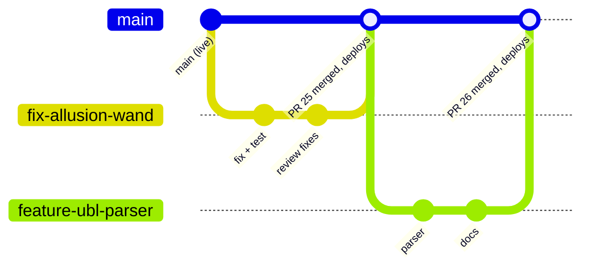

# Development workflow

How a change travels from an idea to the live app, step by step, with the command-line and GUI versions of each step. It follows "GitHub Flow": short-lived branches off `main`, merged through pull requests. The rules behind it are in [CONTRIBUTING.md](../CONTRIBUTING.md).

## The shape of it



1. Start from an up-to-date `main`.
2. Make a branch for one change.
3. Change the code, run it, run the tests, and update the docs.
4. Commit and push the branch.
5. Open a pull request. Checks run, and once previews exist there's a preview link.
6. Review it, and for anything a capturer will see, have a capturer or Paul try it.
7. Squash and merge. GitHub Pages deploys `main` within minutes.
8. Check the live app, then delete the branch.

Most changes should take a day or two from branch to merge. A branch that lives for weeks drifts away from `main` and gets harder to merge.

## Step by step

### 1. Start from an up-to-date `main`

```bash
git switch main
git pull
```

*GitHub Desktop:* choose `main` under Current branch, then **Fetch origin** and **Pull**. *Git GUI:* **Remote → Fetch from → origin**, then **Merge → Local Merge** of `origin/main`.

### 2. Make a branch

```bash
git switch -c fix/allusion-wand-lh-and-rh
```

Name it as [CONTRIBUTING.md](../CONTRIBUTING.md#branch-names) describes. *GitHub Desktop:* **Branch → New branch**. *Git GUI:* **Branch → Create**.

### 3. Change, run, test

- Run the app locally ([getting-started.md](getting-started.md#5-run-the-app-locally)) and try the change.
- Run the regression tests ([testing.md](testing.md)). Passes should go up or stay the same, and the failures should still be the 25 known ones.
- Do the end-to-end check for the area you touched ([testing.md](testing.md#manual-end-to-end-check)).
- Update the `docs/` page that describes what you changed, and `CLAUDE.md` if it's a rule or a contract.

### 4. Commit and push

```bash
git add -A
git status                     # check nothing unexpected is staged
git commit                     # opens an editor: summary line, blank line, why + evidence
git push -u origin fix/allusion-wand-lh-and-rh
```

*GitHub Desktop:* tick the files, write the summary and description, **Commit to <branch>**, then **Publish branch**. *Git GUI:* **Rescan**, **Stage Changed**, write the message, **Commit**, **Push**.

### 5. Open a pull request

After the push, GitHub shows a "Compare & pull request" button (GitHub Desktop: **Create Pull Request**). Fill in the [template](../.github/pull_request_template.md): what and why, the evidence, the test result and the checks. Open it as a **draft** if you want feedback before it's finished.

### 6. Review

- Read the whole diff on GitHub's **Files changed** tab, as a reviewer would.
- For anything a capturer will see, have a capturer or Paul try it on the preview link (once [previews](environments.md) exist) or on your screen.
- Claude Code's pull requests get the same review. Ask it to explain anything unclear before you merge.

### 7. Merge

- Choose **Squash and merge** and edit the commit message so it keeps the why. One commit per change on `main` makes the history readable and a revert one click.
- **Backend changes:** merging doesn't deploy the proxy. Deploy it yourself straight after merging, as [deployment.md](deployment.md#backend-the-gemini-proxy) describes.

### 8. Check the live app and tidy up

- On GitHub, the **Actions** tab shows a "pages build and deployment" run for the merge. When it's green, the new files are live.
- Browsers can keep the previous files for up to about 10 minutes. Reload with Ctrl+F5 to check the new version. The namespace imports in `index.html` exist so that a browser holding a mix of old and new files keeps working ([architecture.md](architecture.md#frontend-modules)).
- Run one real comparison, and if the converter changed, convert one real file.
- Delete the branch (GitHub offers a button on the merged pull request), then locally: `git switch main && git pull && git branch -d <branch>`.

## Rolling back

If a merged change breaks something, **undo first and investigate afterwards**:

1. On the merged pull request, press **Revert**. GitHub opens a new pull request that undoes it.
2. Merge that pull request. Pages redeploys the previous behaviour within minutes.
3. Fix the problem on a new branch, with a test that would have caught it.

From the command line: `git revert <commit>` on a new branch, then push it and open a pull request. For the proxy, roll back to the previous Cloud Run revision instead ([deployment.md](deployment.md#rolling-back)).

## Tagging releases

`main` deploys continuously, so a tag is just a bookmark. Tag notable deploys (a new prompt version, a converter rule set, a model change) so that "what changed when?" has an answer, which the quarterly review needs:

```bash
git switch main && git pull
git tag -a release-2026-10-29 -m "Prompt v2.4, wood venetians, double rollers"
git push origin release-2026-10-29
```

On GitHub, **Releases → Draft a new release** turns a tag into release notes for Paul and the capturers.

## Branch hygiene

On 29 October 2026 the repository had 16 branches besides `main`:

- **13 are fully merged** and can be deleted: `RussedyBussedy-patch-1` to `-6` (from editing on GitHub's website), `Cost-Report-Schedule`, `converter-accuracy-2026-10`, `fix/allusion-wand-lh-and-rh`, `fix/always-export-unknown`, `claude/cost-report-console`, `claude/cost-report-layout` and `claude/fix-handwriting-flags`.
- **3 from April 2026 aren't merged:** `claude/fix-inline-prompt`, `claude/fix-motor-validation` and `claude/relaxed-ptolemy`. Pull requests #4 and #5 appear to have landed the same fixes, so compare them with `main` before deleting.

Check a branch with `git branch -r --merged origin/main`, or with the **Branches** page on GitHub, before deleting it. See also the [runbook](operations/runbooks.md#clean-up-branches).

## Habits to drop

| Instead of | Do this |
|---|---|
| Committing straight to `main`, including through GitHub's website. Since August 2026, 53 commits went straight to `main` and 10 changes came through pull requests. | A branch and a pull request for every change |
| "Add files via upload" and "Update index.js" messages: 89 of 249 commits | A summary of what changed, and why in the body |
| Copies of the code in OneDrive (`BlindIQ Order Converter (updated 17 Jun).html`, `OrderBot integration/js/`) | Branches for work in progress, tags for versions worth keeping |
| Finished work waiting in a review package (the Finish Logic change of 16 Oct 2026) | Push the branch and open the pull request the same day |
| Large mixed changes | One concern per pull request |

## Working with Claude Code

- **On the web (claude.ai/code):** Claude creates a `claude/…` branch, commits and opens a pull request. Review it and merge it like any other.
- **Locally:** run Claude Code in your clone. It works on your branch, and you push and open the pull request.
- Either way: ask for the test result and the evidence in the pull request description, check that `docs/` was updated, and don't merge what you can't explain.

## Related pages

- [CONTRIBUTING](../CONTRIBUTING.md)
- [Getting started](getting-started.md)
- [Environments](environments.md)
- [Testing](testing.md)
- [Deployment](deployment.md)
- [Runbooks](operations/runbooks.md)
