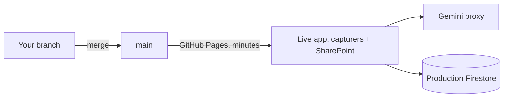

# Environments

Which copies of OrderBot exist, which data each one touches, and why every pull request should get its own test link before it reaches `main`. This page answers the question "do we need a test environment for branches before pull requests to main, and how do we do it in practice?".

## Today: one environment



- `main` **is** production. GitHub Pages publishes it to the capturers within minutes of a merge, and nothing sits in between.
- The proxy only answers the websites on its CORS list: the live site, the SharePoint site and Google's Canvas preview (`allowedOrigins` in `index.js`).
- There's one Firestore database, and everything reads and writes it.
- You can run the page on your PC ([getting-started.md](getting-started.md#5-run-the-app-locally)), but it can't call the AI, and anything it saves lands in production.

So the first time a change meets real documents in a real browser is when the capturers get it.

## Is a test environment necessary?

**Yes, a light one. Not a permanent staging server.** For OrderBot specifically:

- **`main` is production, and it's used every working day.** About 1,100 orders a month are checked, and the converter brings in hundreds of orders a month.
- **Changes are frequent and mostly written with AI help.** There were 35 commits in October 2026 alone. Since August, 53 commits went straight to `main` without a pull request.
- **It has broken production before.** The April 2026 restructure (`ef4eea8`) was reverted the next day.
- **The safety net exists but isn't automatic.** About 1,250 regression checks pass on `main`, but they only run when someone runs them by hand.
- **Business rules need business eyes.** A capturer or Paul is the best judge of whether a flag or a converted line is right. They need a link to click, not a PC set up for development.

What it does **not** need: a permanent second copy of everything that someone has to keep in step, a release manager, or a second Google project.

## The target: three layers

### 1. Automatic checks on every pull request

GitHub Actions runs the regression tests on every push to a pull request's branch and shows a green tick or a red cross on the pull request. With a branch rule on `main` ([the plan](plans/move-to-company-github.md), phase 3), a red pull request can't be merged.

This needs the tests inside the repository. Their fixtures are business data, so that needs the repository to be **private** first ([testing.md](testing.md#bringing-the-tests-into-the-repository)). A sketch of the workflow, assuming the tests move to a `tests/` folder with their own `package.json` and lockfile:

```yaml
name: tests
on:
  pull_request:
  push:
    branches: [main]
jobs:
  test:
    runs-on: ubuntu-latest
    steps:
      - uses: actions/checkout@v4
      - uses: actions/setup-node@v4
        with:
          node-version: 24
      - run: npm ci
        working-directory: tests
      - run: npm test
        working-directory: tests
```

### 2. A preview link for every pull request

[Firebase Hosting preview channels](https://firebase.google.com/docs/hosting/github-integration) do this with one set-up command and Google's [official GitHub action](https://github.com/marketplace/actions/deploy-to-firebase-hosting):

- `firebase init hosting:github`, run once from the repository, creates a service account that may deploy to Hosting, stores its key as an encrypted GitHub secret, and writes two workflow files: one for pull requests, one for merges to `main`.
- Every pull request then gets its own preview address. The action posts it as a comment on the pull request, and later pushes update the same address.
- A preview channel expires **7 days after its last deploy** by default. The expiry can be changed in the workflow.
- On merge, the second workflow deploys `main` to the **live** channel. Production moves from GitHub Pages to Firebase Hosting, so previews and production are served the same way, and GitHub Pages is no longer needed once the repository is private.

What has to change for it: a `firebase.json` that publishes the repository root but leaves out the server and documentation files (`index.js`, `package.json`, `Dockerfile`, `docs/`, Markdown, `.github/`, tests); the SharePoint embed's address; and the proxy's CORS list.

### 3. Test data kept apart from production

Firebase warns that preview channels use the project's **real** backend. Without this layer, a preview would save test comparisons into the history, and a test edit to the guidelines or mappings would reach the capturers' prompts and conversions immediately.

- Create a second Firestore database in the same project, for example `staging`. A project can hold several Firestore databases, and security rules are deployed to each ([Firebase docs](https://firebase.google.com/docs/firestore/manage-databases)).
- Make `js/config.js` choose the database by hostname: the production address uses the default database, and anything else (previews, `localhost`) uses `staging`. Today `index.html` opens the default database with `getFirestore(app)`, and the converter and cost report modules receive that same `db`, so it's a single change point.
- Seed `staging` with copies of the reference data (`orderbot_biq_mappings`, `orderbot_customer_formats`, the fabric, motor and tube tables, the guidelines, a sample of corrections) but no comparison history. Refresh it after each catalogue import.
- Previews still call the real Gemini API through the proxy. The cost of a few test comparisons is negligible.

### The proxy's part

The proxy has to accept requests from the preview addresses (they all start with the project ID followed by a double hyphen, and end in `.web.app`) and from `http://localhost:8000`. That's a backend change, so it goes in its own pull request and is deployed on its own ([CONTRIBUTING.md](../CONTRIBUTING.md)). It's also the moment to add proper caller verification ([security.md](security.md)).

## Environments at a glance

| | Local | Preview (one per pull request) | Production |
|---|---|---|---|
| Address | `http://localhost:8000` | A temporary `*.web.app` address, posted on the pull request | Today `https://russedybussedy.github.io/OrderBot/`; then the Firebase Hosting live address. Both embedded in SharePoint. |
| Who uses it | The developer | The reviewer, a capturer, Paul | Capturers and admins |
| Code | Your working copy | The pull request's branch | `main` |
| Data | `staging` database (today it's production, so don't save) | `staging` database | Production database |
| AI | Through the proxy, once `localhost` is allowed | Through the proxy | Through the proxy |
| Deployed by | You | GitHub Actions, on every push to the pull request | GitHub Actions on merge (today: GitHub Pages) |
| Lifetime | While you run it | 7 days after the last push | Permanent |

## Testing a proxy change

Previews share the live proxy, so a change to `index.js` is tested differently: deploy it as a **tagged Cloud Run revision that takes no traffic**, test against its own address, then move the traffic over.

```bash
gcloud run deploy gemini-secure-proxy --source . --region africa-south1 --project orderbot-2b212 --tag pr-123 --no-traffic
# Cloud Run prints an address for the tag; point a local copy of the page at it and test
gcloud run services update-traffic gemini-secure-proxy --to-tags pr-123=100 --region africa-south1 --project orderbot-2b212
```

## Alternatives considered

| Option | For | Against |
|---|---|---|
| **Firebase Hosting previews** (recommended) | Same Google project as Firestore and the proxy. The free tier covers an internal app. Official GitHub action, set up with one command. | Hosting moves off GitHub Pages, which is a one-off change |
| Azure Static Web Apps | Built-in staging environments for pull requests; Microsoft Entra ID sign-in at the hosting layer; fits the company's Microsoft 365 preference | A third platform while Firestore and the proxy stay on Google. Revisit it with the Microsoft sign-in work. |
| GitHub Pages plus a pull-request-preview action | Stays on GitHub | Community actions publish previews into a folder of the live site; Pages from a private repository needs a paid plan |
| A permanent staging copy | Familiar | Someone has to keep it in step, it drifts, and it doesn't give each pull request its own link |

## Order of work

Hosting moves first, so nothing breaks for the capturers. Then the repository goes private, then the tests and branch rules, then previews and staging data. The steps, owners and checklists are in [plans/move-to-company-github.md](plans/move-to-company-github.md), and the decision is recorded in [ADR 0008](decisions/0008-firebase-hosting-with-pr-previews.md).

## Related pages

- [Development workflow](development-workflow.md)
- [Testing](testing.md)
- [Deployment](deployment.md)
- [Backend proxy](backend-proxy.md)
- [Security](security.md)
- [Moving to a company GitHub organisation](plans/move-to-company-github.md)
