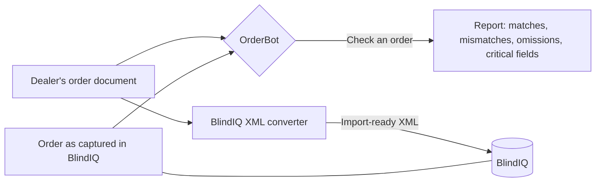

# Overview

What OrderBot is for, who uses it, what it does and doesn't do, and what it has achieved so far. This page needs no programming knowledge. Terms in *italics* are explained in the [glossary](glossary.md).

## The problem it solves

Blind Designs makes blinds, shutters and curtain tracks to order for *dealers*: retailers and installers across South Africa. Every dealer sends orders in its own format: spreadsheets, PDF purchase orders from their own systems, order forms filled in by hand, photos, and *BlindIQ Online* exports.

*Order capturers* key each order into *BlindIQ*, the company's order and production system. A typing slip, a misread handwritten figure or a wrong option (a 2720 mm width keyed as 2700, a motor instead of a chain, the wrong fabric colour) goes straight to the factory. It's usually found when the blind is fitted, and by then the blind has to be remade.

OrderBot tackles this from two sides:

1. **Check** what was captured against what the customer actually asked for, before the order goes into production.
2. **Capture** the order automatically where the customer's layout is known, so there's less retyping in the first place.

## What it does

| Tool | Who uses it | What it does |
|---|---|---|
| **Check an order** (the main screen) | Order capturers | The capturer drops in the customer's document and the BlindIQ order printout. Google's Gemini AI reads both, OrderBot compares them field by field, applies Blind Designs' own rules and checks, and shows a report. *Critical fields* (product, range, colour, quantity, width, drop, controls) get the strongest highlighting and a summary at the top. Every check is saved to the history. |
| **Comparison history** | Capturers, admins | Finds earlier checks by order number. |
| **BlindIQ XML converter** | Capturers (convert), admins (maintain the mappings) | Reads the customer's document. Known dealer layouts are read exactly; anything else is read by the AI. OrderBot turns it into a BlindIQ order using BlindIQ's own catalogue and the company's rules, shows the problems a capturer must fix, and produces an XML file the capturer imports into BlindIQ. |
| **AI guidelines, and fabric, motor and tube properties** | Paul and Russel in practice (the app doesn't restrict editing yet) | The reference data the checks use: business rules for the AI, fabric weights and widths, motor torque, tube sizes. |
| **Drawings** | Staff, factory | Shows the separate *Bend & Blind Visualiser* (curtain track bends, sloped verticals, shaped cellular blinds) inside OrderBot. Its code lives in another repository. |
| **Cost report** (admin only) | Paul, Russel | Settings for the Daily Cost Report that the office PC emails each day. |

## Scale and results

These figures come from the October 2026 review of OrderBot's first fifteen months, which matched every first check against what was changed on the BlindIQ order afterwards. They're estimates from a sample, so read them as approximate.

- **About 16,500 orders checked** between July 2025 and early October 2026, roughly 1,100 a month. In September 2026, 69% of all orders were checked.
- **About 3,700 real mistakes caught** (fields OrderBot flagged that were then corrected), on about 1 order in 15. Most were options, then controls and fixing, sizes, and fabric and colour.
- **About 670 blinds put right before they were made**, so they never needed a remake.
- **The converter** brought in 430 orders in September 2026, about a third of the orders that arrived as documents. On 2,380 stored items, the share of items it got fully right rose from 30% to 73% during the October 2026 rule work.

The review's cost and saving figures are kept in the private project documents, not in this public repository.

## What it doesn't do

- **It doesn't change BlindIQ.** The comparison only reports. The converter produces a file, and the capturer decides whether to import it.
- **It doesn't check orders by itself.** A capturer has to run each check, so coverage depends on the capturer's habits. Checking every order automatically is on the [roadmap](known-issues-and-roadmap.md).
- **It doesn't replace the capturer's judgement.** A flag is something to look at. About 1 flag in 60 to 90 led to a change, and the rule checks exist to cut the noise.
- **The AI can misread.** Handwriting is the weak spot: a handwritten 1200 read as 1700 can fool the AI and the capturer alike. For handwritten or unclear documents OrderBot reads the customer's document a second time on its own, and reports where the two readings disagree.
- **It doesn't price orders or handle payments.**

## Who's who

| Role | Who | What they do with OrderBot |
|---|---|---|
| Product owner and maintainer | Russel | Decides what OrderBot should do, maintains the code, makes the rulings on converter rules |
| Rule owner | Paul | Owns the critical-field rules and the Daily Cost Report settings; admin for mappings |
| Order capturers | The capture team | Run checks and conversions every day; send problem orders to the mapping admins |
| Development partner (if appointed) | External | Maintenance and the platform work in [the plan](plans/move-to-company-github.md) |

## Related pages

- [Glossary](glossary.md)
- [Architecture](architecture.md)
- [User interface](app/user-interface.md)
- [Comparison pipeline](comparison/pipeline.md)
- [Converter overview](converter/overview.md)
- [History](history.md)
