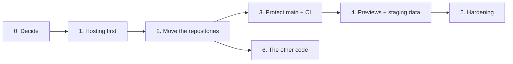

# Moving to a company GitHub organisation

The step-by-step plan for making OrderBot's code company-owned and private, with the tests running on every pull request and a preview link for each change. The order is chosen so that the live app never breaks for the capturers. Russel chose this direction on 29 October 2026. The decisions behind it are [ADR 0007](../decisions/0007-private-company-github-organisation.md) and [ADR 0008](../decisions/0008-firebase-hosting-with-pr-previews.md).

## Where things stand (29 October 2026)

- The code is in **public** repositories on Russel's personal GitHub account `RussedyBussedy`: `OrderBot`, `bd-tools`, `delivery-optimiser`, `DashBoard`, `Tech-Release-Generator`, `outlook-mcp-server` and `OrderBoTTest`, plus personal ones.
- The frontend is served by **GitHub Pages** from `OrderBot`'s `main`. The Drawings view loads `bd-tools`, which is also on GitHub Pages.
- The regression tests, analysis tools, Daily Cost Report script and visualiser source live outside any repository ([architecture.md](../architecture.md#things-that-live-outside-this-repository)).
- Done on 29 October 2026: a local clone at `C:\dev\blind-designs\OrderBot`, outside OneDrive, and this wiki.

## The phases



| Phase | What | Effort | Capturers notice? |
|---|---|---|---|
| 0 | Decide the organisation, plan, owners and access | S | No |
| 1 | Move hosting from GitHub Pages to Firebase Hosting | M | No: the SharePoint embed is updated behind the scenes |
| 2 | Create the organisation, transfer the repositories, make them private | S | No |
| 3 | Tests in the repository, run on every pull request; `main` protected | M | No |
| 4 | A preview link and separate test data for every pull request | M | Only when asked to try a preview |
| 5 | Hardening: caller verification, Microsoft sign-in, rules in the repository, dependencies | L | Yes: they sign in with their Microsoft account |
| 6 | Give the other code (visualiser, cost report, analysis) a home | M | No |

Effort: **S** is under half a day, **M** one to three days, **L** longer.

## Phase 0: Decide

**Owner:** Russel and Paul. **Effort:** S, one meeting.

1. **The organisation's name**, for example `blind-designs`. It must be unused on GitHub. It becomes part of every address.
2. **The plan.** The facts that matter, from GitHub's documentation ([plans](https://docs.github.com/get-started/learning-about-github/githubs-products), [protected branches](https://docs.github.com/en/repositories/configuring-branches-and-merges-in-your-repository/managing-protected-branches/about-protected-branches), [pricing](https://github.com/pricing)):

   | | GitHub Free (organisation) | GitHub Team |
   |---|---|---|
   | Private repositories | Unlimited | Unlimited |
   | Protected branches and rulesets on private repositories | No: public repositories only | Yes |
   | GitHub Pages from private repositories | No | Yes |
   | Actions minutes a month for private repositories | 2,000 | 3,000 |
   | Price | Free | Listed at US$4 per user a month; the pricing page currently says "for the first 12 months" |

   **Recommendation:** Team, for the people who push code. Without it, `main` can't be protected on a private repository, so the rules in [CONTRIBUTING.md](../../CONTRIBUTING.md) would rely on discipline alone. Check on GitHub's billing page how collaborators on private repositories are counted before inviting the development partner.
3. **Owners:** at least two (Russel and Paul, or Russel and IT), so the company never depends on one account. Require two-factor authentication for everyone.
4. **The development partner:** their own GitHub accounts, added as outside collaborators on the repositories they work on, with Write access (not Admin), and removed when the work ends. Their contract should say the code belongs to Blind Designs.
5. **Which repositories move:**

   | Repository | Proposal |
   |---|---|
   | `OrderBot` | Move. This plan. |
   | `bd-tools` | Move, together with the visualiser's source, which isn't in any repository today |
   | `delivery-optimiser`, `DashBoard`, `Tech-Release-Generator` | Move if they're company tools (Russel to confirm) |
   | `outlook-mcp-server` | Move. It's a company integration. |
   | `OrderBoTTest` | Archive. It's an old test copy from November 2025. |
   | `bakers-home-hub`, `Pixel-Card` | Stay personal |

**Done when:** the choices are written into [ADR 0007](../decisions/0007-private-company-github-organisation.md) and its status changes to Accepted.

## Phase 1: Hosting first

**Owner:** Russel or the development partner. **Effort:** M.

**Why this comes first:** GitHub redirects a transferred repository's web and Git addresses, but **not its GitHub Pages site** ([GitHub docs](https://docs.github.com/en/repositories/creating-and-managing-repositories/transferring-a-repository)). On the Free plan, a private repository can't use Pages at all. Moving the repository first would take the live app down.

1. On a branch (`chore/firebase-hosting`), install the Firebase CLI (`npm install -g firebase-tools`), run `firebase login`, then `firebase init hosting`: project `orderbot-2b212`, public directory `.` (the repository root), not a single-page rewrite.
2. Make `firebase.json` publish only the app, not the server or the docs. For example:

   ```json
   {
     "hosting": {
       "public": ".",
       "ignore": [
         "firebase.json", "**/.*", "**/node_modules/**",
         "index.js", "package.json", "package-lock.json", "Dockerfile",
         "docs/**", "**/*.md", ".github/**", "tests/**"
       ]
     }
   }
   ```

3. `firebase deploy --only hosting`, then test the project's `web.app` address. Run a comparison, convert a file, open admin mode and the Drawings view.
4. In its own pull request, add the new address to `allowedOrigins` in `index.js` and deploy the proxy on its own ([runbook](../operations/runbooks.md#deploy-the-proxy)).
5. If the Firebase web API key restricts which websites may use it, add the new address (Google Cloud console → APIs & Services → Credentials).
6. Do the same for `bd-tools`, the visualiser: give it its own Firebase Hosting site in the same project, then point `BASE` in the script at the end of `index.html` at it.
7. Run `firebase init hosting:github` and keep **only** the workflow that deploys to the live channel on merge to `main`. Leave out the pull request previews until phase 4 gives them their own database.
8. Switch the staff SharePoint embed to the new address, **keeping its `#dk=…&dv=…` fragment**, and update bookmarks and staff guides.
9. Keep GitHub Pages running for one to two weeks as a fallback, then switch it off (repository Settings → Pages).

**Done when:** capturers reach the Firebase address through SharePoint, merges to `main` deploy there, and Pages is off.

**Rollback:** point the SharePoint embed back at the Pages address. That's why it stays up for a fortnight.

## Phase 2: Move the repositories

**Owner:** Russel, with an organisation owner. **Effort:** S, plus an hour updating references.

1. Create the organisation (github.com → **+** → New organization), choose the plan, add the second owner and require two-factor authentication.
2. Transfer `OrderBot`: Settings → General → Danger Zone → **Transfer** → the organisation. Then the other repositories from phase 0.
3. Make each one private: Settings → General → Danger Zone → **Change visibility**.
4. Update everything that points at the old address:
   - local clones: `git remote set-url origin https://github.com/<organisation>/OrderBot.git`;
   - the Claude project's GitHub sync, which reads `RussedyBussedy/OrderBot` and `bd-tools`;
   - Claude Code on the web: install its GitHub app on the organisation;
   - the test package's README and `setup.sh`, and the prompts of the "OrderBot quarterly review" and "OrderBot monthly report" scheduled tasks;
   - links in this wiki, `README.md` and `CLAUDE.md`.
5. Optional: rename `OrderBot` to `orderbot`, now that no live address depends on the name. GitHub redirects renamed repositories too.
6. Never create a new repository at an old address: that permanently breaks GitHub's redirect to the moved one.

**Done when:** the repositories are private in the organisation, and everything above works against the new addresses.

## Phase 3: Protect `main` and run the tests on every pull request

**Owner:** the development partner or Russel. **Effort:** M.

1. Bring the regression package into `tests/`, importing `../js/` directly instead of using `setup.sh`, with its own `package.json` and a committed lockfile. Real customer documents stay outside the repository, opt-in through `TASKFILES_DIR` and `ABTEST_DIR` ([testing.md](../testing.md#bringing-the-tests-into-the-repository)).
2. List the 25 known failures by name as expected failures, so the run is green and anything new turns it red.
3. Add the workflow from [environments.md](../environments.md#1-automatic-checks-on-every-pull-request).
4. Add a **ruleset** for `main` (Settings → Rules → Rulesets): require a pull request, require the tests check to pass, block force pushes and deletion. Require an approval once there's a second developer. Until then an approval rule would block solo merges.
5. Add a `CODEOWNERS` file naming the reviewers for each area. The pull request template is already in place.
6. Mark [ADR 0005](../decisions/0005-regression-tests-outside-repository.md) as superseded.

**Done when:** a pull request with a failing test can't be merged, and a green one merges and deploys.

## Phase 4: Previews and staging data

**Owner:** the development partner. **Effort:** M. The design is in [environments.md](../environments.md#the-target-three-layers).

1. Create a `staging` Firestore database in the project and deploy the same security rules to it.
2. Seed it with the reference data (mappings, customer formats, fabric, motor and tube tables, guidelines, a sample of corrections). Write the seeding steps into the [runbooks](../operations/runbooks.md).
3. Make `js/config.js` choose the database by hostname, and pass it to `getFirestore` in `index.html`.
4. In a backend pull request, let the proxy accept the preview addresses and `http://localhost:8000`.
5. Switch on the pull request workflow from `firebase init hosting:github`, and check that the preview comment appears on a test pull request.
6. Tell the capturers and Paul, in a short note, how to try a change from its preview link.

**Done when:** every pull request gets a working preview that writes only to `staging`.

## Phase 5: Hardening

**Owner:** the development partner, with Russel. **Effort:** L. From the October 2026 code review (the detail is in the private review, [security.md](../security.md)):

- Verify callers at the proxy (for example Firebase App Check) and cap spending, with budget alerts.
- Microsoft (Entra ID) sign-in through Firebase Authentication, with capturer and admin roles enforced by the Firestore rules. Admin mode then comes from the role.
- Firestore rules and indexes kept in the repository and deployed through pull requests.
- Pinned, current dependencies: SRI hashes on CDN scripts, updated SheetJS and PDF.js, the current Node LTS in the proxy image, a lockfile.

**Done when:** the security items in the private review are closed.

## Phase 6: The other code

**Owner:** whoever knows each piece. **Effort:** M.

- The visualiser's source into the private `bd-tools`, with the build step that produces the encrypted page.
- `cost_report.py` into its own private repository (for example `daily-cost-report`), with the Firestore contract documented on both sides.
- The analysis tools and the monthly report scripts into a private `orderbot-analytics`.
- The BlindIQ catalogue extract scripts into `tools/catalogue/` in `OrderBot`.
- The June 2026 server automation retired.
- `OrderBoTTest` archived.

**Done when:** nothing in [Things that live outside this repository](../architecture.md#things-that-live-outside-this-repository) depends on one PC or one OneDrive folder.

## Checklist

- [ ] **0** Organisation name, plan, owners (two or more, with two-factor authentication), development partner access, and repository list decided; ADR 0007 accepted
- [ ] **1** Firebase Hosting serves the app (and `bd-tools`); proxy CORS updated in its own pull request; SharePoint embed switched with its fragment; merges deploy to Firebase; Pages off after a fortnight
- [ ] **2** Organisation created; repositories transferred and private; remotes, the Claude project sync, Claude Code, the scheduled tasks and the docs updated
- [ ] **3** Tests in `tests/` and green in CI; ruleset on `main`; `CODEOWNERS`; ADR 0005 superseded
- [ ] **4** `staging` database seeded; `config.js` switches by host; proxy accepts previews; preview links on pull requests
- [ ] **5** Caller verification, Microsoft sign-in and roles, rules in the repository, dependencies updated
- [ ] **6** Visualiser source, cost report, analytics and catalogue scripts in private repositories; old automation retired

## What a development partner could take on

The plan is written so it can serve as the brief for an outside developer:

- **Theirs:** phases 1, 3 and 4 end to end, phase 5's technical work, and the extraction in phase 6. Each piece of work goes through pull requests, with the docs updated.
- **Russel's (and Paul's):** phase 0's decisions, every business rule and ruling, reviewing pull requests that change what capturers see, and approving merges until the partner has earned direct merge rights.
- **Ask them for:** a short proposal per phase with effort and risks, using this page and [known-issues-and-roadmap.md](../known-issues-and-roadmap.md) as the starting point.

## Related pages

- [Environments](../environments.md)
- [Testing](../testing.md)
- [Deployment](../deployment.md)
- [Security](../security.md)
- [Decisions](../decisions/README.md)
- [Getting started](../getting-started.md)
